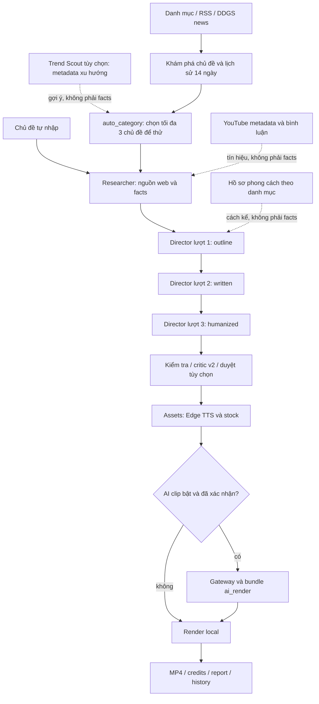

# Quy trình dự án Video AI Tool

Cập nhật đối chiếu: **2026-10-23**, múi giờ người dùng Asia/Saigon.
Tài liệu này mô tả bản code tại máy, không phải cam kết dịch vụ bên ngoài.

**BẮT BUỘC đọc toàn bộ tài liệu này trước khi sửa bất kỳ thứ gì.** Sau mỗi
thay đổi phải cập nhật mục tương ứng, checklist và changelog trước khi báo xong.
Đọc cả [quy tắc gốc](../AGENTS.md). Khi tài liệu mâu thuẫn code, báo người dùng;
không tự chọn cách hiểu rồi sửa hành vi ngoài phạm vi.

## Quy ước và căn cứ

- **ROOT**: `C:\Users\admin\Desktop\app create video`, gốc Git chứa tài liệu
  này và `AGENTS.md`. **APP**: `ROOT/video_ai_tool`, chứa mã ứng dụng.
- Đường dẫn `agents/...`, `output/...`, `config/...` trong các mục bên dưới
  được tính từ **APP**, trừ đường dẫn bắt đầu `ROOT/`.
- Khi mô tả artifact của một project, `audio/`, `clips/`, `render/`,
  `ai_video/`, `ai_render/` là thư mục con của `output/<project>/`, không phải
  thư mục code cấp APP. Thay `<project>`, `<hash>`, `<ID>` bằng giá trị thật trước khi chạy lệnh.
- Mọi lệnh Python/Streamlit/pytest bên dưới chạy sau khi chuyển vào APP.
- Đã đối chiếu mã ứng dụng, Pydantic, YAML, prompts, danh mục test/fixture,
  14 tài liệu chuyên đề và toàn bộ các file `.log` hiện có. Logs được đọc với
  lọc bí mật; lịch sử lỗi không có nghĩa lỗi vẫn tồn tại trong code hiện tại.
- Không đọc/xuất nội dung `.env` thật để viết tài liệu. Bảng cấu hình dựa trên
  `config/settings.py` và `.env.example`; mặc định không phải giá trị máy Đức.
- Test offline chứng minh hành vi với fixture/mock và media local; không
  chứng minh quota, giá, quyền model hay độ đúng của tin tức ngoài đời.
- **CHƯA XÁC NHẬN** có mã Uxx ở cuối mục 13; luôn kèm file/cách kiểm tra.
  Không biến các mục này thành tính năng đã nghiệm thu.

## 1. Mục tiêu, người dùng và mức chất lượng

Người dùng là **Đức**, sinh viên, chạy Windows/local, ưu tiên chi phí thấp và
cách thao tác đơn giản. Mục tiêu sản phẩm là chọn chủ đề, nghiên cứu, kể chuyện
cuốn hút bằng tiếng Việt, tạo giọng/stock/đồ họa rồi xuất MP4 xem được ngay.
Không phải nền tảng SaaS, công cụ đăng video tự động hay hệ thống kiểm chứng tin
tức độc lập. Hiện không có bước đăng YouTube/TikTok/Facebook/Instagram.

Định hướng Đức chấp nhận kiến thức nền có độ mềm khoảng **70–75%**, không yêu
cầu mọi diễn giải đạt tuyệt đối. Đây là **mong muốn biên tập**, không phải số
đo đã được code đánh giá. Không được nói hệ thống đã chứng minh đạt 75% (U01).

Phải tách hai lớp: sự kiện cụ thể về công ty/người thật vẫn cần fact có dẫn
chứng; giải thích/ẩn dụ/ý kiến được mềm và đánh dấu riêng. Không dùng mục tiêu
70–75% để hợp thức hóa số liệu, tên nguồn, ngày hoặc trích dẫn bịa. Ưu tiên
cache, `--from-raw`, preview, tắt AI clip mặc định và không gửi lại job trả phí
khi chưa rõ remote ID. Không kéo dài video bằng lặp ý cho đủ số giây.

## 2. Kiến trúc và hợp đồng giữa các bước



Sơ đồ ba lượt là luồng mặc định của `run_director(..., script_style="storytelling")`
và các trang/pipeline hiện tại. **Không phải mọi nhánh Director đều gọi đúng ba
lần API**: retry, audit, critic, open-loop, query và knowledge notes có thể tăng
số lần gọi; cache/checkpoint có thể giảm về không. API Python `script_style=None`
vẫn có nhánh sinh EditPlan/audit cũ. Không xóa nhánh cũ bằng suy đoán.

| Bước | Input | Output và artifact trong project | Code và API/model |
|---|---|---|---|
| Trend Scout tùy chọn | Danh mục, region, cấu hình/cache/ngân sách, lịch sử 14 ngày | TrendItem → chủ đề/góc kể; `trend_scout_latest.json` ở output; auto lưu `trend_scout.json` trong project | `pipeline/trend_scout.py`, `providers/trends/`; ScrapeCreators metadata, nguồn miễn phí, Gemini gom batch |
| Khám phá | Danh mục, region, 1/3/7 ngày, số gợi ý, lịch sử | Gợi ý một sự kiện, angle/query gợi ý; `topic_candidates.json` trong auto-category, `topic_discovery.json` khi handoff | `sources/topic_discovery.py`, `pipeline/discover.py`; RSS/feedparser, DDGS news, Gemini Researcher, YouTube tùy chọn |
| Research | Topic, web_limit, source_languages, discovery_hint, content_mode | `sources.json`: bài và chẩn đoán; `brief.json`: facts, quotes, truy vấn, cảnh báo, insight; v2 có research_questions/knowledge_notes | `agents/researcher.py`, `sources/web_search.py`; DDGS + trafilatura; LLM_PROVIDER_RESEARCHER → Gemini/OpenAI, mục 9; YouTube Data API chỉ cho trends |
| Director outline | Brief và snapshot profile; type/format/duration/style | Dàn ý, fact IDs, hook/open loop; stage trong `director_state.json` hoặc `director_state.explainer_v2.json` | `agents/director.py`, `director_story.py`, `explainer_director.py`; LLM_PROVIDER_DIRECTOR → model riêng theo provider, mục 9 |
| Director written | Dàn ý đã kiểm tra và facts | Lời đọc theo cảnh; stage `written` | Cùng provider Director; chuẩn hóa trước Pydantic, chỉ sửa cảnh lỗi căn cứ |
| Director humanized | Bản viết đã kiểm tra, cảnh cần sửa | `edit_plan.json`; review_notes/validation_events; lỗi còn lại lưu `edit_plan.draft.json` | Nhánh storytelling hoặc v2; v2 có thêm critic và LoopReview tùy kết quả |
| Assets | `edit_plan.json` gốc, giọng, query, cache | `audio/scene_<id>.mp3`, `.tts.json`, `.words.json`, `clips/`, `assets.json`, `edit_plan.resolved.json`, `credits.txt` | `pipeline/assets.py`; Edge TTS không cần key, Pixabay chính, Pexels tùy chọn; không gọi Gemini để dựng asset thường |
| AI clip tùy chọn | Số clip/model/giây đã duyệt, ai_prompt, job cũ | `ai_video/<hash>.json`, receipts/locks, clips AI; pipeline tạo bản sao `ai_render/` | `pipeline/ai_video.py`, `run_all_ai.py`, `providers/video_gateway.py`; Hinton Videos API, không phải Gemini chat |
| Render | Resolved plan + audio + clips + manifest + credits | `render/<slug>_<format>_<mode>.mp4`, `preview.json`/`final.json`, credits, `visual_review.json`, `render/report.md`, tùy chọn `motion_cache/` | `editor/render.py`, MoviePy 2, Pillow, NumPy, FFmpeg từ imageio-ffmpeg; motion thêm Chromium local, không gọi mạng |
| Điều phối | RunConfig / AutoConfig, callbacks, cancel flag, resume | `project.json`, `run_state.json`, `report.md`, artifact hashes, nhật ký ngắn | `pipeline/run_all.py`, `auto_category.py`; tái sử dụng hàm từng bước, không parse terminal |

### 2.1 Research thực tế

1. LLM Researcher sinh 2–4 truy vấn tự nhiên/ngôn ngữ; chủ đề nhiều thực thể được tách
   tối đa ba nhánh trong `agents/search_queries.py`. `vi,en` mặc định; thêm
   `zh,ko,ja`. Đầu ra hiện chỉ `vi`, không có chế độ TTS ngôn ngữ khác.
2. V2 sinh câu hỏi cơ chế/vì sao/tác động/phản biện và query vi/en; nếu bước này
   lỗi thì giữ query đa ngôn ngữ. Discovery chỉ cung cấp gợi ý, không cung cấp fact.
3. DDGS text/news, tải HTML bài cụ thể, trafilatura; fallback đọc paragraph từ
   HTML đã tải. Giữ tối đa khoảng 8000 ký tự ở ranh giới đoạn, loại bài <300 ký
   tự, trang chủ/chuyên mục, URL mạng xã hội, địa chỉ mạng riêng và redirect xấu.
   Không lấy snippet để bù thành fact trong luồng hiện tại.
4. Mục tiêu 5–8 nguồn tốt, `web_limit=6`, cho phép 1–12. Thu mọi query rồi ưu
   tiên nhà xuất bản đa dạng và ngày đăng. Đây không phải ngưỡng cứng tối thiểu.
   Tổng text nguồn gửi lượt rút fact ≤40000 ký tự, chia theo số nguồn; **không
   phải** trần toàn bộ prompt kể cả metadata/chỉ dẫn.
5. Prompt mong muốn 12–20 fact chi tiết, mỗi fact 1–3 câu. Quote gốc 15–200 ký
   tự, ≤25 từ, kiểm tra nguồn gốc, chuẩn hóa khoảng trắng/dấu nháy; không dịch
   quote. Quote nguyên bản >25 từ chỉ cắt 25 từ đầu sau khi cả quote khớp nguồn.
   Quote bịa hoặc URL ngoài nguồn bị loại riêng. Có ≥1 fact hợp lệ là tiếp tục;
   0 fact sinh `NoResearchDataError`. Ít hơn 8 fact chỉ cảnh báo dữ liệu mỏng.
6. Nguồn đơn/ít hơn 6 fact: thử mở rộng **một lần**, tối đa 4 query và 4 nguồn
   mới; rút/đối chiếu lại, giữ fact cũ nếu mở rộng lỗi. Không có nguồn ngay từ
   bước thu thập thì báo thiếu dữ liệu để auto-category thử chủ đề kế.
7. Tách lượt schema nhỏ rút fact và lượt enrich `story_angles`, key_numbers,
   timeline, why_it_matters, counterpoints, glossary. Lượt enrich lỗi không mất
   facts. V2 thêm tối đa 8 knowledge_notes low/medium, nguồn “kiến thức nền”.
8. YouTube trends chạy riêng sau grounding: metadata/statistics/comments, không
   đưa vào facts. Tối đa 10 bình luận/video cho top 3 video, mặc định cửa sổ 14
   ngày. Trends/Gemini insight lỗi hoặc hết quota chỉ cảnh báo.

`validate_grounding` là kiểm tra quote/URL và metadata; nó **không tự chứng
minh mọi mệnh đề trong fact_vi đều suy ra được từ một quote ngắn**. Đây là giới
hạn cần người biên tập đối chiếu nguồn; không gọi mọi fact là đã xác minh độc lập.

### 2.2 Một nút, resume và chuyển chủ đề

- `run_all`: thứ tự `research → director → assets → ai_video → render`;
  `stop_after` chỉ nhận các tên bước này. Mặc định auto, AI=0, trends=false,
  render preview. `--review` dừng sau Director, `--continue` xác nhận tiếp tục.
- `run_auto`: thêm discovery, mặc định tự động hoàn toàn, render **final**,
  tối đa 3 gợi ý chưa trùng lịch sử. Chỉ chuyển chủ đề khi chuỗi nguyên nhân là
  `NoResearchDataError`; không coi 403/quota/504 là thiếu facts để đổi chủ đề mù.
- Chủ đề thử lại trong **cùng lượt auto** dùng project đó và ghi lý do bỏ. Mỗi
  video trong `--count N` có project riêng, tuần tự, dừng nếu chờ duyệt/hủy.
- Project mới dùng slug + ID ngắn. `--force` của run_all tạo project **mới**,
  không xóa/reset dữ liệu project cũ. `run_research` gọi độc lập không có
  output_dir dùng slug + hash topic, có thể ghi lại cùng nơi: không đồng nhất
  với chính sách project mới của `run_all`.
- `run_state.json` có config, status, steps, thời gian, attempts, warnings,
  hashes, lỗi và log ngắn; không phải SQLite. Done chỉ được bỏ qua nếu artifact
  tồn tại và hash còn đúng. Không sửa tay hash/status để ép tiếp tục.
- Có ngoại lệ nhận chỉnh sửa kịch bản lúc đang chờ duyệt và Assets chưa chạy:
  backend kiểm tra/lưu lại, có thể gọi Gemini. Đổi input ngoài ngoại lệ phải
  tạo lại bước/project thích hợp, không giả coi cache còn đúng.
- Lỗi AI clip mặc định skip, vẫn render b-roll; `stop` mới dừng. Giá trị `ask`
  vẫn còn trong kiểu/CLI nhưng nhánh xử lý hiện coi mọi giá trị khác stop là
  skip; **không đảm bảo một hộp hỏi giữa lượt**. UI phải xác nhận phí từ đầu.
- Hủy là hợp tác tại điểm an toàn; không bảo đảm ngắt ngay HTTP/FFmpeg hay hủy
  job từ gateway. Job đã gửi có thể vẫn tính phí. Không xóa lock để ép chạy kép.
- Lịch sử `output/topics_history.json` chỉ ghi sau video hoàn tất; so gần giống
  tiêu đề hoặc cùng nguồn trong 14 ngày, không đưa mọi gợi ý vào blacklist.

### 2.3 Trend Scout: tín hiệu trước Research, không phải bằng chứng

- `config/trends.yaml.enabled=false` mặc định: auto-category giữ nguyên nhánh
  RSS/news. Bật true thì discovery gọi `scout`, chọn chủ đề điểm cao chưa dùng;
  nếu không còn gợi ý hoặc scout lỗi thì fallback RSS/news hiện có. Resume dùng
  topic_candidates/run_state đã lưu, không quét lại discovery đã done.
- Interface `fetch(category,limit) -> list[TrendItem]`. TrendItem chỉ có
  id/title/summary/url/platform/language/region/score_raw/metrics/hashtags/
  fetched_at. Không chứa transcript, kịch bản, URL media, ảnh/avatar/author.
  TikTok lấy caption metadata ngắn, không lấy lời thoại. API có thể trả các
  field media nhưng code bỏ ngay, chỉ cache projection TrendItem.
- Bộ nguồn mặc định được phép thử khi Scout bật: ScrapeCreators TikTok (cần
  key), Reddit public JSON, HackerNews Firebase (chỉ công nghệ/kinh doanh/game),
  Google Trending Now RSS, YouTube mostPopular (cần key). Weibo/Bilibili tắt,
  endpoint chưa xác nhận (U09). Nguồn timeout/401/403/429/JSON lỗi bị bỏ qua và
  log riêng; không vượt chặn bot. Bật nguồn không bảo đảm endpoint đang hoạt động.
- TikTok: trending feed + **một** keyword danh mục mỗi region/cache miss;
  tối đa 2 HTTP/region, both=VN+US tối đa 4. Region là quốc gia proxy, **không
  phải** bộ lọc xuất xứ video. Không phân trang tự động; hashtag chỉ dùng ở probe.
- Cache theo provider/query/region (kèm category/limit ở nguồn miễn phí khi cần),
  TTL 21600s; kiểm cache trước key/ngân sách. SQLite reserve trước HTTP, không
  retry/redirect ScrapeCreators; lỗi/timeout vẫn tính lượt dự trù. Các endpoint
  dùng hiện báo 1 credit/request; `credits_charged` lưu riêng, không giả timeout
  là biết phí thực. Trần mặc định 30/ngày **UTC**, xét max(lượt HTTP dự trù,
  tổng credit đã được phản hồi). Budget hết chỉ còn cache và nguồn miễn phí.
  SQLite transaction BEGIN IMMEDIATE ngăn hai worker cùng vượt trần lượt.
- YouTube chỉ videos.list chart=mostPopular, dùng ledger quota có sẵn,
  1 đơn vị mỗi HTTP attempt kể cả retry; không dùng search hay transcript.
- Gom trùng URL/tiêu đề trước Gemini. Tối đa 40 nhóm, mỗi nhóm 3 metadata,
  JSON input <=16000 ký tự, summary <=120 ký tự/mục; **một** generate_json batch
  (retry mạng dùng chung, provider do LLM_PROVIDER_TREND chọn). Topic có topic_title_vi/why_hot/2–3 angle_suggestions/
  score_hot/score_fit_category/score_vietnam_audience/sources. Điểm tổng
  .4 nóng + .3 phù hợp danh mục + .3 khán giả VN. Code loại URL/tên/số mới ngoài
  metadata và gom trùng lần nữa; đây là lọc đề xuất, không thêm luật nhóm 1.
- Gemini lỗi/không có đề xuất hợp lệ: score_raw log-normalize theo từng nền
  tảng, fit/VN trung tính 5/10. **Fallback không dịch offline**: tiêu đề gốc
  ngoại ngữ có thể còn nguyên, cần người dùng sửa; không giả đó là bản dịch.
  Điểm nóng/phù hợp/khả năng mới với khán giả VN là ước lượng, không đo độ phổ biến.
- Scout kết hợp `used_topics` SQLite và history JSON cũ; loại tiêu đề giống
  >=.78 trong 14 ngày hoặc cùng URL đã làm. SQLite chỉ ghi khi run_all hoàn tất
  với discovery hint, không đánh dấu lúc quét/chọn/dừng duyệt/lỗi. History cũ vẫn
  giữ; lỗi ghi DB được log và còn đường dự phòng JSON.
- Handoff tái dùng DiscoveryHint/TopicSuggestion: topic + why_now(why_hot) +
  angle + truy vấn là **gợi ý**. `create_brief` nhận topic_inspiration_only riêng,
  không nhận TrendItem như SourceDocument. Mọi fact vẫn phải có quote khớp bài
  web trong sources. Director/validation registry giữ nguyên. Credits/report
  liệt kê nguồn gợi ý ở mục metadata, tách khỏi nguồn fact.

**Khảo sát API thật 2026-10-23**: đã được Đức cho phép và thêm key bằng editor;
4 HTTP request, đều 200, mỗi response `credits_charged=1`, tổng API báo 4 credit.
`tools/probe_scrapecreators.py` lưu field_types và projection đã xóa dữ liệu cá
nhân ở `tests/fixtures/scrapecreators_*.json`; không lưu raw có author/media.
Không in giá trị key hoặc nội dung .env. Cấu trúc thực đã quan sát:

| Request | Danh sách thực | Trường dùng | Credit API báo |
|---|---|---|---|
| GET /v1/tiktok/get-trending-feed, VN | aweme_list[] | aweme_id, desc, region, create_time, statistics, url; desc_language có thể thiếu | 1 |
| Cùng endpoint, US | aweme_list[] | Cùng cấu trúc, không suy ngôn ngữ từ region | 1 |
| GET /v1/tiktok/search/keyword, query AI | search_item_list[].aweme_info | aweme_id, desc, desc_language, region, statistics, url | 1 |
| GET /v1/tiktok/search/hashtag, hashtag AI | aweme_list[] | Cùng metadata video; cursor/has_more ở cấp response | 1 |

Statistics dùng play_count/digg_count/share_count/comment_count → views/likes/
shares/comments; thiếu/null → 0. Top-level có success/credits_charged/
credits_remaining; không coi balance ở fixture là số dư hiện hành. Fixture
đã thay @username trong URL bằng @redacted, bỏ avatar/link cá nhân/media;
adapter production giữ URL trang video công khai để đối chiếu, không tải video.
Probe giữ receipt, bỏ fixture đã có và giới hạn tổng tối đa 6 lượt probe, không
tự mua lại fixture khi chạy lại. Dữ liệu API/credit có thể thay đổi sau mốc này.
Tài liệu tham chiếu chính thức: [trending feed](https://docs.scrapecreators.com/v1/tiktok/get-trending-feed/),
[keyword](https://docs.scrapecreators.com/v1/tiktok/search/keyword/),
[hashtag](https://docs.scrapecreators.com/v1/tiktok/search/hashtag/).

Danh sách file của lần bổ sung Trend Scout (28 tệp nguồn/tài liệu/fixture;
đường dẫn APP trừ khi ghi ROOT):

| Trạng thái | File |
|---|---|
| Tạo | `tools/probe_scrapecreators.py`, `schemas/trends.py`, `config/trends.py`, `config/trends.yaml` |
| Tạo | `providers/trends/__init__.py`, `providers/trends/base.py`, `providers/trends/scrapecreators_tiktok.py`, `providers/trends/reddit.py`, `providers/trends/hackernews.py`, `providers/trends/google_trends.py`, `providers/trends/youtube_trending.py` |
| Tạo | `pipeline/trend_scout.py`, `pipeline/trend_scout_jobs.py`, `app/views/trend_scout.py`, `tests/test_trend_scout.py` |
| Tạo từ probe thật | `tests/fixtures/scrapecreators_trending_vn.json`, `tests/fixtures/scrapecreators_trending_us.json`, `tests/fixtures/scrapecreators_keyword_ai.json`, `tests/fixtures/scrapecreators_hashtag_ai.json`, `tests/fixtures/scrapecreators_probe_report.json` |
| Sửa | `.env.example`, `config/settings.py`, `db/repository.py`, `pipeline/auto_category.py`, `pipeline/run_all.py`, `agents/researcher.py`, `app/streamlit_app.py`, `ROOT/docs/PROCESS.md` |

Artifact runtime: SQLite `data/app.db` được nâng schema/thêm bộ đếm probe;
không xuất DB/khóa thật vào fixture. `.env` chỉ do Đức thêm key bằng editor,
không được script sửa hay xuất. Không thay Director, script_depth, registry luật.

## 3. Thư mục và module cần hiểu trước khi sửa

```text
ROOT/
├── AGENTS.md                  # quy tắc làm việc, dưới 40 dòng
├── docs/PROCESS.md            # tài liệu này
└── video_ai_tool/             # APP, thư mục chạy lệnh
    ├── agents/               # Research, Director, validation, prompt video
    ├── app/views/            # trang Streamlit; gọi backend bằng hàm
    ├── config/               # Settings, categories, themes, rules, profiles
    ├── prompts/              # chỉ dẫn Gemini, tách khỏi dữ liệu nguồn
    ├── schemas/              # hợp đồng Pydantic và kiểu JSON
    ├── sources/              # web/RSS/YouTube, metadata và quota
    ├── providers/            # Gemini, Edge TTS, stock, gateway
    ├── pipeline/             # orchestration, assets, scan, style library
    ├── editor/templates/     # Pillow/MoviePy motion graphics
    ├── utils/                # atomic I/O, locks, cache, log, media
    ├── db/repository.py      # SQLite cho thư viện học phong cách
    ├── assets/               # fonts/music/sfx/backgrounds/reference_videos
    ├── data/app.db           # DB local; kèm WAL/SHM khi hoạt động
    ├── output/<project>/     # sản phẩm và checkpoint mỗi video
    ├── .cache/               # cache nguồn/tts/stock/quota/style compatibility
    ├── logs/                 # log lỗi UTF-8 đã lọc bí mật
    ├── tests/fixtures/       # snapshot hồi quy, không phải output sản xuất
    └── docs/                 # tài liệu chuyên đề/lịch sử, có mục đã cũ
```

| Module/file quan trọng | Vai trò và lưu ý |
|---|---|
| `config/settings.py`, `.env.example` | 54 biến ứng dụng, validate kiểu/phạm vi, precedence, không tự export env; tùy chọn OpenAI/LLM mềm, mục 9 |
| `providers/llm/base.py`, `gemini_client.py`, `openai_client.py`, `router.py` | Client JSON đã parse/text, lỗi chuẩn, Responses SDK, chọn theo bước và một failover; facade tương thích agent JSON text |
| `config/trends.py`, `trends.yaml`, `schemas/trends.py` | Công tắc/ngân sách/TTL/nguồn; metadata TrendItem/Topic tách khỏi facts |
| `pipeline/trend_scout.py`, `trend_scout_jobs.py`, `app/views/trend_scout.py` | Gom/chấm đề xuất, CLI/worker/UI và handoff Research |
| `providers/trends/*.py`, `tools/probe_scrapecreators.py` | Adapter metadata/cache/budget; probe giới hạn có fixture thật đã ẩn dữ liệu cá nhân |
| `config/categories.py`, `categories.yaml` | ID ổn định, RSS/keyword/style, sửa/bật tắt; không đổi ID tùy tiện vì gắn profile/thư mục/DB |
| `config/presets.py`, `storytelling.py`, `video_models.py` | Định dạng/voice/shot, mốc duration/style, model+giây gateway |
| `agents/researcher.py`, `search_queries.py`, `research_expansion.py` | Sinh query, thu/đối chiếu facts, enrich và mở rộng dữ liệu mỏng |
| `agents/explainer_research.py`, `trend_insights.py` | Question-driven research, live blog, knowledge notes, trends tách riêng |
| `agents/director.py`, `director_story.py`, `director_state.py` | Entry point, audit, ba lượt kể chuyện, checkpoint/hash, rewrite cảnh/toàn bài |
| `agents/explainer_director.py`, `explainer_guard.py`, `explainer_visuals.py` | Ba lượt v2, nhãn câu, critic/loop, shot theo ý hình ảnh |
| `agents/validation_rules.py`, `script_depth.py`, `story_style.py` | Registry nhóm luật, căn cứ và cảnh báo độ sâu/văn phong |
| `agents/plan_structure.py`, `broll_queries.py`, `content_plan.py`, `adaptive.py` | Chuẩn hóa mảng/query/timing, co theo dữ liệu; khác nhau giữa mode cũ và v2 |
| `agents/director_numbers.py`, `vietnamese_tts.py`, `director_title.py`, `director_sources.py` | Số/đơn vị/ngày, tiêu đề cấp video, alias tên nguồn và allowed_sources |
| `agents/proper_names.py`, `visual_planner.py`, `visual_policy.py` | Bộ dò tên chung, chọn thẻ, đối chiếu đồ họa và lựa chọn trung tính/giữ nguyên |
| `agents/video_prompt_writer.py`, `pipeline/video_prompts.py` | Prompt ngắn an toàn; chỉnh prompt không tự tạo clip trả phí |
| `sources/web_search.py` | Bài đầy đủ, SSRF/public URL, fallback HTML, quyết định giữ/loại |
| `sources/topic_discovery.py`, `youtube.py`, `youtube_trends.py`, `youtube_resolver.py` | RSS/news, ledger quota, trends, resolve/scan nguồn YouTube |
| `sources/transcripts.py`, `sources/debug.py`, `social_signals.py` | Legacy transcript/debug còn tồn tại; social provider mặc định tắt, không thuộc facts Research hiện tại |
| `providers/llm_gemini.py`, `gemini_resilience.py`, `research_payload.py` | SDK, wire schema, retry/fallback, source budget; helper cũ tồn tại không có nghĩa đang được gọi |
| `providers/style_schema.py`, `style_compat.py` | Schema phẳng Style, bisect 400, nhớ cấu hình được HTTP chấp nhận |
| `providers/tts_edge.py`, `tts_text.py` | Làm sạch/chia đoạn/retry/voice fallback/silence và metadata |
| `providers/stock_base.py`, `stock_pixabay.py`, `stock_pexels.py`, `stock_http.py` | Interface StockProvider, adapters, cache/rate limit/HTTP retry |
| `providers/video_gateway.py`, `pipeline/ai_video.py`, `ai_video_jobs.py` | Payload/model/billing estimate, durable ID, reconcile job và worker |
| `pipeline/projects.py`, `run_all.py`, `run_all_jobs.py`, `run_all_ai.py` | Project/checkpoint, resume/cancel, bundle AI riêng và fingerprint |
| `pipeline/auto_category.py`, `auto_category_jobs.py`, `discover.py`, `discovery_jobs.py`, `topics_history.py` | Một nút danh mục, handoff gợi ý, lịch sử và hàng đợi tuần tự |
| `pipeline/assets.py`, `stock_assets.py` | Retiming audio thật, manifest/credits, đổi stock/riêng audio một cảnh |
| `pipeline/style_learner.py`, `style_raw.py`, `style_library.py`, `style_jobs.py` | Video local, hash/cache, raw bền, parse lại, phân loại/thư viện/worker |
| `pipeline/style_profile.py`, `category_style.py`, `style_safety.py` | Tổng hợp profile, khóa chỉnh tay, loại nội dung riêng, n-gram chống chép |
| `pipeline/scan_sources.py`, `scan_jobs.py`, `db/repository.py` | Preview YouTube, xác nhận học, SQLite, retry lỗi và tổng hợp chỉ mẫu mới |
| `pipeline/run.py` | Stub “Giai đoạn 6”, **không phải entry point pipeline hiện tại** |
| `pipeline/explainer_compare.py`, `editor/template_demo.py` | Công cụ so sánh v2 hoặc demo đồ họa; xem phạm vi API trước khi chạy |
| `schemas/base.py`, `source.py`, `research_brief.py`, `languages.py` | Base model, nguồn/fact/insight/ngôn ngữ |
| `schemas/edit_plan.py`, `story.py`, `explainer.py`, `validation.py`, `visual.py`, `assets.py` | Hợp đồng kịch bản, nhãn câu, luật, thẻ, resolved/manifest |
| `schemas/style.py`, `style_compact.py`, `style_normalize.py`, `style_repairs.py`, `topic_discovery.py` | Quan sát mẫu có default/repair, schema gọn, danh mục/gợi ý |
| `editor/runtime.py`, `timeline.py`, `render.py`, `jobs.py` | MoviePy 2/FFmpeg, timeline theo sample, worker một render/lần |
| `editor/effects.py`, `captions.py`, `audio_mix.py`, `graphics.py`, `templates/` | Cover/effects, caption, âm lượng/ducking, thẻ/progress |
| `editor/motion/base.css`, `runtime.js`, `pipeline/render_motion.py` | Motion HTML tùy chọn, renderAt(t), Chromium → FFmpeg, cache cảnh và dự phòng Pillow; không thay validator/prompt |
| `utils/word_timing.py`, `editor/motion/memory.py`, `pipeline/motion_demo.py` | Sidecar/timing theo từ, working-set sampler Windows và benchmark cảnh local không gọi API |
| `app/streamlit_app.py`, `app/views/*.py` | Router PAGES, sidebar, các trang; đăng ký trang mới ở PAGES, không gọi terminal để lấy dữ liệu |
| `app/visual_review.py`, `ai_prompt_controls.py`, `style_controls.py`, `ui_errors.py` | Quyết định đồ họa, sửa prompt, preset, lỗi đã redaction |
| `utils/atomic_io.py`, `file_lock.py`, `cache.py`, `plan_lookup.py` | Ghi bền/đọc chịu khóa, locking/cache, lookup scene-shot theo khóa |
| `utils/diagnostics.py`, `logger.py`, `console.py` | Redaction, UTF-8, traceback; Diagnostics có đọc cấu hình để thu bí mật cần che, không xuất file env |
| `utils/retry.py`, `rate_limit.py`, `style_rate_limit.py`, `media.py`, `json_response.py`, `text.py`, `source_credits.py` | Retry/rate, media decode, parse JSON, slug/text, liệt kê nguồn/ngôn ngữ |
| `requirements.txt`, `pytest.ini`, `tests/conftest.py` | Dependency pin, chỉ thu tests/, cách ly env thật/SDK trong test |

Không nhập `test_gemini.py` như suite chính hay chạy thử API để “kiểm tra nhanh”
nếu chưa được phép. Đó là script chạy tay; suite chính chỉ ở `tests/`.

## 4. Cấu hình thực tế

### 4.1 Cơ chế đọc và toàn bộ biến `.env`

`get_settings(path)` chọn **một** file: đường dẫn chỉ định hoặc APP/.env.
Precedence: biến môi trường tiến trình > file đó > mặc định Pydantic.
Không gọi `load_dotenv`, không tự cập nhật `os.environ`. Import MoviePy đi qua
`editor/runtime.py` để tránh nạp `.env` ngầm và dùng FFmpeg kèm dependency.
Khóa dùng `SecretStr`; thiếu key chỉ bị yêu cầu khi gọi provider tương ứng.
Tên lạ không thuộc Settings không trở thành cấu hình ứng dụng; `ROOT_DIR`/
`root_dir` là đường dẫn code/Python, không phải biến `.env` được get_settings nhận.

**Chỉ có tên, mô tả, mặc định công khai ở bảng sau; không có giá trị key.**

| Tên biến | Mặc định trong code | Ý nghĩa/phạm vi |
|---|---|---|
| `MOTION_ENABLED` | `false` | Bật HTML motion trong Render; tắt giữ renderer cũ, thiếu engine/lỗi cảnh dùng Pillow. |
| `MOTION_FPS` | `30` | 1–60 fps khi motion bật, áp dụng cả preview/final. |
| `MOTION_SCALE` | `1.0` | .25–1.0; nhân khung final, làm tròn kích thước chẵn; .5 = 540×960 dọc. Ba biến để trống dùng mặc định. |
| `GEMINI_API_KEY` | `trống (không có giá trị khóa trong tài liệu)` | Key Google Gemini, SecretStr; chỉ cần khi gọi Gemini. |
| `OPENAI_API_KEY` | `trống (không có giá trị khóa trong tài liệu)` | SecretStr; thiếu key/model thì OpenAI tắt, không làm lỗi cấu hình chung. |
| `OPENAI_MODEL` | `trống` | Model text OpenAI dùng cho Researcher/Trend khi chọn openai; không đoán model/quyền tài khoản. |
| `OPENAI_DIRECTOR_MODEL` | `trống → OPENAI_MODEL` | Model riêng Director của OpenAI; trống dùng OPENAI_MODEL. |
| `OPENAI_TIMEOUT_SEC` | `120` | Timeout HTTP riêng OpenAI, >0 và <=600s; trống/lỗi dùng mặc định và cảnh báo tên biến nếu lỗi. |
| `OPENAI_RPM_LIMIT` | `20` | 1–1000, ledger local 60s, mỗi retry cũng đặt trước lượt; không phải quota dashboard. |
| `OPENAI_MAX_RETRIES` | `3` | 0–8 retry sau request đầu, SDK retry riêng tắt để không nhân số lượt. |
| `LLM_PROVIDER_RESEARCHER` | `gemini` | gemini/openai; điều khiển queries, facts, enrich/knowledge và insight trong bước Research. |
| `LLM_PROVIDER_DIRECTOR` | `gemini` | gemini/openai; áp dụng outline/written/humanized/audit/critic/viết lại/prompt shot qua director_provider. |
| `LLM_PROVIDER_TREND` | `gemini` | gemini/openai; Trend Scout batch và khám phá RSS/news của auto_category. |
| `LLM_FALLBACK_PROVIDER` | `trống` | Không failover mặc định; gemini/openai dự phòng một lần khi lỗi tạm thời sau retry, xem mục 9. |
| `GEMINI_MODEL` | `trống` | Model nền cho Research/query/discovery/trends; trống thì lỗi khi cần model, không có tên model mặc định. |
| `GEMINI_DIRECTOR_MODEL` | `trống` | Model Director; trống dùng GEMINI_MODEL. |
| `GEMINI_FALLBACK_MODEL` | `trống` | Model dự phòng khi deadline lặp; trống không đổi model. |
| `GEMINI_TIMEOUT_SEC` | `120` | Timeout client Gemini giây, >0 và <=600; tách HTTP thông thường. |
| `GEMINI_STYLE_MODEL` | `trống` | Model phân tích Style; trống dùng GEMINI_MODEL. |
| `STYLE_MAX_VIDEOS_PER_RUN` | `5` | 1–20 mẫu/lô Style; còn áp vào scan. |
| `STYLE_MAX_FILE_MB` | `200` | 1–2000 MB/file local; upload đoạn đầu vẫn tải file gốc lên Files API. |
| `STYLE_MAX_DURATION_SEC` | `600` | 1–3600s ở Settings, nhưng inspect_video còn hard cap min(600, giá trị này). |
| `STYLE_TIMEOUT_SEC` | `180` | 10–300s, timeout Gemini media và chờ xử lý file. |
| `STYLE_MAX_OUTPUT_TOKENS` | `8192` | 1024–65536; bisect/compact có thể hạ 8192; không bảo đảm model cho mọi mức. |
| `STYLE_MEDIA_RESOLUTION` | `low` | low / medium / none; none bỏ tham số, cache accepted có thể override request. |
| `STYLE_USE_RESPONSE_SCHEMA` | `true` | Bật structured wire schema Style; không có nghĩa dùng nhầm field SDK response_schema. |
| `STYLE_SCHEMA_MODE` | `flat` | flat / essential; schema wire riêng, validation local vẫn StyleAnalysis. |
| `STYLE_COMPACT_OUTPUT` | `false` | Bật output gọn ngay; vẫn có compact retry khi output mới bị cắt. |
| `STYLE_MAX_VIDEO_SEC` | `180` | 0 < giây <=600: phạm vi đầu video; CLI --max-sec có thể đổi giá trị request. |
| `STYLE_VIDEO_FPS` | `0.5` | 0 < FPS <=1: lấy mẫu frame phân tích, không phải FPS render. |
| `STYLE_TPM_LIMIT` | `250000` | >=1000 token ước lượng/rolling minute; chỉ ledger Style local. |
| `STYLE_RPM_LIMIT` | `2` | 1–1000 request/rolling minute Style; không phải quota đã đọc từ Google. |
| `STYLE_REQUEST_INTERVAL_SEC` | `5` | 0–300s: khoảng cách tối thiểu giữa request Style. |
| `SCAN_MAX_VIDEO_SEC` | `180` | 1–3600s: lọc metadata scan; Style vẫn có trần thực tế 600s. |
| `SCAN_MAX_AGE_DAYS` | `180` | 1–3650 ngày: tuổi video khi scan. |
| `SCAN_MAX_NEW_VIDEOS` | `5` | 1–20: trần video mới toàn lô scan, còn chịu STYLE_MAX_VIDEOS_PER_RUN. |
| `GATEWAY_API_KEY` | `trống (không có giá trị khóa trong tài liệu)` | Key Hinton video gateway, SecretStr; độc lập key Gemini. |
| `GATEWAY_BASE_URL` | `https://api.buihuuthang.com/v1` | Provider khóa đúng HTTPS/host/path này; không phải base chat tùy ý. |
| `GATEWAY_VIDEO_MODEL` | `veo-3.1` | Chỉ veo-3.1 hoặc seedance-2.5-30s; phải qua allowed list trước POST. |
| `GATEWAY_ALLOWED_MODELS` | `["veo-3.1", "seedance-2.5-30s"]` | Danh sách IDs, nhận chuỗi phân cách phẩy hoặc JSON array; không tự xác minh quyền tài khoản. |
| `AI_CLIP_SECONDS` | `4` | 1–30 và đúng tập seconds của model. Không đặt tường minh thì lấy seconds đầu của model (Veo 4, Seedance 5). |
| `AI_CLIP_MAX_PER_RUN` | `3` | 0–20: trần clip muốn tạo, không phải số clip mặc định được bật; generation_failed có thể thêm một job/clip. |
| `YOUTUBE_API_KEY` | `trống (không có giá trị khóa trong tài liệu)` | Key YouTube Data API, SecretStr; thiếu thì trends tùy chọn bỏ qua, scan cần key. |
| `SCRAPECREATORS_API_KEY` | `trống (không có giá trị khóa trong tài liệu)` | Key metadata TikTok cho Trend Scout, SecretStr, header x-api-key; thiếu thì bỏ nguồn có phí. |
| `PEXELS_API_KEY` | `trống (không có giá trị khóa trong tài liệu)` | Key stock phụ, SecretStr; trống không gọi provider Pexels. |
| `PIXABAY_API_KEY` | `trống (không có giá trị khóa trong tài liệu)` | Key stock chính, SecretStr; thiếu/lỗi có fallback hình/nền. |
| `DEFAULT_VOICE` | `vi-VN-HoaiMyNeural` | vi-VN-HoaiMyNeural hoặc vi-VN-NamMinhNeural, chép vào kế hoạch mới. |
| `DEFAULT_VOICE_FALLBACK` | `vi-VN-NamMinhNeural` | Cùng hai giọng; nếu trùng giọng chính thì thử giọng còn lại. |
| `REQUEST_TIMEOUT_SEC` | `30` | 0 < giây <=300: HTTP nguồn/stock/gateway/Edge; không là timeout Gemini chính. |
| `RETRY_ATTEMPTS` | `3` | 1–8: retry chung HTTP/agent; Gemini generation riêng 1+5, TTS chunk riêng 1+4. |
| `CACHE_TTL_SEC` | `86400` | Giây TTL cache chung >=1; discovery/stock có cap/floor riêng. |
| `YOUTUBE_DAILY_QUOTA` | `10000` | 1–10000 đơn vị ledger local/ngày Pacific; không đảm bảo quota tài khoản ngoài app. |
| `YOUTUBE_MAX_SEARCHES_PER_RUN` | `2` | 0–10 search/run; scan keyword còn dùng như trần search/ngày; tính retry. |
| `LOG_LEVEL` | `INFO` | DEBUG/INFO/WARNING/ERROR cho logger tiện ích; một số CLI chủ động tắt log SDK để tránh rò key. |

Giới hạn trong Pydantic là cấu hình local, không chứng minh gói Google/gateway
có quota tương ứng. Giá trị model Gemini mặc định trống, không hardcode model
trong tài liệu thành giá trị hiện hành của Đức (U02).

### 4.2 Cấu hình ngoài `.env`

- `config/trends.yaml`: enabled=false; region=VN; limit_per_source=8 (1–30),
  TREND_DAILY_CREDIT_LIMIT=30 (0 tắt request trả phí), cache_ttl_sec=21600,
  gemini_enabled=true; providers là công tắc từng nguồn; categories gắn ID ổn
  định với keywords/subreddits. Ngân sách/TTL là **YAML, không phải biến .env**.
  Đặt enabled=true để trang Trend Scout và auto-category dùng nguồn mới.
  `gemini_enabled` và kết quả `gemini_error` là tên legacy giữ tương thích:
  công tắc này điều khiển batch LLM đã chọn, kể cả khi chọn OpenAI.

- `config/validation.yaml`: nhóm của từng ID đã đăng ký; ID/nhóm sai báo lỗi,
  không lờ đi. Hạ schema_basic không thể biến JSON hỏng thành model hợp lệ.
- `config/categories.yaml`: 9 ID mặc định: tin-tuc, cong-nghe, thoi-trang,
  giai-tri, kinh-doanh, suc-khoe-doi-song, the-thao, du-lich, game. Mỗi mục có
  name/enabled/keywords_vi/keywords_en/rss/suggested_type. RSS mặc định dùng
  VnExpress và Guardian, một số feed rộng có include_keywords. Không bảo đảm
  tất cả URL còn hoạt động hôm nay (U03). Sửa qua YAML hoặc UI Khám phá.
- `config/themes.yaml`: studio (gradient tối), paper (giấy sáng); màu nền,
  card/foreground/muted/accent/secondary, radius/shadow, ảnh tùy chọn. Ảnh chỉ
  ở `assets/backgrounds/`, không tải ảnh nền từ URL tùy ý.
- `config/style_profiles/`: `_default.json`, `<category>.json`,
  `<category>.<news|review|story>.json`, lock files. Đây là profile, **không phải
  key/model config**. Token chọn danh mục có dạng `@category:cong-nghe`.
- Thứ tự chọn style theo loại/danh mục và default do `category_style.py` quản
  lý, không tự suy từ tên video. Snapshot vào EditPlan để resume nhất quán.
  `none` tắt profile; preset chỉ định được load riêng. Khi chọn category:
  profile đúng type có video → profile chung category có video → `_default`.
  Không category và không preset thì backend có thể không gắn profile, không
  tự áp `_default` cho mọi request.
  Có preset legacy `config/style_presets/` và `config/style_profile.json` qua
  `style_profile.py`; không nhầm với profile danh mục mới.
- Profile chứa nhịp nói/shot, cấu trúc, connector, caption/audio, confidence,
  snapshot mẫu và trường khóa chỉnh tay. Confidence là mức tích lũy mẫu, không
  phải tỷ lệ đúng sự kiện. Rebuild giữ trường khóa; guidance bỏ corpus đối chiếu.
- `config/storytelling.py`: mốc UI 30/60/90/120/180s; style storytelling/news/
  explain/review. CLI vẫn nhận thời lượng tùy chỉnh trong phạm vi schema 6–600s.
- `.streamlit/config.toml`: address 127.0.0.1, headless=true, tắt telemetry,
  showErrorDetails=none. Debug được hiển thị qua Diagnostics đã che bí mật.
- `config/presets.py` còn preview 360×640/640×360 và fps=30; **renderer hiện
  dùng 540×960/960×540, 15fps**. Không lấy preset cũ làm thông số MP4 thực tế.
- Flags như content_mode, creative_license, web_limit, source_languages,
  render_mode, AI confirmation là tham số request/UI, không phải biến `.env`.
  `run_all` có preview mặc định; `auto_category` có final mặc định và CLI auto
  hiện không có cờ render-mode riêng, dù hàm Python nhận render_mode.

## 5. Luật validation và ranh giới nội dung

### 5.1 Registry và cách áp dụng

Nguồn chuẩn: `agents/validation_rules.py::RULES` + nhóm hiệu lực trong YAML.
Mỗi luật có ID/nhóm/mô tả/check/repair nếu có. `run_rules` ghi ValidationEvent
và review_notes; chỉ **nhóm hiệu lực 1** tạo RuleViolation. Nhóm 2 sửa bằng code
và kiểm tra lại; nhóm 3 cảnh báo. Nâng một luật lên 1 bằng YAML có thể khiến
luật đó chặn/retry, nên phải báo rõ, có test và cập nhật bảng này.

Chuẩn hóa cấu trúc/query còn chạy trước Pydantic; không phải mọi sửa nằm trong
hàm repair của registry. Có các kiểm tra ngoài registry: schema cơ bản, ID
cảnh ở lượt viết, validate đồ họa cuối Director, hash/manifest/audio/đường dẫn
trước Render. Vì vậy không được hứa “chỉ chỉnh YAML là mọi lỗi đều không chặn”.
Render có chính sách đồ họa phục hồi riêng tại mục 5.4.

| rule_id | Nhóm mặc định hiệu lực | Ý nghĩa trong registry | Hàm check / repair |
|---|---:|---|---|
| `sentence_grounding` | 1 | Nhãn câu khớp lời đọc; event có fact, nền không giả làm sự kiện | `explainer_sentences / fix_explainer_names` |
| `sentence_background_names` | 3 | Tên riêng trong ví dụ nền chỉ cảnh báo | `explainer_background_names / —` |
| `visual_structure` | 2 | Giữ nhãn đồ họa đúng thứ tự lời đọc | `visual_structure / fix_visual_structure` |
| `visual_grounding` | 1 | Số liệu, tên, ngày, URL trong đồ họa có căn cứ brief | `visual_grounding / —` |
| `visual_background` | 3 | Ví dụ nền trong đồ họa cần kiểm tra, không chặn | `visual_background / —` |
| `schema_basic` | 1 | JSON/schema cơ bản không sửa được | `structure_notes / —` |
| `outline_structure` | 2 | Đồng bộ dàn ý/blueprint | `outline_shape / fix_outline_shape` |
| `open_loop` | 2 | Gán fact payoff liên quan hoặc bỏ câu hỏi | `open_loop / fix_open_loop` |
| `fact_ids` | 1 | ID fact hợp lệ; cảnh nội dung có căn cứ | `fact_ids / —` |
| `forbidden_editorial` | 1 | Cụm kiểm chứng bị cấm còn sót sau xóa | `forbidden / clean_forbidden` |
| `grounding_numbers` | 1 | Số liệu trong lời đọc/overlay có trong brief hoặc giả định rõ | `unsupported_numbers / —` |
| `grounding_names_quotes` | 1 | Tên riêng/trích dẫn có căn cứ | `names_quotes / —` |
| `grounding_claims` | 1 | Khẳng định/nhân quả được audit đối chiếu fact | `audit_claims / —` |
| `originality` | 1 | Không sao chép lời đọc video mẫu | `originality / —` |
| `shot_structure` | 2 | Chuẩn hóa mảng/shot/role/schema trình bày | `structure_notes / —` |
| `broll_query` | 2 | Query stock hợp lệ và khác nhau | `structure_notes / —` |
| `ai_prompt` | 2 | Chuẩn hóa prompt AI trước khi cho gọi gateway | `ai_prompt / fix_ai_prompt` |
| `title` | 2 | Tiêu đề cấp video hợp lệ | `title / fix_title` |
| `duration` | 2 | Căn tổng thời lượng bằng code | `duration / fix_duration` |
| `format` | 2 | Đồng bộ format | `format_issues / fix_format` |
| `brief_binding` | 2 | Cập nhật metadata brief và kiểm tra lại | `freshness / rebind` |
| `attribution` | 2 | Định dạng nguồn Theo ... | `attribution / fix_attribution` |
| `fact_reuse` | 2 | Giảm lặp ID, ưu tiên fact tương đương | `repeated / fix_repeated` |
| `hook_length` | 3 | Độ dài hook | `check / —` |
| `hook_strength` | 3 | Hook hấp dẫn/cách mở | `check / —` |
| `cliches` | 3 | Cụm sáo rỗng | `check / —` |
| `sentence_length` | 3 | Câu dài/cấu trúc câu | `check / —` |
| `transitions` | 3 | Chuyển ý/mở cảnh bị lặp | `check / —` |
| `repeated_ideas` | 3 | Lặp lời/ý | `check / —` |
| `pattern_interrupt` | 3 | Thiếu pattern interrupt | `check / —` |
| `ending_style` | 3 | Kết video đúng kiểu | `check / —` |
| `word_budget` | 3 | Lượng từ lệch quá khoảng ±20% | `check / —` |
| `tts_format` | 3 | Cách đọc số/đơn vị/viết tắt | `check / —` |
| `overlay_style` | 3 | Độ dài/ý nghĩa overlay | `check / —` |
| `examples` | 3 | Thiếu ví dụ/số liệu cụ thể | `depth / —` |
| `open_loop_clarity` | 3 | Câu hỏi mở không rõ | `unclear_loop / —` |
| `scene_target` | 3 | Số cảnh dưới mục tiêu | `thin_scenes / —` |
| `audit_clarity` | 3 | Audit không giải thích kết luận | `structure_notes / —` |

### 5.2 Event, explain, opinion, cta

- `event_only`: nhánh cũ, cảnh nội dung có fact và các khẳng định phải dựa
  brief. Số fact không còn tối thiểu 3; một fact vẫn có thể chạy ngắn.
- `explainer_v2`: `scene.sentences[] = {type,text,fact_ids}`; narration phải
  đúng phép nối các câu. Mỗi event cần IDs tồn tại, số khớp fact tham chiếu;
  tên/nguồn/trích dẫn theo brief và chủ đề được phép. Background không cần ID.
- explain là cơ chế/kiến thức nền/ẩn dụ; opinion là nhận định mềm; cta là câu
  hỏi/lời mời. Tên ví dụ ngoài brief chỉ cảnh báo nhóm 3. Điều này **không miễn
  luật** cho số cụ thể gắn công ty/người, trích dẫn/ngày hoặc khẳng định sự kiện
  giả nhãn nền: `background_issues` vẫn có thể tạo lỗi căn cứ.
- Số nền cần làm tròn + từ ước lượng. Code là heuristic, chưa hiểu đầy đủ ngữ
  nghĩa xuyên nhiều câu; không có bộ đo đúng 70–75% (U01).
- V2 bỏ kiểm tra cần fact cho mọi scene/background, bỏ giới hạn lặp fact và
  adaptive duration kiểu cũ. Event trong scene vẫn có IDs đúng; không bắt bịa
  fact cho cảnh ẩn dụ. Mỗi beat có information_kind và new_information.
- Timing Director cũ `content_timed`: max(words/2.6 + .8, 2.5)s/cảnh, round
  theo shot_seconds.mean, tối đa 4 shot. V2 dùng tốc độ profile clamp 2.5–3.0
  từ/s (thiếu profile dùng 2.7), cùng .8s đệm và tối thiểu 2.5s, rồi pad/chia
  để shot 2.5–4s; không cap 4 shot/cảnh. Đây là timing ước lượng trước audio,
  không phải lời hứa video sẽ khớp chính xác duration người dùng nhập.
- `creative_license`: strict/balanced/story chủ yếu là hướng dẫn cách kể trong
  prompt và metadata: sát fact / nối ý tự nhiên / minh họa rõ. Không phải công
  tắc bỏ grounding. V2 là content_mode riêng; không coi creative_license=story
  đồng nghĩa đã bật V2 hay tự đổi nhóm luật.

### 5.3 Tên riêng, số, nguồn, title và retry

- `agents/proper_names.py` là bộ lọc ứng viên chung Director/đồ họa: bỏ từ
  Việt phổ biến như Trải, Nhiều, Khi, Nếu, Vì, Mỗi, Hầu, Thực, Giả, kể cả viết
  hoa. Đầu câu/mệnh đề sau `. ! ? : —`, dòng/bullet không tự tạo tên riêng.
  Cụm >=2 từ viết hoa và token Latin lạ/CamelCase/acronym/identifier như
  Cambridge, Meta, OpenAI, GPT-5 vẫn có thể là tên ở đầu câu. Không phải NER hoàn chỉnh.
- Event có tên ngoài brief được thử sửa cục bộ một lần bằng **fact_vi đã tham
  chiếu**, không chỉ đổi tên thành một chủ thể chung rồi giữ khẳng định bịa.
  Không có fact hợp lệ để sửa thì giữ nhóm 1. Đồng bộ narration và thẻ tự sinh
  gắn câu; cảnh khác không bị viết lại vì lỗi này. Lỗi cũ đã hết được bỏ khỏi
  danh sách lỗi hoạt động, không xóa bản nháp lưu trữ.
- Bộ số hiểu số chữ tiếng Việt, $, dấu nghìn/thập phân, triệu/M, phần trăm;
  tách ngày/tháng/năm trước để tránh 1/2026 → 12026. Không tách “hai mươi bốn”
  thành 20. Kiểm tra trước, số → dạng đọc chỉ ở ranh giới TTS; không ghi bản
  TTS ngược vào narration. Tên có số chỉ miễn khi cả tên được phép.
- **Phân biệt hai check số**: `grounding_numbers` kế thừa kiểm tra số event/
  overlay với tập brief; `sentence_grounding` v2 còn so event với IDs của câu.
  Vì vậy số event bịa trong v2 vẫn chặn, không áp dụng máy móc tài liệu cũ
  “có fact thì mọi số lạ chỉ warning”.
- Tên nguồn phải thuộc allowed_sources từ brief, không lấy kênh/báo trong
  video mẫu. Fact một nguồn có cách dẫn Theo... trong nhánh cũ; thẻ nguồn có
  thể thay dẫn lặp. V2 không bắt đầu mỗi cảnh bằng Theo...; mục tiêu tối đa hai
  lần nêu nguồn. Đây là hướng dẫn/normalizer, không phải chứng minh nội dung đúng.
- Title là cấp video, không đối chiếu lặp với facts từng cảnh: tập brief/topic,
  năm/tháng hiện tại, số thứ tự khớp mục thực. Title sai chỉ sửa riêng một lần,
  rồi bỏ số/fallback; không buộc viết lại cả video. Tiêu đề Việt <=60 ký tự là
  mục tiêu v2; heuristic không phải máy nhận diện ngôn ngữ chắc chắn.
- Lỗi nhóm 1 retry riêng cảnh, giữ cảnh đạt, thường tối đa 3 lượt validation/
  sửa ở agent. Retry HTTP là ngân sách khác (mục 9), không đồng nghĩa 3 request.
  Hết lượt lưu draft + failed_scene_ids/validation_errors. Người hóa có thể
  fallback bản viết đã kiểm tra; không fallback bản đã bị audit bác căn cứ.
- Open loop nhánh cũ có thể gán fact liên quan/gộp hoặc bỏ câu hỏi bằng code.
  V2 **không dùng tự gán fact để giả giải đáp**: Gemini LoopReview so lời kết
  thật, thử đổi câu hỏi một lần hoặc bỏ. Critic 5 tiêu chí 1–5 là cảnh báo; điểm
  <3 hoặc code phát hiện kể tin/lặp/word budget thì sửa đúng cảnh yếu tối đa một
  vòng. Critic/API lỗi giữ bản có căn cứ và ghi rõ, không giả có điểm mới.

### 5.4 Đồ họa thống nhất V2, không làm sập Render

- `visual.sentence_index` đếm từ 1; câu liên kết quyết định lớp nội dung. Thiếu
  index có tương thích theo text/label; kế hoạch cũ mặc định event. Thẻ nguồn
  luôn là provenance event. Overlay cũng dùng cùng chính sách liên kết câu.
- Event visual: số/tên/trích dẫn/nguồn/URL/ngày cần căn cứ, Director giữ nhóm 1.
  Background visual: tên nổi tiếng/ví dụ được giữ và cảnh báo; số cụ thể không
  ước lượng/làm tròn cảnh báo. Không gộp nhiều trường thành tên giả như
  “Cambridge Analytica Vụ”. Nhãn đảo được khôi phục từ cụm thực trong narration.
- Render đối chiếu trên bản sao trong bộ nhớ. Event graphic sai hoặc thiếu
  brief → text_focus trung tính theo chủ đề, xóa overlay đồ họa cũ tương ứng,
  không sửa narration/audio. Background chỉ warning. Mẫu vẽ lỗi → nền màu an
  toàn. Lỗi audio/manifest/font/I/O vẫn có thể dừng; không hứa mọi lỗi Render đều qua.
- Edit Plan có hai nút từng shot: **Dùng bản trung tính** / **Giữ nguyên (tôi
  chịu trách nhiệm)**. Lưu riêng `visual_decisions.json`, khóa scene/shot + hash
  narration; narration đổi thì lựa chọn cũ không còn hiệu lực. Không gọi Gemini
  để lưu lựa chọn, không đổi hash Assets. UI dùng resolved shots khi cùng lời đọc.
- Quyết định giữ nguyên được Render thường tôn trọng, kèm cảnh báo trách nhiệm;
  không miễn luật căn cứ narration của Director. Cảnh báo vào review_notes in
  memory, `render/visual_review.json`, `render/report.md`, result warnings, rồi
  báo cáo pipeline. Không ghi ngược vào resolved plan gốc.
- **Giới hạn xác định từ code**: `run_all_ai.prepare_ai_bundle` hiện không copy
  `brief.json` hoặc `visual_decisions.json` sang `ai_render/`. Render trên bundle
  đó có thể thiếu căn cứ/lựa chọn và dùng đồ họa event trung tính. Không khẳng
  định lựa chọn đã truyền xuyên bundle; đây là việc còn cần xử lý/kiểm thử.

## 6. Style Learner, danh mục và Scan YouTube

**Style Learner phân tích media CHỈ dùng Gemini**, cả Files API local và
YouTube URL. Không gọi router text, không dùng OpenAI kể cả khi
LLM_FALLBACK_PROVIDER=openai. OPENAI_* hoặc LLM_PROVIDER_* không thay
GEMINI_STYLE_MODEL/STYLE_*; UI học phong cách vẫn cần Gemini.

### 6.1 Local video và bản thô bền

- Mẫu local: `assets/reference_videos/<category_id>/*.mp4`; file `.txt` cùng
  stem là ghi chú tùy chọn, không phải chỉ dẫn đáng tin. Thư mục legacy chưa
  phân loại vẫn được library hỗ trợ; không tự chuyển file chỉ vì Gemini đoán.
- Thêm/chuyển danh mục cần xác nhận; không ghi đè video có sẵn. Local ID là
  SHA256 nội dung; đổi tên cùng file không mặc nhiên tốn thêm lượt phân tích.
- `inspect_video` dùng bundled FFmpeg, kiểm tra size/duration. Trần thực tế
  `min(600, STYLE_MAX_DURATION_SEC)`; >600s bỏ qua trước upload. File quá size
  bị từ chối. Video dài trong trần có thể chỉ phân tích 0–STYLE_MAX_VIDEO_SEC
  (mặc định 180), qua VideoMetadata offset, không cắt/sửa file gốc.
- Gemini Files upload qua AsciiVideoStream tên `<hash>.mp4` và display_name
  ASCII; tên Việt/dấu nháy/# chỉ ở JSON/DB/đường dẫn local. File upload được
  xóa trong finally, xóa lỗi được ghi ID/cảnh báo để xử lý, không phân tích lại.
- Raw **lưu ngay trước parse/validate**, UTF-8, có metadata trạng thái, scope,
  finish_reason/truncated; local raw theo hash nội dung dưới
  `assets/reference_videos/analysis/<category>/<hash>.raw.txt`. AnalysisRecord
  local đọc bằng `style_library.record_path`, thường theo tên video trong thư
  mục analysis danh mục; cache bền ở `analysis/.cache/`. Không đoán JSON nào
  là raw chỉ dựa trên tên video.
- Parser bỏ fence/prefix/suffix, lấy object cân bằng, sửa trailing comma/nháy
  đơn trong trường hợp đơn giản; không eval và không bịa nốt JSON bị cắt.
  `.raw.meta.json`/metadata do `RawResponse` quản lý; xem helper trước khi tự sửa.
- Trường quan sát phụ có default/normalizer: màu tên Việt/Anh → hex hoặc None
  kèm color_note; transition null/none/chuỗi/dict; thời gian sort/clamp/sửa bằng
  cảnh sau hoặc thời lượng; loại cảnh không cứu được. Cần còn cảnh hợp lệ có
  start/end/purpose. Hook/structure thiếu có thể suy từ mục đích cảnh, không bịa
  nội dung. Cảnh cuối transition=None. Lưu analysis_warnings, UI done có cảnh báo.
- Có raw từ lần trước: **parse lại, không gọi Gemini**, kể cả force/Học lại
  trong luồng hiện tại (`reuse_raw` ưu tiên raw). Tài liệu/UI cũ nói Học lại
  chắc chắn gọi model là không đúng với raw đã tồn tại. Muốn phân tích mới cần
  thiết kế thao tác lưu trữ raw/xác nhận phí rõ ràng; không xóa raw để “thử nhanh”.
- Một phản hồi mới bị MAX_TOKENS/unbalanced trong chính lượt đang chạy được
  thử gọn đúng một lần, tối đa 12 cảnh, lưu archive. Lượt sau raw cắt vẫn được
  giữ, không tự mua thêm lượt. `--from-raw` không upload/gọi Gemini.

### 6.2 Cấu hình đã có bằng chứng tại máy

Mặc định code: STYLE_MAX_OUTPUT_TOKENS=8192, media=low, FPS=.5, use_schema=true,
schema_mode=flat, max-video=180s. Không lặp lại mặc định lịch sử 16000 thành
giá trị hiện tại. Schema gửi API riêng/phẳng, không anyOf/$ref phức tạp hoặc
additionalProperties; Pydantic local vẫn mềm.

Cache `.cache/style_compatibility.json` được kiểm tra ở mốc tài liệu có profile
accepted với media_resolution=None, use_schema=false, max_output_tokens=8192,
schema_mode=flat, compact=false. File gợi ý an toàn nằm ở
`logs/style_compatibility.suggested.env`, không phải `.env` thật. Tên `.env`
trong phần này là tên file gợi ý, không chứa khóa. Đây là bằng chứng lần chạy
trước, **CHƯA XÁC NHẬN** độ ổn định/quota của model hiện hành bằng API mới (U02).

Khi Style 400: thử mỗi cấu hình khác một lần, cộng dồn: bỏ media → bỏ schema
giữ JSON MIME → compact+8192 → schema thiết yếu phẳng. Bỏ cấu hình trùng. Nhớ
cấu hình request được chấp nhận theo model/SDK/input settings. Một HTTP 200
không đồng nghĩa JSON hợp lệ hoặc quan sát đúng. Đây là ngoại lệ Style, không
phải retry mù mọi 400 của provider dùng chung.

### 6.3 Hồ sơ danh mục và chống sao chép

- Analysis có bảng scenes/purpose/narration_summary/shot_count/camera/overlay/
  transition, reusable rules, entities_in_video. Mốc/thông số là quan sát, không
  phải chỉ dẫn bắt renderer dựng y hệt hoặc facts cho video mới.
- `category_style` tổng hợp mẫu local còn hiệu lực + YouTube done; không gọi
  lại Gemini cho mẫu cũ. Profile chung và theo news/review/story; chữ ký theo
  dữ liệu để rebuild khi thêm/xóa/sửa, giữ trường người dùng đã khóa.
- Loại nội dung riêng bằng entities_in_video nguyên cụm + ranh giới từ và
  regex số. Giữ “giải thích/sử dụng/phân tích/đánh giá/cao trào/chia nhỏ/ví dụ”.
  Không dùng danh sách âm tiết của chủ đề để thay thành {topic}. Placeholder
  hỏng/dính từ hoặc >2/câu dùng bản gốc đã bỏ tên/số, kèm cảnh báo.
- reference_texts/reference_entities được giữ tại máy để đối chiếu và lọc,
  không gửi nguyên corpus/nội dung mẫu vào guidance Director/audit.
- `copying_scenes`: câu >=7 từ, 4-gram + SequenceMatcher, ngưỡng **>0.60**.
  Luật originality mặc định nhóm 1, retry cảnh đó; quá số lần giữ draft.
  Chỉ có tóm lược/outline mẫu nên không thể bảo đảm phát hiện mọi sao chép.
- Nhịp/profile chỉ hướng dẫn: shot_seconds.mean có thể >4 vì là số quan sát;
  v2/Assets vẫn clamp/chia theo giới hạn dựng. Không lấy “confidence ổn” làm
  chứng cứ video đủ hấp dẫn hay đúng tin tức.

### 6.4 Nguồn quét YouTube

`sources/youtube_resolver.py` nhận watch/youtu.be/shorts → kênh qua videos.list;
handle → channels.list(forHandle); `/channel/UC...` trực tiếp; playlist → kênh
chủ sở hữu, **sau đó quét uploads kênh**, không học tất cả kênh trong playlist.
Tên kênh → search type=channel, luôn yêu cầu chọn kết quả; keyword là loại
nguồn riêng, không tự biến tên nhập vào thành kênh đầu tiên.

`preview_scan`: channels contentDetails → uploads playlistItems → videos
snippet/statistics/contentDetails/status. Tối đa 20 trang/nguồn; dừng tại video
đã ghi nhận hoặc đủ giới hạn. Bỏ riêng tư/xóa/live/không phát nhúng/quá cũ/quá
dài, giữ lý do; failed có đường retry riêng. Lô chọn tối đa 5 mặc định, không
nhân giới hạn theo số nguồn, còn chịu STYLE_MAX_VIDEOS_PER_RUN.

Hiện **không có isShort chính xác**: short_hint dựa ngưỡng <=180s. Mode regular
>180s có thể không còn video nếu SCAN_MAX_VIDEO_SEC vẫn 180. Giao diện phải nói
đó là ước lượng, không tải/scrape để đoán khung hình.

UI preview video/thời lượng/ngày/reason/token ước tính, bỏ chọn rồi xác nhận
Gemini. Gửi trực tiếp URL công khai bằng Part.from_uri, không tải video/audio,
không dùng Files upload cho URL. Một video lỗi không làm hỏng lô. JSON phân tích
YouTube ở `analysis/<category>/<video_id>.json`; raw của URL dùng hash URL theo
RawResponse, khác video_id. DB đánh done sau khi ghi/đọc kiểm tra JSON thành công.

Quota search=100, các list=1, tính từng HTTP retry trước request, chia ledger
`.cache/youtube_quota.json` với Research/Trends. Ngày Pacific, lỗi ledger thì
fail closed. Keyword còn giới hạn search/ngày theo YOUTUBE_MAX_SEARCHES_PER_RUN.
Trạng thái UI là ước lượng tại máy, không phải Google Console. Số Gemini Style
trong `api_usage` theo UTC là lượt ứng dụng gọi, không phải hóa đơn Google.

### 6.5 Quy tắc sử dụng mẫu và nguồn

Trend Scout là ngoại lệ **API metadata TikTok** được yêu cầu rõ: chỉ tiêu đề,
caption ngắn/hashtag/engagement/link, không lấy transcript/tải video, không
đưa vào facts. Điều này không mở quyền tải/dùng lại nội dung mạng xã hội.

Chỉ học cấu trúc/nhịp/giọng văn. Không tải hoặc đưa hình/âm thanh video YouTube,
TikTok/Facebook/Instagram của người khác vào Assets/Render. Video local mẫu
phải do Đức có quyền sử dụng/phân tích; không thể suy quyền chỉ từ việc có file
hoặc URL công khai (U06). Không clone giọng người trong mẫu. Giữ credits và
license của font/music/stock; key stock không thay thế điều kiện sử dụng tài nguyên.

**Ngoại lệ legacy cần biết**: `sources/transcripts.py` còn thư viện không chính
thức và lệnh debug; `YouTubeSource` cũ có thể nhận TranscriptProvider. Research
hiện bỏ qua `use_transcripts`, Trends/Scan không gọi transcript. Không chạy
nhánh debug này rồi tuyên bố toàn bộ repo chỉ có API chính thức. Việc gỡ legacy
là công việc riêng, không thực hiện trong lần viết tài liệu.

RSS discovery có kiểm tra robots.txt và không vượt chặn bot. Research HTML có
public-URL/redirect/status guards nhưng **chưa có robots.txt check tương đương**
trong `_article`. Không hứa mọi downloader đã thực thi đầy đủ chính sách bot.

## 7. Visual templates và Render

Mỗi module `editor/templates/<name>.py` có `render(data,duration,size,theme)`;
`core.Card` vẽ bằng Pillow theo thời gian, MoviePy nhận frame. Không ImageMagick,
không thêm engine đồ họa nặng, không thực thi expression trong data.

| Template | Dữ liệu VisualData dùng chính | Khi dùng và giới hạn |
|---|---|---|
| hook_card | text, highlight[] | Hook lớn giữa khung, hiệu ứng ease-back, từ nhấn; chữ không phải dữ kiện được miễn grounding |
| stat_card | value, number_text, unit, label, source | Đếm tăng đến value; value là giá trị gốc, number_text giữ biểu diễn; không dùng năm như stat tùy tiện |
| steps_list | items[] (thực tế hiển thị tối đa 4), text/highlight | 2–4 bước/ý, hiện dần và dấu tích; rút gọn/co chữ |
| compare_bars | bars[{label,value,unit,fact_id}], fact_ids | 2–4 thanh; auto-select nhánh cũ hiện thận trọng với % cùng đơn vị; không chứng minh hai số cùng cơ sở chỉ bằng việc cùng đơn vị |
| source_card | source, source_url, date, title, fact_ids | Thẻ nguồn gần đầu/cuối; không cần mở mỗi cảnh bằng Theo... |
| text_focus | text, highlight[] | Giải thích/kết luận/ẩn dụ hoặc đồ họa trung tính fallback |
| stock | Không vẽ thẻ | Giữ b-roll và caption; vẫn cover không méo |
| progress_tracker | render_style.progress_tracker/progress_labels, timeline cảnh | Overlay suốt video, tối đa 6 nhóm hiển thị; không phải giá trị template trong Visual enum |

Visual còn content_type, sentence_index, auto_generated. Chọn thẻ nhánh cũ từ
fact/scene; v2 từ ý câu và loại thông tin. Data event chịu grounding mục 5.
Không tự điền giá trị mẫu trong trang “Xem trước mẫu” vào video sản xuất.

Theme studio/paper sinh nền local; ảnh nền tùy chọn confined trong backgrounds.
Stock là nền cover, chuyển động nhẹ, blur/tối dưới thẻ. Card có reveal/easing/
nhịp refresh để giảm khung tĩnh; tests kiểm thay đổi frame, không đo sức hấp dẫn
thị giác. Dữ liệu thiếu/dài dùng default/rút gọn/co font; lỗi Card dùng nền an toàn.

Font ưu tiên local Bold rồi ttf/otf, fallback Arial Bold/Arial Windows. Hiện
thấy DTPhudu Bold/Black và file license trong assets/fonts. Không có font hợp
lệ vẫn có thể dừng; license/nguồn mẫu cần Đức đối chiếu quyền (U06).

Render thực tế: preview dọc 540×960/ngang 960×540, 15fps/preset ultrafast/CRF27;
final 1080×1920 hoặc 1920×1080, 30fps/preset medium/CRF20, libx264+aac,
yuv420p, faststart. Cắt/loop nguồn ngắn theo timeline; crop-cover giữa, không
kéo méo. Fade/zoom/whip dùng phần đuôi ngắn, không chồng narration/cắt mất cảnh.

Caption Pillow có word/phrase/sentence, classic/pill; phrase khoảng 3 từ, gộp
nhóm đuôi 1 từ. Có `.words.json` hợp lệ thì dùng, không có thì chia theo ký tự.
**Edge hiện lấy WordBoundary và ghi sidecar** (chi tiết mục 8.1); MP3/cache cũ
không có timing thì ước lượng theo ký tự, không gọi lại Edge để lấy mốc.
Vùng có thẻ khoảng .68–.82 chiều cao để tránh
đè đồ họa/TikTok; co/wrap chữ. Cảnh im lặng vẫn có caption dù profile tắt caption.

Âm thanh: decode PCM stereo 44.1k, normalize peak giọng mục tiêu .85 (gain tối
đa 8), nhạc local chọn tên mood trước, loop/fade, RMS duck về khoảng .22 khi có
lời, SFX nếu file đúng whoosh/pop tồn tại, peak limiter cuối .98. Không phải
chuẩn loudness LUFS chuyên nghiệp. Thiếu music/SFX bỏ qua; không tự tải nhạc.

Tại mốc audit assets/music và assets/sfx chỉ có .gitkeep, nên không hứa preview
hiện tại có nhạc/SFX. Có cơ chế nhưng chưa có tài nguyên nghe thật tương ứng.

### 7.1 Motion graphics HTML — giai đoạn 1

- Mặc định **MOTION_ENABLED=false**, không import/chạy Playwright ở đường Render
  cũ. Khi bật: `pipeline/render_motion.py` dựng trước từng cảnh có ít nhất một
  `hook_card`/`steps_list`/`compare_bars`; MoviePy vẫn ghép cảnh/transition,
  giọng/nhạc/SFX/ducking và progress_tracker như cũ. Mẫu khác dùng đúng callback
  Pillow hiện có trong cùng cảnh; không thay nội dung hoặc luật kiểm chứng.
- Kích thước motion = khung final × MOTION_SCALE, số pixel chẵn: TikTok
  1080×1920 (scale=1) hoặc 540×960 (.5); YouTube 1920×1080/960×540. FPS theo
  MOTION_FPS=30, **ghi đè độ phân giải/FPS preview cũ chỉ khi bật motion**;
  preset/CRF/audio vẫn theo mode preview/final. Tắt motion giữ preview15/final30.
- CSS có nền tối, hạt sáng nhẹ, vùng đồ họa khoảng .19–.62, caption .71–.81;
  font DTPhudu/local qua find_font, nhúng data URI. Nền gradient và hạt raster
  bằng code thành PNG vì dithering CSS-gradient làm hash thay đổi 1–2 mức màu
  khi tua lại. Không lấy mascot/ảnh từ mẫu. Browser bị chặn HTTP/nguồn ngoài.
- `window.renderAt(t)` nhận giây **tuyệt đối trong cảnh**, dựng lại toàn bộ trạng
  thái: không setTimeout, CSS animation hay phụ thuộc số lần gọi. Có helpers
  easeOutCubic/easeOutBack/fadeSlideIn/countUp/strikeThenReplace/growBar/
  ringPercent/typing. Hook có tiêu đề/từ nhấn/value đếm/badge; steps tối đa4 hàng,
  hiện dần và viền hàng hiện tại; compare tối đa4 thanh với số đếm, co theo max.
- `Visual.beats` là dữ liệu **tùy chọn**, mặc định rỗng và không serialize khi
  rỗng nên giữ hash plan cũ. Ví dụ ở một shot:

  ```json
  {"template":"steps_list","data":{"items":["Đọc nguồn","Đối chiếu"]},
   "beats":[{"at_word_index":0,"action":"reveal"},{"at_sec":1.6,"action":"reveal"}]}
  ```

  Index từ **bắt đầu 0**, tính trên words.json/narration của **cả cảnh**; at_sec
  cũng là giây trong cảnh, không phải từ đầu shot. Nếu cả hai có thì ưu tiên
  at_sec. Thiếu/ngoài phạm vi dùng nhịp mặc định. Steps/bars dùng beats theo thứ
  tự hàng; hook hiểu action reveal/count_up/badge. Action `strike_replace`
  cho compare thể hiện giá trị thanh trước gạch → giá trị thanh sau, dùng chính
  hai `bars[].value` đã có, không thêm trường số liệu chưa được grounding.
  Action chỉ chọn hiệu ứng có sẵn, không thực thi JavaScript từ JSON.
- Caption HTML nhóm3 từ, gộp từ cuối lẻ thành4; có classic/pill, màu chữ/
  highlight/stroke/font_scale/stroke_width_ratio lấy render_style.captions.
  Cụm đặt ở vùng dưới an toàn, từ đang đọc đổi màu, chữ dài co/rút gọn. Shot
  Pillow trong cùng cảnh dùng caption Pillow, không chồng hai bộ phụ đề.
- Chromium chụp JPEG sau mỗi renderAt(i/fps), pipe trực tiếp FFmpeg image2pipe
  → libx264/yuv420p/faststart, không lưu hàng nghìn screenshot. Mỗi cảnh cache
  ở `render/motion_cache/<hash>.mp4/.json`, khóa file; hash gồm visual+beats+
  duration+words/caption+size/fps+font+CSS/JS/backend+metadata file stock và theme/
  scene. Kiểm SHA256/size clip cache trước khi hit. Cache hit không mở browser.
- Thiếu package/Chromium, lỗi HTML/chụp/FFmpeg → log UTF-8 render_errors.log,
  cảnh báo result/report rồi dùng renderer Pillow cho cảnh đó. Không sửa plan/
  audio/clips/credits đầu vào. Các lỗi Render cũ như thiếu audio vẫn giữ nguyên.
  RenderJobs/UI và run_all/auto giữ worker/callback cũ; message có cảnh, số khung
  và ETA (ước lượng theo tốc độ hiện tại, không phải SLA).
- Cài Playwright đã pin **1.64.0** bằng requirements rồi cài Chromium riêng:

  ```powershell
  .\.venv\Scripts\python.exe -m playwright install chromium
  ```

  Đã đối chiếu [Playwright browsers](https://playwright.dev/python/docs/browsers)
  và [screenshots](https://playwright.dev/python/docs/screenshots). Không cần
  FFmpeg hệ thống; Playwright có tải phụ trợ riêng nhưng encoder dùng imageio-ffmpeg.
  Chỉnh .env bằng editor, restart Streamlit. Nếu pipeline đã done, dùng trang
  Render để xuất lại, không sửa hash/status ép resume.
- Demo offline: `python -m pipeline.motion_demo output/auto-cong-nghe-01bfaa5f/edit_plan.resolved.json --scene 1`.
  Ghi MP4/PNG/benchmark.json trong `output/motion_demo/`; cảnh đồ họa kéo10s,
  audio cảnh gốc được cắt/pad im lặng, không tạo lời đọc giả hoặc gọi API.
  RAM đo tổng working set Python + descendants mỗi250ms bằng WinAPI, có thể
  đếm trùng shared pages; không phải RAM cả máy. Đo tuần tự cùng tiến trình nên
  scale0.5 có thể còn allocator/cache từ scale1.0. Không suy tốc độ90–180s từ
  một cảnh (U05/U12).

Benchmark local **2026-10-23**, scene1 của `auto-cong-nghe-01bfaa5f`, 10s/30fps,
hai lượt đều cache miss; thời gian dưới đây là HTML→clip cảnh (kể cả mở
Chromium/encode), **chưa cộng lượt ghép audio/encode MP4 demo cuối**:

| Scale | Độ phân giải | Thời gian motion | Đỉnh working set cây tiến trình |
|---|---|---:|---:|
| 1.0 | 1080×1920 | 81.028s | ~944.7 MB |
| 0.5 | 540×960 | 26.860s | ~756.2 MB |

`output/motion_demo/benchmark.json`: cả hai `deterministic_hash_match=true`,
`cache_hit=false`, `timing_source=estimated_characters`. 13 input files đã so
SHA256 trước/sau, `input_files_unchanged=true`. Hai MP4 demo đo lại bằng FFmpeg
đều đúng10.0s/kích thước ở bảng; có audio gốc + pad, không gọi API mới. Clip:
`output/motion_demo/scene_1_scale_1.mp4` và `scene_1_scale_0.5.mp4`, có PNG
cùng stem. Số đo chỉ đại diện lượt local này, không cam kết mọi máy.

File của lần Motion1 (APP, trừ ROOT/docs/PROCESS.md): tạo
`editor/motion/{__init__.py,base.css,runtime.js,memory.py}`,
`pipeline/render_motion.py`, `pipeline/motion_demo.py`, `utils/word_timing.py`,
`tests/test_motion.py`; sửa `providers/tts_edge.py`, `pipeline/assets.py`,
`pipeline/run_all_ai.py`, `editor/render.py`, `schemas/visual.py`,
`config/settings.py`, `app/views/render.py`, `requirements.txt`, `.env.example`,
`README.md`, `ROOT/docs/PROCESS.md`. `.env` thật không được script sửa.

## 8. Assets, TTS, stock và AI clip

### 8.1 Edge TTS chịu lỗi

1. Chuyển số/đơn vị/viết tắt sang cách đọc ở Assets, bảo vệ tên riêng có số;
   làm sạch emoji, markdown, HTML/XML, control/Unicode lạ, &/</>, whitespace.
2. Chia theo câu, hard limit khoảng 300 ký tự/đoạn; cache speech chunk theo
   text sạch+voice+rate. Pipeline đi tuần tự cảnh, semaphore tối đa 2 request
   trong một tiến trình, không phải giới hạn toàn bộ máy/nhiều app.
3. Mỗi đoạn/voice một lần đầu + tối đa **4 retry**, chờ 2/4/8/16s cho lỗi được
   coi là tạm thời (NoAudioReceived/Edge exception/WebSocket/network/timeout...)
   và một số lỗi đọc/ValueError. Không retry mọi cảnh đã thành công.
4. Hết lượt → giọng fallback (nếu trùng giọng chính tự chọn giọng còn lại) → text
   đơn giản hơn với fallback → MP3 im lặng cho phần đoạn nếu vẫn lỗi. Rỗng/chỉ
   dấu câu không gọi Edge, tạo im lặng theo kế hoạch. Im lặng không cache như speech.
5. Nối chunk bằng bundled FFmpeg, đo sample/audio thật. Metadata
   `.tts.json` có silent/error/voice/chunks/warnings; audio_silent có thể có
   nghĩa **một phần** cảnh im lặng, không nhất thiết cả MP3 không có tiếng.
   Đồng thời lưu `audio/scene_<id>.words.json` UTF-8, words có text/start/end
   (giây), timing_source, duration_sec. Edge `boundary="WordBoundary"`, offset/
   duration gốc100ns → giây; cộng thời lượng chunk đã decode để nối mốc đúng.
   Không dùng SDK stream_sync vì exception ở worker có thể treo queue; đọc
   async stream qua worker có timeout tổng max(30,3×REQUEST_TIMEOUT_SEC),
   giữ retry/voice fallback/chunk cache cũ. Sidecar chunk được cache cùng MP3.
   Thiếu boundary/cache cũ/im lặng → estimated_characters; TTS mở rộng số/
   đơn vị lệch tokens narration → boundary_projected (ước lượng theo ký tự trên
   mốc), không giả alignment chính xác. Sidecar cuối giữ đúng tokens narration
   gốc, tương thích captions. AI render bundle copy thêm sidecar nếu có.
6. Ghi cảnh báo “cảnh N không có giọng đọc”, UI/report rõ; cho render bằng
   caption. Disk/FFmpeg không tạo được file hợp lệ vẫn là TTSError/partial,
   không giả audio thành công. Thông báo phải đúng TTS, không đổ lỗi thiếu shot.

Assets gốc không đổi EditPlan. Resolved timing khớp audio, thường 1.5–4s/shot;
cảnh có sentences v2 dùng 2.5–4s, có thể pad khoảng nghỉ để chia được. Hook thực
>3s/tổng lệch yêu cầu chỉ warning, không đổi tốc độ giọng. Duy trì hash giữa
plan/manifest/resolved; sửa prompt-only được loại khỏi source_hash để không
buộc tạo lại audio/stock. Query/voice/narration đổi có thể làm mất hiệu lực Assets.

UI/CLI cho chạy lại **riêng audio cảnh N**, giữ cảnh khác và stock đang dùng,
retime/remap slot khi cần; đổi query shot bằng refresh_shot không tạo lại audio.
Shot lookup dùng `(scene_id,shot_id)`, không giả định ID là vị trí list gốc sau resolve.

### 8.2 Stock

- Interface `StockProvider`, Pixabay đứng trước Pexels; **duyệt video của các
  provider trước rồi ảnh**. Pexels trống key bỏ qua, Pixabay thiếu/lỗi cuối cùng
  vẫn có nền màu. Đúng orientation trước, ưu tiên clip dài đủ; clip ngắn đánh
  requires_loop, Render thực thi loop. Ảnh khác tỷ lệ có thể crop.
- Cache search theo provider/query/format/kind; stock provider TTL tối thiểu
  một ngày; file tải cache riêng và copy vào clips. Không tái tải cùng asset
  nếu file hợp lệ. Thử vài ứng viên, kiểm metadata và file thực.
- Pixabay ledger sliding window **90 request/60s** bảo thủ, khóa file giữa
  tiến trình, retry cũng đếm, tôn trọng cooldown/header. Không phải xác nhận
  hạn mức dịch vụ hiện tại hay các ứng dụng khác cùng key (U02).
- Chỉ HTTPS/CDN allowlist, kiểm redirect/file; không tải YouTube/TikTok/
  Facebook/Instagram. Không tìm thấy thì ảnh/nền text, ghi fallback_reason.
- credits liệt kê đúng tài nguyên **manifest đang dùng**, provider/tác giả/URL,
  nguồn fact và ngôn ngữ; file cũ trong clips không mặc nhiên là tài nguyên đang dùng.

### 8.3 Clip AI qua Hinton gateway

- Base bắt buộc `https://api.buihuuthang.com/v1`; bearer key riêng GATEWAY_API_KEY,
  không dùng GEMINI_API_KEY. Host/path bị khóa, không chuyển key theo redirect.
- Code chỉ nhận `veo-3.1` và `seedance-2.5-30s`, còn chịu GATEWAY_ALLOWED_MODELS.
  Veo giây 4/6/8, 720p hoặc 1080p; Seedance 5/10/15 hoặc 20–30, 720p. Không tự
  đổi `seedance-2.5` cũ thành model mới. Startup kiểm model/seconds; allowed list
  không chứng minh tài khoản có quyền. 403 cần xem dashboard và lỗi gốc đã che key.
- AI prompt tiếng Anh 1 câu <=30 từ, chủ thể/hành động/bối cảnh đơn, camera
  chậm/đứng; validator, sanitizer, fallback. Không chữ/logo/brand/người thật/
  chart/screen readable/nội dung nhạy cảm. Edit Plan/AI Video cho sửa/viết lại;
  không tự gửi clip trả phí chỉ vì sửa prompt.
- API POST /videos → ID → GET /videos/{id}?model=... → /content?model=...
  Poll mặc định 5s, thời gian chờ phía job 1800s; HTTP timeout riêng request.
  UI/CLI có phí cần xác nhận; pipeline mặc định clip AI tắt.
- POST mất phản hồi/5xx/timeout/429 hoặc thiếu ID là **ambiguous**: không retry
  POST tự động. Lưu intent trước gửi, remote ID ngay khi nhận, retry ghi bền,
  chặn gửi trùng bằng job hash/receipt/locks. Không xóa job JSON/receipt để né chặn.
- Thiếu ID: UI nhập remote ID + Tiếp tục job có sẵn; hoặc đã kiểm dashboard
  không có job mới xác nhận Tạo lại, có cảnh báo chi phí, lưu dấu job cũ.
- Riêng lỗi terminal **generation_failed** được tạo thêm đúng **một job** với
  prompt an toàn hơn, intent retry ghi trước POST; có thể tính phí lần hai.
  Timeout/403/thiếu ID không được coi thành generation_failed. Thất bại tiếp
  thì dùng b-roll thường trong pipeline mặc định; không tạo job thứ ba.
- Logs gateway ghi request model/prompt đã sanitize/seconds/aspect/params,
  remote ID và response lỗi đầy đủ, che key. UI hiển thị thông số/prompt lỗi.
- Standalone AI Video tạo clip riêng; run_all mới thay slot trong bundle
  `ai_render/`, bảo toàn manifest/audio/credits gốc. Thất bại bước AI mặc định
  bỏ bundle và render resolved gốc.
- `VideoRequest.estimated_cost_vnd` là **giá tham khảo hardcode** trong code,
  không phải giá được kiểm tra hôm nay. Header cost nếu có cũng cần đối chiếu
  dashboard; log nói hoàn credit không chứng minh tiền thực nhận (U02).

## 9. LLM đa provider và Gemini media: timeout, retry và giới hạn

### 9.1 Chọn provider/model theo bước

`providers/llm/base.py::LLMClient` có generate_json(prompt, system, schema,
max_output_tokens, temperature, timeout) → **dict đã parse**, generate_text →
str. Router thực thi cùng interface; `RoutedProvider` là facade JSON text cho
agent hiện có. ResearchBrief vẫn dùng ResearchFactsResponse rồi
compact_facts_json như Gemini trước đây. Schema lưu đĩa, prompt nội dung,
normalizer và 38 luật nghiệp vụ không đổi.

| Bước | Provider chọn | Model Gemini | Model OpenAI |
|---|---|---|---|
| Researcher (kể cả query/enrich/insight YouTube nội bộ) | LLM_PROVIDER_RESEARCHER | GEMINI_MODEL | OPENAI_MODEL |
| Director/audit/critic/viết lại/prompt shot | LLM_PROVIDER_DIRECTOR | GEMINI_DIRECTOR_MODEL hoặc GEMINI_MODEL | OPENAI_DIRECTOR_MODEL hoặc OPENAI_MODEL |
| Trend Scout, khám phá RSS/news trước Research | LLM_PROVIDER_TREND | GEMINI_MODEL | OPENAI_MODEL |
| Style Learner media/YouTube URL | **Gemini cố định** | GEMINI_STYLE_MODEL hoặc GEMINI_MODEL | **Không hỗ trợ/không failover** |

- Mặc định ba bước text chọn gemini, fallback rỗng. Chỉ key mà thiếu model
  hoặc ngược lại thì provider tắt; không instantiate SDK/làm hỏng get_settings
  chỉ vì chưa dùng OpenAI. UI nút Research/Edit Plan/Tạo video/viết prompt
  kiểm theo route, không bắt Gemini nếu đã chọn OpenAI đủ cấu hình.
- Các biến mới đều tùy chọn: trống trở về default. Số OpenAI sai kiểu/phạm vi
  dùng default + cảnh báo **chỉ tên biến**; tên provider không hợp lệ tắt lựa
  chọn đó và cảnh báo tên LLM_PROVIDER_*. Không in giá trị key trong lỗi cấu hình.
  Nếu không có route dùng được, lỗi rõ lúc chạy bước, còn app local vẫn mở.
- Fallback chỉ là nhà cung cấp **khác** đã được khai báo và đủ key/model. Sau
  retry lỗi 429/5xx/timeout/kết nối, router chuyển đúng một lần cho lời gọi đó;
  provider sau lỗi thì trả lỗi, không bật vòng ping-pong. 400/401/403/404,
  JSON/Pydantic sai, output rỗng/cắt hoặc bị từ chối không kích hoạt failover.
  Trường hợp provider chính thiếu cấu hình và có fallback hợp lệ khai báo
  rõ thì dùng fallback với cảnh báo; không tự tìm provider khác khi fallback rỗng.
- Lỗi chuẩn: RateLimitError, TimeoutError, AuthError, BadRequestError,
  TransientError; OutputError/ConfigurationError cho output/cấu hình. Alias
  GeminiOutputError/GeminiRequestError/GeminiTransientError được giữ cho Style
  và code cũ. Director người hóa nhận TransientError chung để giữ checkpoint.
- Cảnh báo failover ghi log của bước (hoặc llm_errors.log khi gọi client/router
  trực tiếp), callback tiến trình, risks của brief và review_notes của EditPlan
  khi lưu thành công. Discovery/Scout đưa vào warnings. Mọi log UTF-8 và
  redaction cả key Gemini/OpenAI, không ghi headers/settings/.env.
- Cache/model identity phân biệt provider và route dự phòng. **Gemini-only
  mặc định giữ model_name cũ** để dùng cache/checkpoint đã có; đổi sang OpenAI
  hoặc bật cross-provider fallback sẽ có identity khác. Không thay hash tay.

### 9.2 OpenAI Responses SDK đã đối chiếu

Đã cài/đọc SDK **openai==3.37.0** trong venv (METADATA,
resources/responses, lib/_pydantic) và
[OpenAI Structured Outputs](https://developers.openai.com/api/docs/guides/structured-outputs?api-mode=responses).
SDK này dùng httpx2 bắc cầu, không thay httpx của Gemini; pip check đã qua.
Chưa gửi request OpenAI thật trong lần triển khai này (U11).

- Gọi SDK chính thức `OpenAI(...,base_url="https://api.openai.com/v1",
  max_retries=0,timeout=...)` rồi `responses.create(input=prompt,
  instructions=...,max_output_tokens=...,text={format:...},store=false)`.
  Không dùng gateway video cho OpenAI. Prompt người dùng giữ nguyên; system
  chỉ thêm yêu cầu định dạng JSON/schema, không sửa nội dung nghiệp vụ.
- Structured output dùng schema strict được chuẩn hóa bằng helper SDK.
  Tất cả properties required/additionalProperties=false theo giao thức;
  bỏ default/minLength/maxLength/format URI không hỗ trợ **chỉ ở wire**, const
  thành enum; Pydantic/schema/URL validator local giữ nguyên. Bản schema có
  dict tự do không ép strict: dùng json_object + mô tả schema ở system rồi
  validator agent chuẩn hóa như trước; không âm thầm đổi schema lưu đĩa.
- Parser dùng chung `utils/json_response.py`: bỏ fence/prefix/suffix, lấy
  object cân bằng/sửa lỗi đơn giản; không bịa JSON bị cắt. Agent giữ vòng
  retry JSON/schema/nghiệp vụ đã có. MAX_TOKENS báo OutputError, facade tăng
  budget như Gemini cũ tối đa 32768 khi agent thực sự retry.
- `temperature` mặc định bỏ khỏi request OpenAI vì model hỗ trợ khác nhau;
  caller truyền tường minh thì chuyển đúng giá trị. Không đoán tên model hoặc
  đổi model tự động khi 400. generate_text OpenAI trả output_text; Gemini text
  dùng JSON envelope text ở transport rồi trả str.
- RPM local OPENAI_RPM_LIMIT=20 trong `.cache/openai_rate_limit.json`, trước
  mỗi attempt. Retry mặc định 3 sau lần đầu, chờ 3/6/12s + jitter (tối đa
  48s/lượt nếu tăng retry); 429/5xx/timeout/lỗi kết nối thử lại, các 4xx còn
  lại không. SDK retry=0 tránh lồng ngân sách. Refusal/incomplete/empty được
  nhận diện, không trả thành JSON thành công.
- Trend Scout vẫn có observer 2 RPM riêng áp dụng trước từng attempt của
  provider đang dùng, bên cạnh limiter OpenAI; đây không phải quota từ server.

Ví dụ cấu hình lựa chọn (tên model/key do Đức điền bằng editor, không dán khóa
ra terminal): Researcher gemini, Director openai, Trend gemini,
LLM_FALLBACK_PROVIDER=openai. Muốn OpenAI là chính và Gemini dự phòng thì đổi
provider bước tương ứng thành openai, fallback thành gemini; vẫn cần đủ cấu
hình model/key của cả hai. Để fallback rỗng nếu không muốn phát sinh lượt ở
nhà cung cấp thứ hai khi lỗi tạm thời.

### 9.3 Gemini hiện có, vẫn dùng cho Style và adapter text

Khi bước chọn Gemini, Research/discovery/query/trends lấy GEMINI_MODEL;
Director/Style có biến riêng, trống fallback GEMINI_MODEL. Gemini key chỉ gửi
Google SDK; OpenAI và gateway độc lập, không chia sẻ credentials.
SDK được pin `google-genai==2.31.0` trong requirements; xem environment khi debug.

- Provider thường: timeout client GEMINI_TIMEOUT_SEC mặc định 120s, SDK retry
  attempts=1 để không lồng ngân sách. Một request ban đầu + tối đa **5 retry**,
  chờ 3/6/12/24/48s + jitter 0–1s. 408/429/500/502/503/504, DEADLINE_EXCEEDED,
  UNAVAILABLE, timeout/network thuộc tạm thời; 400/401/403/404 không retry mù.
- Sau hai deadline/timeout: compact prompt, giữ chỉ dẫn và facts đang tham
  chiếu/ID, giảm nguồn về tổng 12000 ký tự, fact soft cap 12 (giữ hết referenced
  kể cả >12), style còn quy tắc chính. Sau lần timeout tiếp mới thử fallback
  model nếu cấu hình, vẫn dùng chung 5 retry, không mở vòng vô hạn.
- `compact_prompt` chỉ compact JSON sau đúng marker INPUT_DATA_JSON; không
  cắt prose/JSON mù nếu không parse được. Vì vậy có request ngắn lại ít hoặc
  không ngắn lại; không hứa mọi 504 được sửa bằng giảm ký tự.
- Output mặc định 8192 token; MAX_TOKENS non-media tăng budget tối đa 32768 rồi
  báo GeminiOutputError retryable để agent quyết định lượt nội dung. Kiểm tra
  output rỗng, finish_reason và safety; bị block không giả output hợp lệ.
- Structured JSON dùng response_mime_type application/json và
  **response_json_schema**, không nhầm OpenAPI response_schema với JSON Schema.
  `providers/style_schema.py` là nơi biến schema wire; local Pydantic vẫn đầy đủ.
- Provider chung **không bisect 400** hiện tại; Research nhận message gốc đã
  redaction và dừng. `reduced_request_prompt`/minimal helpers còn trong code
  không có nghĩa đang được Research gọi. Style có bisect riêng mục 6.
- JSON/schema/grounding retry ở agent độc lập retry mạng; tổng calls có thể
  cao hơn 6 khi một pipeline có nhiều request. Cache/checkpoint giảm phí nhưng
  không bảo đảm quota đủ hay request miễn phí.
- Style timeout riêng STYLE_TIMEOUT_SEC=180, có retry upload/get/delete qua
  `settings.retry_attempts` và backoff riêng; generation vẫn qua provider chung.
- Style generation có ledger rolling 60s `style_rate_limit.json`: mặc định
  TPM=250000, RPM=2, interval>=5s, tuần tự video, mỗi retry/fallback dự trù lượt.
  Ước lượng token là công thức dự trù (FPS/độ phân giải + audio + ký tự), không
  số billing. Một video dự trù vượt TPM thì báo giảm scope/FPS, không gửi.
- **Chưa có limiter TPM/RPM chung cho toàn bộ Research/Director** tương đương
  Style; chúng chủ yếu timeout/backoff và điều phối tuần tự theo lượt. Nhiều
  worker/app có thể cùng dùng Gemini/key; không gọi trần Style là trần toàn ứng dụng.
- Trend Scout dùng `RateLimiter` chung với ledger riêng
  `trend_gemini_rate_limit.json`, 2 request/60s cho batch metadata, gắn observer
  trước mỗi SDK attempt; backoff/fallback Gemini dùng provider hiện có. Đây
  không phải trần TPM/RPM toàn app. Không có vòng retry chất lượng Scout riêng.
- Callback hiển thị “Gemini quá tải (504), thử lại lần N/5 sau X giây”. Log có
  mã, model, prompt_chars, token ước lượng, elapsed, compact/fallback và traceback.
  Không đưa nguyên .env vào log. Style lưu raw đã lọc key, không chỉ thông báo lỗi.

## 10. SQLite và trạng thái refactor

Đã có `db/repository.py` dùng sqlite3 chuẩn, kết nối ngắn từng thao tác,
WAL, foreign_keys ON, busy_timeout=15000ms, user_version=2, câu lệnh có tham số.
Migration thêm bảng idempotent, chỉ nâng version nếu <2, không hạ version mới hơn.
`Repository.for_settings` chốt `data/app.db` trong APP, user_id mặc định 1.

| Bảng | Nội dung/ràng buộc hiện tại |
|---|---|
| scan_sources | user/category/kind channel hoặc keyword/value/label/source_url/active/last_scanned_at/created_at/thumbnail_url; UNIQUE(user_id,category_id,kind,value) |
| learned_videos | user/category/platform/video_id/url/title/channel/date/duration/analyzed_at/analysis_path/status/error/permanent_skip; UNIQUE(platform,video_id,category_id) |
| learned_video_sources | liên kết video_pk-source_id, PK ghép, FK cascade |
| api_usage | user/provider/created_at; đếm lượt gọi Gemini Style trong ứng dụng |
| trend_requests | user/provider/day UTC/endpoint/credits_charged/created_at; reserve HTTP atomic, credit phản hồi có thể null |
| used_topics | user/topic/category/project/used_at; UNIQUE(user_id,project), chỉ ghi sau hoàn tất video có discovery hint |

Tại mốc đọc DB: 0 scan_sources, 7 learned_videos, 0 liên kết nguồn-video,
14 api_usage; WAL và version 1 **trước thay đổi Trend Scout**. Probe mới thêm
4 trend_requests (4 credit phản hồi), schema hiện version 2. Đây là snapshot, không phải mức quota/đã học
mọi video mới. Các bảng đã có test thread/unique nhưng chưa thành SaaS nhiều user.
UNIQUE video **không chứa user_id** dù nhiều truy vấn lọc user: cần thiết kế
migration và phân quyền trước khi hỗ trợ nhiều tài khoản thực.

Projects/run_state/history/cache/analysis/profile hiện **vẫn là JSON/file**;
SQLite không phải nguồn chuẩn của toàn pipeline. Không có ORM, auth, tenant,
server queue, migration framework đầy đủ. Chưa có kế hoạch refactor được chốt
cho từng bảng/thứ tự di chuyển (U07); không tự tuyên bố đã chuyển tất cả vào DB.

Atomic I/O chung ghi temp cùng thư mục, flush/fsync/đóng handle trước replace;
8 lần thử đối với PermissionError/WinError 5/32, delay .05/.1/.2/.4/.6/.8/1s;
hết thì direct-write + cảnh báo, xóa temp. Nếu direct-write cũng không được,
helper vẫn raise; run_all.save bắt riêng lỗi status để giữ tiến độ trong memory,
không giả durable AI receipt/remote ID đã lưu. Một số caller khác vẫn có thể dừng.

Đọc run_state UI thử vài lần rồi dùng snapshot đọc tốt/worker; resume đọc chặt,
không dùng stale tùy ý. Thread locks theo path + file locks orchestration. Dọn
orphan *.tmp có grace mặc định một giờ để không xóa temp worker khác đang ghi.
Không xóa thủ công `.lock`, `.receipt`, quota hay job state khi chưa xác định liveness.

## 11. Cách chạy, kiểm thử, resume và đọc lỗi

### 11.1 Chuẩn bị và UI local

Chạy từng lệnh PowerShell, không dán giá trị key vào terminal/chat:

```powershell
Set-Location 'C:\Users\admin\Desktop\app create video\video_ai_tool'
```

Nếu chưa có môi trường, dùng Python phù hợp dependency rồi tạo venv/cài pin;
không cài lại nếu môi trường đang hoạt động không có lý do.

```powershell
py -m venv .venv
```

```powershell
.\.venv\Scripts\python.exe -m pip install -r requirements.txt
```

Chỉnh key/model bằng editor trong APP/.env, không mở file env ra màn hình/log
qua lệnh cat/Get-Content. Không cần FFmpeg cài hệ thống hoặc ImageMagick.

```powershell
.\.venv\Scripts\python.exe -m streamlit run app/streamlit_app.py --server.address 127.0.0.1
```

UI có 11 trang: Tạo video theo danh mục, Khám phá chủ đề, Tạo video, Research,
Edit Plan, Assets, AI Video, Render, Phong cách mẫu, Xem trước mẫu, Trend Scout. Sidebar chỉ
hiện key đã/chưa có và model, không xác minh quyền. Worker thread/cache_resource
cho các tác vụ dài; không gọi subprocess để parse output CLI. FFmpeg subprocess
là xử lý media của backend, không mâu thuẫn nguyên tắc này.

### 11.2 Chạy từng bước

Các lệnh Research/Director có thể tốn quota provider LLM đã chọn; Assets cần mạng Edge/stock.
Render và --from-raw dùng dữ liệu local nếu đầu vào đầy đủ.

```powershell
.\.venv\Scripts\python.exe -m agents.researcher "Chủ đề cụ thể" --no-youtube --web-limit 6 --source-languages vi en --explainer-v2
```

```powershell
.\.venv\Scripts\python.exe -m agents.director "output/<project>/brief.json" --type news --format tiktok --duration 60 --style explain --category "công nghệ" --explainer-v2
```

```powershell
.\.venv\Scripts\python.exe -m pipeline.assets "output/<project>/edit_plan.json"
```

```powershell
.\.venv\Scripts\python.exe -m pipeline.assets "output/<project>/edit_plan.json" --scene 2
```

```powershell
.\.venv\Scripts\python.exe -m editor.render "output/<project>/edit_plan.resolved.json" --mode preview
```

```powershell
.\.venv\Scripts\python.exe -m editor.render "output/<project>/edit_plan.resolved.json" --mode final
```

Không nhập resolved plan cho CLI Assets. Nếu sửa narration/voice/query làm
hash đổi, tạo lại Assets thay vì sửa manifest cho qua kiểm tra. Sửa prompt AI
riêng dùng UI/helper; đừng tái tạo audio chỉ để sửa mô tả video.

### 11.3 Một nút, khám phá và resume

Trend Scout: chỉnh `config/trends.yaml` thành `enabled: true` (key chỉnh trong
editor .env, không dán ra terminal). Chạy một lượt chỉ quét/gợi ý, không render:

```powershell
.\.venv\Scripts\python.exe -m pipeline.trend_scout --category "công nghệ" --region vn --count 5
```

Kết quả `output/trend_scout_latest.json`. UI → Trend Scout → Quét xu hướng →
Dùng chủ đề này → form Tạo video đã điền sẵn; Research vẫn tìm nguồn gốc.
Ô Nhập chủ đề cảm hứng → Đưa thẳng vào Researcher mở project mới/form Research,
không quét và không gọi API chỉ vì chuyển trang. Bấm Chạy Researcher để bắt đầu.
Auto-category đọc cùng công tắc, không cần cờ CLI mới. Có thể tắt từng provider
hoặc gemini_enabled để kiểm soát chi phí; tắt global giữ RSS/news trước đây.

```powershell
.\.venv\Scripts\python.exe -m pipeline.run_all --topic "Chủ đề cụ thể" --type news --format tiktok --duration 60 --review --render-mode preview --explainer-v2
```

```powershell
.\.venv\Scripts\python.exe -m pipeline.run_all --resume "output/<project>" --continue
```

```powershell
.\.venv\Scripts\python.exe -m pipeline.discover --category "công nghệ" --region both --days 3 --count 8
```

```powershell
.\.venv\Scripts\python.exe -m pipeline.auto_category --category "công nghệ" --region both --days 3 --duration 60 --format tiktok --review --explainer-v2
```

```powershell
.\.venv\Scripts\python.exe -m pipeline.auto_category --resume "output/<project>"
```

Auto không có --review sẽ tự đi hết, final mặc định. --count N (1–20) ở CLI
auto chạy tuần tự, nhưng nếu count>1 khi resume không có category cho lượt mới
thì cần kiểm tra đầu vào; không hứa mọi tổ hợp flags đã nghiệm thu. RunConfig
resume dùng config đã lưu; truyền tham số khác có thể bị từ chối. --force chỉ
run_all, tạo project mới. CLI run_all hiện không có --creative-license dù kiểu
Python và auto/UI có creative_license: xem --help trước khi thêm cờ theo suy đoán.

AI clip chỉ khi muốn chịu phí: thêm --ai-clips N --ai-model <ID> --ai-seconds N
và --confirm-ai từ đầu. Không đưa --confirm-ai vào lệnh chạy mặc định. Đã gửi
job mà thiếu ID thì nhập ID qua UI hoặc resume, không dùng --force/recreate để thử mù.

```powershell
.\.venv\Scripts\python.exe -m pipeline.ai_video resume "output/<project>/ai_video/<hash>.json" --remote-id "ID_TU_DASHBOARD"
```

Project `auto-cong-nghe-2ccb3f80` đã được revalidate offline và lưu lại EditPlan
5 cảnh, giữ lời đọc/checkpoint gốc; `regression_name_review.json` ghi chứng cứ.
Điều đó **không** đồng nghĩa run_state đã đánh mọi bước Assets/Render là done.
Mở Edit Plan rồi tạo Assets; khi resume pipeline phải tuân thủ checkpoint/hash.

### 11.4 Style/scan, ưu tiên không tốn lại token

```powershell
.\.venv\Scripts\python.exe -m pipeline.style_learner --category "tin tức" --analyze --estimate-only --max-sec 180
```

```powershell
.\.venv\Scripts\python.exe -m pipeline.style_learner --category "công nghệ" --analyze --from-raw --max-sec 180
```

```powershell
.\.venv\Scripts\python.exe -m pipeline.style_profile --category "công nghệ" --rebuild
```

```powershell
.\.venv\Scripts\python.exe -m pipeline.scan_sources --category "công nghệ" --add "https://www.youtube.com/@TEN_KENH"
```

```powershell
.\.venv\Scripts\python.exe -m pipeline.scan_sources --category "công nghệ" --scan --max 5
```

Scan không --yes dừng preview/hỏi trước Gemini; --yes là chấp nhận học. Tên
kênh vẫn cần chọn/--choose, --yes không tự chọn kênh. Local --analyze khi không
có raw/cache có thể gọi Gemini ngay; phải xem estimate hoặc UI trước nếu cần
xác nhận. CLI local không có --yes giả định. --retry-failed của scan đưa lại
video lỗi vào lô xác nhận, không âm thầm phân tích lại toàn bộ thư viện.

### 11.5 Test và phạm vi chứng minh

```powershell
.\.venv\Scripts\python.exe -m pytest -q --basetemp=.pytest_tmp -p no:cacheprovider
```

`pytest.ini` chỉ tests/, fixture autouse xóa biến cấu hình app/SDK, redirect
file env sang file tạm, chặn dotenv đọc .env thật. Test nào cần config tự tạo
file/biến giả. Tests không gọi API thật; có test FFmpeg/MP3/MP4/Pillow local và
Streamlit AppTest. Không chạy hai suite dùng cùng --basetemp song song.

Kết quả sau Motion1 **2026-10-23: 878 passed, 0 failed,
38 cảnh báo deprecation trong 387.77s** (17 test motion mới, không API mạng).
Các test Chromium chạy thật tại máy sau khi cài browser; kiểm hash khi tua cùng
mốc, callback Pillow, ghép audio/cache và fallback thiếu engine. Tắt motion giữ
preview cũ và input hashes. Timing Edge dùng mock WordBoundary/async timeout,
không giả đã gọi dịch vụ thật. Kết quả riêng motion17 passed/27.90s.
Mốc sau lớp LLM đa provider: 861 passed/3 warnings/709.71s (53 test LLM mới).
Mốc Trend Scout trước đó là 808 passed/385.44s, mốc tài liệu gốc là
768 passed/342.04s. Cảnh báo: google-genai/types về Union
và MoviePy/NumPy reshape (35 phát sinh từ đọc clip motion, 2 test clip ngắn cũ). Không đổi runtime/dependency
để làm sạch cảnh báo ngoài phạm vi tài liệu. Lệnh ở trên là lệnh đã chạy thật;
không dùng số test cũ trong README làm kết quả lần này.

Các nhóm test quan trọng: Research/diagnostics/quote/multilingual/deep/limits;
Director/story/checkpoint/numbers/title/validation/proper_names; Style raw/schema/
compatibility/profile/scan/SQLite; Assets/TTS/stock; run_all/auto/resume/quota/
AI idempotency; visual/templates/timeline/render/UI; I/O và cách ly cấu hình;
Trend Scout adapter fixture thật đã ẩn dữ liệu cá nhân, provider timeout/401/429,
cache/region/ngân sách đồng thời, gom trùng/lịch sử/allowlist, handoff/resume,
metadata TikTok không vào facts, form cảm hứng bỏ qua quét. Tests không dùng
khóa thật hay gọi mạng; 4 request probe được chạy riêng trước adapter.
Lớp LLM có hồi quy settings thiếu/trống/sai tùy chọn, chọn model theo bước,
Responses wire/parse, retry/RPM, lỗi thường trực không retry/failover, failover
đúng một lần, notes/schema giữ nguyên, OpenAI-only UI/Research, Gemini media
không bị chuyển provider. Mock cũ chỉ đổi điểm tiêm từ GeminiProvider sang
provider_for_step, không bỏ assertion nghiệp vụ. Kiểm tra thêm SDK import
không được bật debug/headers từ OPENAI_LOG; client áp policy sau import SDK.
Sau kiểm tra bảo mật cuối, chạy riêng `tests/test_llm_router.py`:
**53 passed, 1 warning, 35.98s**; không thêm request API thật.
Fixture có các project từng lỗi, Barclays checkpoint, raw công nghệ. Một số
hồi quy dùng bản tái dựng có ghi rõ nguồn, không giả khôi phục được plan=null.

### 11.6 Đọc lỗi mà không làm lộ bí mật

| Log | Đọc để xác định |
|---|---|
| researcher_errors.log | Query, số kết quả và quyết định URL, fact giữ/loại, 400 gốc, quote, trends/quota |
| director_errors.log | Model/prompt size/time/retry, cảnh/rule/group, audit, drafts, critic/open loop |
| assets_errors.log | Cảnh/đoạn TTS, text sạch tối đa 200 ký tự, voice/attempt, stock/download/rate |
| gateway_video_errors.log | Request đã gửi, remote_id, response code/message/details; timeout/ambiguous/generation_failed |
| render_errors.log | Timeline/audio/codec/font/Card/media lỗi; không mặc nhiên coi lỗi lịch sử còn tồn tại |
| run_all_errors.log, auto_category_errors.log | Bước lỗi, cause chain, chủ đề bị bỏ, resume/report |
| style_learner_errors.log | Upload ASCII, schema/field path, raw/truncation, bisect, scope, cleanup |
| topic_discovery_errors.log | Feed/search/robots, gợi ý bị loại, fallback metadata |
| trend_scout_errors.log | Provider/region lỗi, thiếu key/hết budget, batch Gemini và gợi ý ngoài allowlist; UTF-8/redaction |
| llm_errors.log | Router/client text dùng trực tiếp: provider, mã lỗi, số lần thử, kích thước prompt/thời gian; không có headers/key; gọi qua agent dùng log agent |
| atomic_io.log | Sharing violation/write fallback nếu có phát sinh; file có thể chưa tồn tại |

UI debug/--debug ở lệnh hỗ trợ cho traceback đã lọc. Không thêm --debug vào
mọi CLI nếu parser không có cờ đó. Không in .env, request Authorization,
locals hoặc response thô chưa redaction. Lọc log theo project/thời gian/cảnh;
log còn lỗi cũ sau sửa là bình thường. Báo cáo public không đính kèm cả logs
và raw nếu chưa kiểm tra dữ liệu riêng tư/bí mật.

## 12. Lỗi đã gặp, nguyên nhân và cách xử lý hiện tại

| Triệu chứng | Nguyên nhân/bằng chứng | Cách sửa/hành vi hiện tại | File liên quan |
|---|---|---|---|
| Timeout test mong 15 nhận 30 | Env máy/import-side-effect lọt vào test; không phải mọi get_settings đọc sai | Cách ly env/SDK, file tạm, chặn .env thật; precedence production giữ nguyên | tests/conftest.py, test_configuration_isolation.py, config/settings.py, editor/runtime.py |
| Research chỉ báo Gemini HTTP 400 | Thông báo bị bọc; schema transport lớn/không đúng kiểu wire có thể gây lỗi, log cũ không đủ kết luận riêng từng request | Ghi code/message/traceback, schema nhỏ + response_json_schema, source budget; 400 thường dừng, Style bisect riêng | providers/llm_gemini.py, research_payload.py, style_schema.py, tests/test_research_request_limits.py |
| Một quote sai làm fail cả brief | Validator cũ raise toàn brief | Lọc từng fact, trim quote chỉ sau match toàn quote; giữ ≥1; retry có lý do | agents/researcher.py, tests/test_researcher.py |
| Không có nguồn/kịch bản nông | Snippet, bài ngắn, query nhiều thực thể, chặn tải | Article HTML đầy đủ >=300, trafilatura+fallback, diagnostics, query đa ngôn ngữ, mở rộng một lần | sources/web_search.py, agents/search_queries.py, research_expansion.py |
| Director 504 dừng mất lượt trước | Provider không chịu lỗi tạm thời hoặc chưa checkpoint | Backoff 5 retry, timeout riêng, compact/fallback, checkpoint từng lượt | llm_gemini.py, gemini_resilience.py, director_state.py |
| Title có số kéo mọi cảnh vào retry | Sai scope so title với facts từng scene | Kiểm cấp video, chỉ sửa title/fallback | agents/director_title.py, tests/test_director_title.py |
| “Số overlay khác số shot” | Mảng song song lệch, validate quá sớm | Một normalizer trước schema cho các lượt/retry, pad/cắt/gộp/mặc định shot | agents/plan_structure.py, tests/test_plan_structure.py |
| 19 query cùng chuỗi dài | Broadcast scalar broll_query sang nhiều shot | Sanitize/local variation/context; v2 ý hình ảnh thật, không hậu tố máy quay để giả khác | broll_queries.py, explainer_visuals.py, tests/test_broll_queries.py |
| Lỗi open loop/văn phong chặn pipeline | Luật chất lượng thành hard error | Registry nhóm; old loop local repair, v2 semantic review/đổi/bỏ; chất lượng warning | validation_rules.py, config/validation.yaml, explainer_director.py |
| IndexError shot_id-1 sau Assets | Resolved có thêm shot, không khớp index gốc | Lookup dict scene_id/shot_id, default+warning, không coi ID là vị trí gốc | utils/plan_lookup.py, pipeline/run_all_ai.py |
| WinError 5/32 khi replace run_state | Handle/đọc đồng thời/Windows sharing | Đóng temp, fsync, retry, direct fallback, lock, đọc chịu lỗi và snapshot UI | utils/atomic_io.py, tests/test_atomic_io.py |
| Clip thiếu remote ID/dễ gửi trùng | POST có thể đã nhận nhưng local chưa lưu/không nhận response | Lưu intent/ID bền trước việc khác, reconcile/dashboard, không retry POST mù | pipeline/ai_video.py, providers/video_gateway.py |
| Gateway 403 Seedance | Model ID/quyền không đúng; seedance-2.5 cũ không được phép | Chỉ IDs code/allowed list, giải thích quyền, không tự đổi model job | config/video_models.py, config/settings.py, video_gateway.py |
| generation_failed/timed_out | Gateway thường không có chi tiết nguyên nhân cụ thể | Log toàn response/request đã lọc; failed thật retry 1 job an toàn, timeout chỉ gợi ý, cuối fallback stock | pipeline/ai_video.py, agents/video_prompt_writer.py |
| Upload tên Việt gây ascii codec | Tên gốc lọt HTTP header | Stream.name/display_name hash ASCII, JSON UTF-8 | pipeline/style_learner.py, tests/test_style_recovery.py |
| JSON fence/thiếu trường phụ | Gemini bọc JSON hoặc lệch schema quan sát | Raw trước parse, parser chịu lỗi, defaults/normalizer, --from-raw | style_raw.py, utils/json_response.py, schemas/style*.py |
| Cảnh cuối transition null hoặc màu bằng chữ làm fail | Schema phụ quá cứng | Optional/normalize, color_note+hex/None, sửa mốc, warnings thay vì fail mọi video | schemas/style.py, style_repairs.py, style_normalize.py |
| Style MAX_TOKENS/JSON cắt | Phân tích quá dài/nhiều mô tả | Max8192 mặc định hiện tại, prompt gọn/retry gọn một lần, giữ raw/truncated | style_learner.py, style_raw.py, prompts/style_analyze.md |
| Style 400 mọi video | Request/config không tương thích; message chung chưa xác định tham số riêng | Bisect a/b/c/d, wire phẳng, cache accepted; không gọi video hỏng chỉ vì 400 | providers/style_compat.py, style_schema.py |
| {topic} thích/dụng/tích... | Sanitizer cũ thay âm tiết thường thành entity | Chỉ entities_in_video nguyên cụm, guard placeholder, rebuild offline | pipeline/style_safety.py, category_style.py, tests/test_guardian_presentation.py |
| 15 từ kéo cảnh hàng chục giây | Ép duration yêu cầu/shot budget cũ | Timing theo lời đọc, ghi requested vs actual; v2 có công thức riêng | agents/content_plan.py, explainer_visuals.py |
| NoAudioReceived cảnh 2, báo thiếu shot | TTS không có audio; lỗi gốc bị lỗi hậu bước che | Chunk/retry/voice fallback/silence rõ ràng, sửa riêng audio | providers/tts_edge.py, pipeline/assets.py, tests/test_tts_resilience.py |
| “Cambridge Analytica Vụ” không có trong brief | Nối cuối/đầu nhiều field thành tên giả | Kiểm từng field, order từ narration, lớp nền warning; Render neutral fallback | visual_planner.py, visual_policy.py, tests/test_visual_policy.py |
| “Trải”/“Nhiều” tên riêng câu nền | Detector coi từ đầu câu viết hoa là entity + sai nhóm | Common whitelist/boundaries/token, câu nền nhóm3, event local repair một lần; 2ccb3f80 revalidated | proper_names.py, explainer_guard.py, validation_rules.py, tests/test_proper_names.py |

Không khẳng định gateway_failed do prompt hay 400 do một tham số duy nhất khi
log không chứng minh. “Đã khắc phục” ở bảng là hành vi code/test tương ứng;
không bảo đảm dịch vụ ngoài sẽ luôn thành công.

## 13. Checklist tính năng, giới hạn và các mục chưa xác nhận

### 13.1 Đã có code và kiểm thử tương ứng

- [x] Research bài đầy đủ, đa ngôn ngữ nguồn, quote nguyên văn, ≥1 fact, diagnostics và mở rộng một lần.
- [x] Trends metadata/comments tách facts, quota local tính search=100/list=1.
- [x] Trend Scout: probe thật 4 request/4 credit; adapters metadata, cache 6h,
  ngân sách SQLite UTC, gom/chấm batch + fallback, lịch sử 14 ngày, UI/CLI và auto-category opt-in.
- [x] Director ba lượt, partial retry, checkpoint/draft, luật ba nhóm và proper-name filter chung.
- [x] LLM text Gemini/OpenAI theo bước, structured output/parse chung, timeout/RPM/retry,
  cross-provider fallback một lần và ghi chú; Style media giữ Gemini-only, cấu hình mới tùy chọn.
- [x] Explainer v2: nhãn câu, knowledge_notes, semantic open loop, critic warning/repair giới hạn.
- [x] Style local/raw/schema mềm, ASCII upload, compact/bisect, profile danh mục và n-gram.
- [x] YouTube source resolver/preview/learn/retry/SQLite theo code và test mock.
- [x] Edge TTS chunk/retry/voice/silence, rerun một cảnh; stock và credits.
- [x] Gateway job bền/reconcile/one generation_failed retry, AI tắt mặc định, bundle tùy chọn.
- [x] MoviePy 2/Pillow templates, timeline theo audio, caption/pill, audio ducking/peak limiter, preview/final.
- [x] Motion graphics giai đoạn1: WordBoundary/sidecar + ước lượng, ba mẫu HTML,
  renderAt deterministic, cache cảnh, preview scale/ETA và fallback Pillow;
  giữ luật/prompt nội dung Director, thêm duy nhất Visual.beats tùy chọn.
- [x] UI 11 trang, tác vụ dài qua worker, project list, một nút/duyệt/resume/hủy hợp tác.
- [x] Windows atomic I/O/locks/snapshot, test cách ly cấu hình thật.
- [x] Đã lưu tài liệu quy trình gốc, registry cấu hình/luật và quy tắc cập nhật bắt buộc.

“Đã có” không đồng nghĩa mọi nhánh đã được chạy API thật hôm nay hoặc không
còn giới hạn heuristic. Xem bảng chưa xác nhận bên dưới trước khi giới thiệu sản phẩm.

### 13.2 Đang làm/chờ làm, không tự mở rộng phạm vi

- [x] Lần công việc hiện tại: kiểm kê và viết docs/PROCESS.md + AGENTS.md, không đổi runtime.
- [x] Bổ sung Trend Scout theo yêu cầu mới; giữ Director và 38 rule không đổi,
  thêm test mock/fixture thật và cập nhật các mục quy trình tương ứng.
- [ ] Đồng bộ/gỡ nội dung cũ mâu thuẫn trong README/chuyên đề, sau khi người dùng cho phạm vi sửa thêm.
- [ ] Truyền brief/visual_decisions sang ai_render và thêm hồi quy đồ họa khi dùng bundle AI.
- [ ] Thống nhất preset preview cũ với renderer; làm rõ/xóa `ai_failure_action=ask` còn giữ kiểu nhưng thực tế skip.
- [ ] Rà riêng detector tên chủ đề discovery: `validate_suggestion` còn heuristic riêng,
  không dùng proper_names chung; log từng có false positive “Trung”. Không nói đã sửa nhánh này.
- [ ] Thiết kế bỏ/khóa legacy transcript ngoài official API và robots policy cho Research HTML.
- [ ] Đánh giá chất lượng kịch bản thực tế và critic, hạn chế kể tin/lặp khi model tự chấm quá cao.
- [ ] Workflow phân tích mới khi đã có raw (archive/consent rõ ràng), không xóa raw để tốn token lại.
- [x] Motion HTML giai đoạn1, test/offline scene benchmark hai scale và cập nhật quy trình/README.
- [ ] Benchmark final dài và RAM/đánh giá alignment thực; đã thêm WordBoundary và
  đánh dấu projected/estimated, không gọi đó là căn chỉnh forced alignment.
- [ ] Refactor SQLite nhiều user/auth/migrations/project state nếu được yêu cầu; hiện chưa triển khai.
- [ ] Đăng video tự động/AI video engine khác không nằm trong phạm vi đã hoàn thành.

### 13.3 CHƯA XÁC NHẬN — phải giữ nhãn tới khi có bằng chứng

| Mã | Nội dung chưa xác nhận | File/dữ liệu cần kiểm tra và cách xác nhận |
|---|---|---|
| U01 | Độ đúng ~70–75%, mức cuốn hút và độ chính xác critic chưa được đo | agents/explainer_director.py, explainer_guard.py, prompts/explainer_v2.txt; cần bộ đánh giá/người duyệt với nguồn gốc, không suy từ điểm 1–5 |
| U02 | Model/quyền API/quota/giá thực của tài khoản hiện tại và độ ổn định cấu hình Style/gateway | config/settings.py, providers/llm_gemini.py, style_compat.py, video_gateway.py, logs và dashboard; .env do Đức tự kiểm bằng editor, không in key; chưa chạy live API mới trong lần tài liệu |
| U03 | RSS/website nào còn truy cập được và cho phép bot tại thời điểm dùng | config/categories.yaml, sources/topic_discovery.py::fetch_feed, sources/web_search.py::_article; cần kiểm tra nguồn/robots hiện tại, không thử vượt chặn |
| U04 | End-to-end Scan YouTube → Gemini URL bằng nguồn kênh thật trong tài khoản hiện hành | sources/youtube_resolver.py, pipeline/scan_sources.py, tests/test_scan_sources.py, data/app.db; DB audit có 0 nguồn quét, test mock không chứng minh live URL/model quyền |
| U05 | Tốc độ/RAM final 90/120/180s trên máy Đức và tải đồng thời | editor/render.py, audio_mix.py, output/<project>/render/final.json; cần benchmark có duration/resolution/render_seconds/hardware, không ngoại suy từ một preview |
| U06 | Quyền phân tích/xuất bản từng mẫu local, font, nhạc/SFX/stock cụ thể | assets/reference_videos/, assets/fonts/DTPhudu-LICENSE.txt.txt, assets/music/, assets/sfx/, credits.txt/điều kiện nhà cung cấp; cần Đức đối chiếu giấy phép/quyền sử dụng, có file không chứng minh quyền |
| U07 | Kế hoạch refactor SQLite toàn ứng dụng/multi-user/migration được Đức chốt | db/repository.py, pipeline/run_all.py, topics_history.py, docs hiện có; hiện chưa có kế hoạch migration được phê duyệt, không tự nhận đã làm |
| U08 | Ngày/commit chính xác của mọi sửa lịch sử trước lần tài liệu | git log/diff và logs theo thời gian; log lỗi không xác định ngày fix, không tự gán ngày hồi tố trong changelog |
| U09 | Endpoint Weibo/Bilibili công khai ổn định chưa được xác nhận; nguồn miễn phí/YouTube mostPopular chưa nghiệm thu live trong lần Scout | config/trends.yaml, providers/trends/; Weibo/Bilibili giữ tắt, Reddit/Google RSS có thể bị chặn và sẽ bỏ qua, tests chỉ mock |
| U10 | Chất lượng gom/chấm Trend Scout bằng Gemini thật và “chưa phổ biến ở VN” chưa đo | pipeline/trend_scout.py, output/trend_scout_latest.json; lượt này chỉ probe ScrapeCreators, test Gemini mock; điểm là ước lượng, không phải xác minh sự kiện |
| U11 | Model/quyền, quota/giá và chất lượng OpenAI thật trong tài khoản hiện hành | providers/llm/openai_client.py, router.py, .env do Đức tự chỉnh bằng editor; đã đối chiếu SDK/docs và test mock, chưa gọi API OpenAI/Gemini trả phí mới trong lần refactor |
| U12 | Độ khớp từ với giọng Edge thực tế mới và tốc độ/RAM motion toàn video dài/máy khác | providers/tts_edge.py, utils/word_timing.py, pipeline/render_motion.py; WordBoundary đã mock, demo dùng audio có sẵn với timing ước lượng; cần nghe/đối chiếu sidecar của lần Assets mới, không nhận projected là timing chính xác. Benchmark10s không đại diện final90–180s. |

### 13.4 Bằng chứng hồi quy local đang có

- `output/auto-cong-nghe-2ccb3f80/edit_plan.json` và
  `regression_name_review.json`: 5 cảnh, khoảng 64s kế hoạch, narration/
  checkpoint giữ nguyên, không gọi Gemini khi phục hồi. Draft cũ lưu riêng.
- `output/auto-cong-nghe-01bfaa5f/render/regression_result.json`: preview
  18.53s, 540×960/15fps, audio có, 20 input files không đổi. MP4
  `meta-bi-phat-25-ty-usd_tiktok_preview.mp4`. Thời gian render đã thay theo tải
  máy trong các lần chạy; không coi một số thời gian là SLA.
- `output/explainer-v2-barclays-266b4d9e/comparison.md`: checkpoint cũ và bản
  Gemini v2; lượt sửa chất lượng gặp 504. Có `edit_plan.editorial.json` biên
  tập riêng 153 từ/6 beat/~55.8s, không giả đó là kết quả critic mới. Bản Gemini
  có cảnh báo chất lượng, không tuyên bố đã đạt mọi tiêu chí explainer.
- `output/barclays-templates-66279d6a/render/`: demo template 30s từ tài nguyên
  cũ có khoảng nghỉ minh họa; không coi là video v2 mới đầy đủ giọng.

## 14. Quy tắc bắt buộc khi AI/người làm việc

1. Đọc **toàn bộ ROOT/docs/PROCESS.md** và ROOT/AGENTS.md trước khi sửa; xác định
   APP, project, yêu cầu mới nhất và tác động tới artifacts/checkpoint/chi phí.
2. Đối chiếu code thật, config, test, log đúng project. Không suy trạng thái
   hiện tại từ lời hứa cũ/README; nếu doc-code mâu thuẫn, báo Đức, không đoán.
3. Sau **mỗi thay đổi** tính năng/luật/config/lỗi: cập nhật đúng mục của tài
   liệu này, thêm một dòng changelog ngày mới nhất ở trên, cập nhật checklist,
   rồi mới báo hoàn thành. Chưa cập nhật tài liệu = chưa xong.
4. Không in/commit key/token/.env, không dump settings/headers/locals. Dùng
   SecretStr/redaction, UTF-8. Không thêm key nhập trực tiếp vào UI hoặc shell.
5. Không thêm/đổi luật chặn mà không có rule_id và nhóm 1/2/3, phạm vi event/
   background rõ ràng. Không dùng warning chất lượng để làm hỏng pipeline mặc định.
6. Mọi sửa lỗi phải có test hồi quy tái hiện lỗi trước sửa, gồm fixture thật
   khi có thể, mock API, giữ cảnh/shot khác. Không bịa hồi quy nguyên plan khi
   file thật chỉ có plan=null hoặc dữ liệu đã bị rút gọn.
7. Chạy pytest trước báo xong; ghi đúng command/kết quả/cảnh báo/phạm vi. Không
   sửa test để che lỗi runtime. Chưa chạy hoặc chạy thất bại phải nói rõ.
8. Không đổi hành vi ngoài phạm vi, không tự tạo job trả phí/thử API/render
   production nếu yêu cầu chỉ tài liệu. Không viết lại module khi có hàm dùng chung.
9. Không sửa input Render/đổi hash tay/đổi request job đã gửi để vượt guard.
   Tôn trọng resume, original/resolved/manifest, atomic writes, locks và việc
   ambiguous POST cần reconcile. Tối đa retry có giới hạn, log nguyên nhân gốc.
10. Ghi rõ sự kiện vs diễn giải, tôn trọng nguồn/quote/quyền sử dụng mẫu. Không
    sao chép nội dung mẫu, không tải video mạng xã hội làm stock. Không nhận
    điểm critic/quota/giá/accuracy ước tính thành bằng chứng đã xác minh.
11. Giữ các mục Uxx nếu chưa có bằng chứng. Muốn đổi trạng thái phải ghi đã
    kiểm tra file nào, phương pháp gì, thời điểm nào; không xóa nhãn để doc đẹp.

## 15. Changelog — mới nhất ở trên

| Ngày | Thay đổi | File | Lý do |
|---|---|---|---|
| 2026-10-23 | Motion graphics giai đoạn1: WordBoundary/cache/sidecar, ba mẫu HTML deterministic + beat/caption profile, Chromium→FFmpeg cache cảnh và fallback Pillow, scale/FPS/ETA, benchmark local hai scale; không sửa luật/prompt Director; pytest878 passed/38 deprecations/387.77s, pip check qua | APP/providers/tts_edge.py, utils/word_timing.py, pipeline/assets.py, render_motion.py, motion_demo.py, run_all_ai.py, editor/motion/, editor/render.py, schemas/visual.py, config/settings.py, app/views/render.py, requirements.txt, .env.example, README.md, tests/test_motion.py; ROOT/docs/PROCESS.md | Đồ họa theo lời đọc có đường dự phòng và kiểm thử/benchmark local; kết quả đo cuối ở mục7.1 |
| 2026-10-23 | Thêm LLMClient Gemini/OpenAI + router theo bước, OpenAI SDK 3.37.0 Responses/JSON/RPM/backoff, fallback một lần, cấu hình tùy chọn và readiness UI; giữ schema/prompt/luật, Style chỉ Gemini; pytest 861 passed/3 warnings/709.71s, pip check qua, không gọi LLM thật | APP/providers/llm/*.py, providers/llm_gemini.py, config/settings.py, .env.example, requirements.txt, agents/researcher.py, director.py, director_story.py, sources/topic_discovery.py, pipeline/trend_scout.py, app/streamlit_app.py, app/views/*.py, app/ai_prompt_controls.py, tests/test_llm_router.py, tests/conftest.py và mock integration tương ứng; ROOT/docs/PROCESS.md | Cho chọn model từng bước và chịu lỗi tạm thời qua provider khác mà không làm thay đổi nghiệp vụ hoặc bắt buộc key OpenAI |
| 2026-10-23 | Thêm Trend Scout opt-in trước Research, metadata-only adapters/cache/ngân sách UTC/lịch sử SQLite v2/UI/CLI; probe thật 4 HTTP200, mỗi call API báo 1 credit; pytest 808 passed/3 warnings/385.44s (40 test Scout mới) | APP/pipeline/trend_scout*.py, providers/trends/, schemas/trends.py, config/trends.*, settings.py, db/repository.py, auto_category.py, run_all.py, agents/researcher.py, app/views/trend_scout.py, app/streamlit_app.py, tools/probe_scrapecreators.py, tests/test_trend_scout.py, tests/fixtures/scrapecreators_*.json, .env.example; ROOT/docs/PROCESS.md | Chọn chủ đề hot trước kiểm chứng, giới hạn phí và cô lập lỗi; không sửa Director/không thêm luật chặn |
| 2026-10-23 | Rà soát tự động đủ 40 biến/38 luật/15 mục, bổ sung hệ quy chiếu artifact và timing/profile thực; ghi kết quả pytest 768 passed, 3 warnings, 342.04s | ROOT/docs/PROCESS.md | Chốt tài liệu có thể kiểm tra lại, tránh nhầm mặc định/preset cũ hoặc đường dẫn output với code |
| 2026-10-23 | Tạo quy trình theo snapshot code/config/tests/logs; liệt kê đủ 40 biến, toàn bộ rule registry, phân nhánh Director/V2, limits/SQLite và các điểm chưa xác nhận; thêm quy tắc đọc/cập nhật bắt buộc | ROOT/docs/PROCESS.md; ROOT/AGENTS.md | Tránh AI/người đọc tài liệu lịch sử rồi đoán sai code hoặc bỏ quên cập nhật sau sửa |

Không tự gán ngày sửa cũ từ thời gian log (U08). Khi có thay đổi tiếp theo,
thêm dòng mới phía trên dòng này và cập nhật các mục liên quan, không chỉ thêm
changelog rồi để phần nội dung mâu thuẫn.

### Tài liệu chuyên đề đã đối chiếu

Các đường dẫn dưới đây tính từ ROOT. Đây là tài liệu tham khảo/lịch sử, không
tự thay thế snapshot code ở trên nếu chưa đồng bộ. Mâu thuẫn mới phải báo Đức.

| File | Chủ đề và lưu ý khi dùng |
|---|---|
| video_ai_tool/README.md | Nhiều mốc giai đoạn cũ; TTS fallback và AI bundle/400 đã khác hiện tại; không lấy số test cũ làm kết quả hôm nay |
| video_ai_tool/docs/director_validation_policy.md | Ba nhóm; bảng cũ chưa bao hết sentence/visual rules mới, xem registry mục 5 |
| video_ai_tool/docs/director_structure_audit.md | Lịch sử overlay/shot; phần cũ đã có banner chính sách mới |
| video_ai_tool/docs/broll_query_repair.md | Gốc lỗi scalar query và giới hạn fixture plan=null; optional helper Gemini không có nghĩa validation hiện tại gọi lại model |
| video_ai_tool/docs/content_presentation.md | Timing/profile cũ; công thức v2 và không-cap-4 cần đọc cùng mục 5/7 |
| video_ai_tool/docs/director_source_numbers.md | Allowed sources, alias TTS, số và ngày |
| video_ai_tool/docs/explainer_v2.md | Mode/câu/critic/checkpoint/so sánh; chú ý heuristic và kết quả model thực tế |
| video_ai_tool/docs/proper_name_review.md | False positive Trải/Nhiều, câu nền warning, event local repair |
| video_ai_tool/docs/gemini_recovery.md | Retry timeout/fallback/checkpoint; Style có ngoại lệ bisect 400 riêng |
| video_ai_tool/docs/style_learner.md | Hướng dẫn thư viện/phong cách; một số đường dẫn, Học lại/cấu hình lịch sử cần đối chiếu code/raw hiện tại |
| video_ai_tool/docs/style_gemini_compatibility.md | Flat schema/bisect/scope/raw, cache/gợi ý cấu hình |
| video_ai_tool/docs/youtube_style_scan.md | Nguồn/quota/SQLite/consent, Shorts chỉ ước lượng |
| video_ai_tool/docs/tts_recovery.md | Chunk/retry/voice/silence và rerun audio, đúng hơn phần TTS README cũ |
| video_ai_tool/docs/visual_templates.md | Template/theme/demo; đọc thêm chính sách V2/background mới |
| video_ai_tool/docs/visual_policy.md | Quyết định per-shot, Render neutral fallback, input bất biến |

