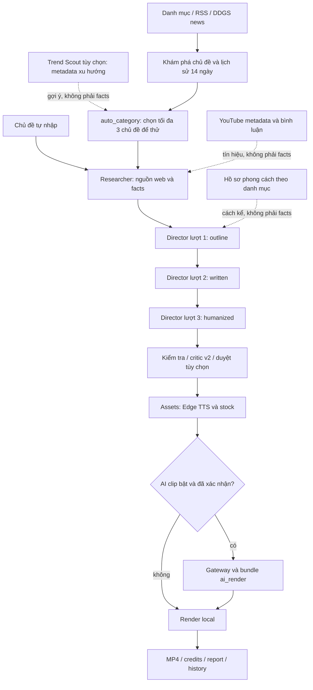

# Quy trình dự án Video AI Tool

Cập nhật đối chiếu: **2026-10-24**, múi giờ người dùng Asia/Saigon.
Tài liệu này mô tả bản code tại máy, không phải cam kết dịch vụ bên ngoài.

**BẮT BUỘC đọc toàn bộ tài liệu này trước khi sửa bất kỳ thứ gì.** Sau mỗi
thay đổi phải cập nhật mục tương ứng, checklist và changelog trước khi báo xong.
Đọc cả [quy tắc gốc](../AGENTS.md). Khi tài liệu mâu thuẫn code, báo người dùng;
không tự chọn cách hiểu rồi sửa hành vi ngoài phạm vi.

## Quy ước và căn cứ

- **ROOT**: `C:\Users\admin\Desktop\app create video`, gốc Git chứa tài liệu
  này và `AGENTS.md`. **APP**: `ROOT/video_ai_tool`, chứa mã ứng dụng.
- Đường dẫn `agents/...`, `output/...`, `config/...` trong các mục bên dưới
  được tính từ **APP**, trừ đường dẫn bắt đầu `ROOT/`.
- Khi mô tả artifact của một project, `audio/`, `clips/`, `render/`,
  `ai_video/`, `ai_render/` là thư mục con của `output/<project>/`, không phải
  thư mục code cấp APP. Thay `<project>`, `<hash>`, `<ID>` bằng giá trị thật trước khi chạy lệnh.
- Mọi lệnh Python/Streamlit/pytest bên dưới chạy sau khi chuyển vào APP.
- Đã đối chiếu mã ứng dụng, Pydantic, YAML, prompts, danh mục test/fixture,
  14 tài liệu chuyên đề và toàn bộ các file `.log` hiện có. Logs được đọc với
  lọc bí mật; lịch sử lỗi không có nghĩa lỗi vẫn tồn tại trong code hiện tại.
- Không đọc/xuất nội dung `.env` thật để viết tài liệu. Bảng cấu hình dựa trên
  `config/settings.py` và `.env.example`; mặc định không phải giá trị máy Đức.
- Test offline chứng minh hành vi với fixture/mock và media local; không
  chứng minh quota, giá, quyền model hay độ đúng của tin tức ngoài đời.
- **CHƯA XÁC NHẬN** có mã Uxx ở cuối mục 13; luôn kèm file/cách kiểm tra.
  Không biến các mục này thành tính năng đã nghiệm thu.

## 1. Mục tiêu, người dùng và mức chất lượng

Người dùng là **Đức**, sinh viên, chạy Windows/local, ưu tiên chi phí thấp và
cách thao tác đơn giản. Mục tiêu sản phẩm là chọn chủ đề, nghiên cứu, kể chuyện
cuốn hút bằng tiếng Việt, tạo giọng/stock/đồ họa rồi xuất MP4 xem được ngay.
Không phải nền tảng SaaS, công cụ đăng video tự động hay hệ thống kiểm chứng tin
tức độc lập. Hiện không có bước đăng YouTube/TikTok/Facebook/Instagram.

Định hướng Đức chấp nhận kiến thức nền có độ mềm khoảng **70–75%**, không yêu
cầu mọi diễn giải đạt tuyệt đối. Đây là **mong muốn biên tập**, không phải số
đo đã được code đánh giá. Không được nói hệ thống đã chứng minh đạt 75% (U01).

Phải tách hai lớp: sự kiện cụ thể về công ty/người thật vẫn cần fact có dẫn
chứng; giải thích/ẩn dụ/ý kiến được mềm và đánh dấu riêng. Không dùng mục tiêu
70–75% để hợp thức hóa số liệu, tên nguồn, ngày hoặc trích dẫn bịa. Ưu tiên
cache, `--from-raw`, preview, tắt AI clip mặc định và không gửi lại job trả phí
khi chưa rõ remote ID. Không kéo dài video bằng lặp ý cho đủ số giây.

## 2. Kiến trúc và hợp đồng giữa các bước



Sơ đồ ba lượt là luồng mặc định của `run_director(..., script_style="storytelling")`
và các trang/pipeline hiện tại. **Không phải mọi nhánh Director đều gọi đúng ba
lần API**: retry, audit, critic, open-loop, query và knowledge notes có thể tăng
số lần gọi; cache/checkpoint có thể giảm về không. API Python `script_style=None`
vẫn có nhánh sinh EditPlan/audit cũ. Không xóa nhánh cũ bằng suy đoán.

| Bước | Input | Output và artifact trong project | Code và API/model |
|---|---|---|---|
| 2026-10-28 | Giai đoạn 7 - Bước (d): Dựng lại 3 project chuẩn đối sánh với Thư viện 28 công thức chuyển động + Lập lịch không lặp: (1) Dựng lại hoàn chỉnh 3 project thực tế: 'luat-cam-chatbot-ai-tao-su-than-mat-cam-xuc' (5 cảnh), 'viet-nam-dat-giai-thuong-so-toan-cau' (6 cảnh) và 'co-hoi-ty-usd-tu-thiet-bi-bay' (6 cảnh); (2) 100% tuân thủ 2 luật lập lịch: 0 cảnh liên tiếp nào cùng họ (0% consecutive repetition) và mỗi video đạt >= 4 họ chuyển động đa dạng (compare_vs, risk_prob, number_stat, fill_level); (3) Tự động ánh xạ kịch bản và số liệu sang các recipe hoạt họa ẩn dụ sống động (lock_unlock, slot_counter, balance_scale, shield_hit, battery_fill, bar_race, traffic_light, before_after_wipe); (4) Tạo 3 bảng so sánh contact sheet trực quan Trước (khuôn lặp phẳng) / Sau (motion vocabulary đa dạng) tại review_frames/contact_sheet_comparison.png và lưu artifact; (5) Bộ kiểm thử hồi quy 71/71 passed 100%. | APP/tools/rerender_3projects.py, editor/motion/scheduler.py, editor/motion/scenes/engine.js; output/{auto-cong-nghe-64e6b569, auto-cong-nghe-efa8eac5, auto-cong-nghe-e0a81f1e}/review_frames/; ROOT/docs/PROCESS.md | Hoàn thành toàn diện Bước (d) Giai đoạn 7: dựng lại 3 project đối sánh, xác nhận trực quan qua contact sheet trước/sau |
| 2026-10-28 | Giai đoạn 7 - Bước (c): 8 Recipe Khái niệm + UI giả lập, Lập lịch không lặp, Metaphor Planner, Clean Theme & Top-Headline: (1) Bổ sung 8 schema RecipeMetadata và RecipeStage trong editor/motion/recipes/recipe_meta.py, sinh đủ 28 descriptor JSON trong descriptors/ (8 Phase A + 12 Phase B + 8 Phase C); (2) Cài đặt trọn vẹn 8 recipe SVG/CSS xác định theo t trong editor/motion/recipes/vocabulary.js: orbit_system (hệ quỹ đạo elip nghiêng 3D + 3 vệ tinh quay xung + xung sóng + hạt năng lượng tia nối), layered_onion (củ hành đồng tâm nhiều lớp quay bóc tách hé lộ nhân sáng), stack_pile (các phiến thẻ 3D xếp chồng nảy nhẹ damped bounce + viền sáng phiến trên cùng), puzzle_snap (2 mảnh ghép khớp mộng cơ học trượt vào bừng sáng viền nối), chat_thread (hội thoại tin nhắn bóng bay + 3 chấm typing + bot phản hồi), mock_card_swipe (thẻ lướt ngang chốt dừng + đóng mộc APPROVED xanh ngọc), form_fill_submit (biểu mẫu nhập liệu 3 hàng gõ phím + nút submit nhấn lún chuyển Hoàn tất), terminal_command_run (cửa sổ lệnh 3D gõ deploy + thanh tiến trình 0->100% + SUCCESS xanh ngọc); (3) Đăng ký đủ 28 recipes vào REGISTRY (editor/motion/registry.py) với semantic fallback; (4) Xây dựng editor/motion/scheduler.py phân loại 7 họ chuyển động (MotionFamily: number_stat, fill_level, compare_vs, process_flow, risk_prob, concept_relation, mock_ui), cấm 2 cảnh liên tiếp trùng họ, đảm bảo video >=5 cảnh có >=4 họ khác nhau, thuật toán suggest_metaphor_recipe tự động nhận diện từ khóa ngữ nghĩa; (5) Bổ sung theme clean_white và paper_brand đạt chuẩn tương phản WCAG AA >=4.5:1 (#0369a1 5.93:1, #047857 5.48:1 trên nền trắng) và hỗ trợ top_headline (y in [250, 360], 48-56px, không đè phụ đề); (6) Mở rộng tools/recipe_gallery.py kết xuất 8 clip MP4 4s (79.0s) và contact_sheet_c.png tại output/recipe_gallery/; (7) Toàn bộ 7/7 test vocabulary và 100% test suite passed. | APP/editor/motion/recipes/{recipe_meta.py, vocabulary.js, __init__.py, descriptors/*.json}, editor/motion/scheduler.py, editor/motion/theme.py, editor/motion/registry.py, tools/recipe_gallery.py, tests/test_recipe_vocabulary.py; ROOT/docs/PROCESS.md | Hoàn thành toàn diện Bước (c) Giai đoạn 7 với đầy đủ 28 recipe, lập lịch chống lặp, theme sáng và top headline |
| 2026-10-28 | Giai đoạn 7 - Bước (b): 12 Recipe So sánh + Rủi ro + Quy trình: (1) Bổ sung 12 schema RecipeMetadata và RecipeStage trong editor/motion/recipes/recipe_meta.py, tự động trích xuất đủ 20 descriptor JSON (8 Phase A + 12 Phase B) trong descriptors/; (2) Cài đặt trọn bộ 12 recipe hoạt họa SVG/CSS xác định theo t trong editor/motion/recipes/vocabulary.js: balance_scale (cán cân 3D nghiêng về bên thắng), tug_of_war (kéo co giằng co dây thừng + cờ đỏ bứt phá), vs_flip_cards (thẻ bài lật xoay 180° đối đầu), before_after_wipe (thanh trượt laser quét chia tách trước/sau), conveyor_belt (băng chuyền 6 con lăn + scanner + mộc PASS), domino_chain (domino đổ liên hoàn kích hoạt đích), funnel_filter (phễu lọc 3 tầng chắt lọc giọt tinh hoa), pipeline_pipes (đường ống zic-zac + van xoay + xung năng lượng), dice_roll (xúc xắc 3D lăn nảy chốt mặt may mắn), lock_unlock (còng khóa bật nảy 25° spring snap + xanh an toàn), shield_hit (khiên lục giác đỡ đạn phản hồi sóng xung kích), traffic_light (cột đèn chuyển đỏ->vàng->xanh chiếu chùm tia sáng); tất cả đều có >= 3 giai đoạn (enter, action, impact), nhãn <= 3 từ đủ nghĩa (sanitizeSemanticLabel), chữ >= 36px, vùng an toàn [70, 1010] x [240, 1330]; (3) Đăng ký 12 recipe vào REGISTRY (editor/motion/registry.py) với fallback tương thích (versus_split, flow_chain, stat_number); (4) Mở rộng tools/recipe_gallery.py hỗ trợ cờ --phase b, kết xuất thành công 12 clip MP4 4s (88.9s) và contact_sheet_b.png tại output/recipe_gallery/; (5) Cập nhật bộ test unit tests/test_recipe_vocabulary.py kiểm tra trọn vẹn 20 recipes; 14/14 test suite passed 100%. | APP/editor/motion/recipes/{recipe_meta.py, vocabulary.js, __init__.py, descriptors/*.json}, editor/motion/registry.py, tools/recipe_gallery.py, tests/test_recipe_vocabulary.py; ROOT/docs/PROCESS.md | Hoàn thành toàn diện Bước (b) Giai đoạn 7 cài đặt 12 recipe hoạt họa So sánh, Quy trình và Rủi ro sống động |
| 2026-10-28 | Giai đoạn 7 - Bước (a): Khung Motion Vocabulary + 8 Recipe số liệu & đổ đầy: (1) Xây dựng schema RecipeMetadata và RecipeStage trong editor/motion/recipes/recipe_meta.py, tự động trích xuất 8 descriptor JSON trong editor/motion/recipes/descriptors/; (2) Cài đặt trọn bộ 8 recipe hoạt họa SVG/CSS xác định thuần túy theo t trong editor/motion/recipes/vocabulary.js: slot_counter (máy quay số 3 cuộn lăn tít + LED chase), strike_replace (vệt chém đỏ ✗ -> số mới ✓), gauge_needle (đồng hồ áp suất bán nguyệt 270° + kim rung cơ học + đèn báo), odometer (trục số cơ khí lăn bánh răng), bar_race (cuộc đua nước rút bứt phá dẫn đầu + cờ sao cán đích), thermometer (cột nhiệt kế sôi + sóng nhiệt + bọt khí), battery_fill (thỏi pin nạp 4 nấc + sét đánh + xung điện quang), glass_fill (dòng nước rót + mực nước dâng + phao dập dềnh); tất cả đều có >= 3 giai đoạn (enter, action, impact), nhãn <= 3 từ đủ nghĩa (sanitizeSemanticLabel), chữ >= 36px, bố cục an toàn tuyệt đối [70, 1010] x [240, 1330]; (3) Tích hợp vocabulary.js vào editor/motion/engine/__init__.py, timeline.js và đăng ký 8 phần tử vào REGISTRY (editor/motion/registry.py) với đường fallback chuẩn; (4) Xây dựng tools/recipe_gallery.py kết xuất thành công 8 clip MP4 4s (53.1s) và contact_sheet.png tại output/recipe_gallery/; (5) Bổ sung bộ test unit tests/test_recipe_vocabulary.py (4/4 passed), 48/48 test suite passed 100%. | APP/editor/motion/recipes/{recipe_meta.py, vocabulary.js, __init__.py, descriptors/*.json}, editor/motion/engine/{__init__.py, timeline.js}, editor/motion/registry.py, tools/recipe_gallery.py, tests/test_recipe_vocabulary.py; ROOT/docs/PROCESS.md | Hoàn thành toàn diện Bước (a) Giai đoạn 7 xây dựng khung công thức chuyển động và 8 recipe số liệu & đổ đầy sống động |
| Trend Scout tùy chọn | Danh mục, region, cấu hình/cache/ngân sách, lịch sử 14 ngày | TrendItem → chủ đề/góc kể; `trend_scout_latest.json` ở output; auto lưu `trend_scout.json` trong project | `pipeline/trend_scout.py`, `providers/trends/`; ScrapeCreators metadata, nguồn miễn phí, Gemini gom batch |
| Khám phá | Danh mục, region, 1/3/7 ngày, số gợi ý, lịch sử | Gợi ý một sự kiện, angle/query gợi ý; `topic_candidates.json` trong auto-category, `topic_discovery.json` khi handoff | `sources/topic_discovery.py`, `pipeline/discover.py`; RSS/feedparser, DDGS news, Gemini Researcher, YouTube tùy chọn |
| Research | Topic, web_limit, source_languages, discovery_hint, content_mode | `sources.json`: bài và chẩn đoán; `brief.json`: facts, quotes, truy vấn, cảnh báo, insight; v2 có research_questions/knowledge_notes | `agents/researcher.py`, `sources/web_search.py`; DDGS + trafilatura; LLM_PROVIDER_RESEARCHER → Gemini/OpenAI, mục 9; YouTube Data API chỉ cho trends |
| Director outline | Brief và snapshot profile; type/format/duration/style | Dàn ý, fact IDs, hook/open loop; stage trong `director_state.json` hoặc `director_state.explainer_v2.json` | `agents/director.py`, `director_story.py`, `explainer_director.py`; LLM_PROVIDER_DIRECTOR → model riêng theo provider, mục 9 |
| Director written | Dàn ý đã kiểm tra và facts | Lời đọc theo cảnh; stage `written` | Cùng provider Director; chuẩn hóa trước Pydantic, chỉ sửa cảnh lỗi căn cứ |
| Director humanized | Bản viết đã kiểm tra, cảnh cần sửa | `edit_plan.json`; review_notes/validation_events; lỗi còn lại lưu `edit_plan.draft.json` | Nhánh storytelling hoặc v2; v2 có thêm critic và LoopReview tùy kết quả |
| Assets | `edit_plan.json` gốc, giọng, query, cache | `audio/scene_<id>.mp3`, `.tts.json`, `.words.json`, `clips/`, `assets.json`, `edit_plan.resolved.json`, `credits.txt` | `pipeline/assets.py`; Edge TTS không cần key, Pixabay chính, Pexels tùy chọn; không gọi Gemini để dựng asset thường |
| AI clip tùy chọn | Số clip/model/giây đã duyệt, ai_prompt, job cũ | `ai_video/<hash>.json`, receipts/locks, clips AI; pipeline tạo bản sao `ai_render/` | `pipeline/ai_video.py`, `run_all_ai.py`, `providers/video_gateway.py`; Hinton Videos API, không phải Gemini chat |
| Render | Resolved plan + audio + clips + manifest + credits | `render/<slug>_<format>_<mode>.mp4`, `preview.json`/`final.json`, credits, `visual_review.json`, `render/report.md`, tùy chọn `motion_cache/` | `editor/render.py`, MoviePy 2, Pillow, NumPy, FFmpeg từ imageio-ffmpeg; motion thêm Chromium local, không gọi mạng |
| Điều phối | RunConfig / AutoConfig, callbacks, cancel flag, resume | `project.json`, `run_state.json`, `report.md`, artifact hashes, nhật ký ngắn | `pipeline/run_all.py`, `auto_category.py`; tái sử dụng hàm từng bước, không parse terminal |

### 2.1 Research thực tế

1. LLM Researcher sinh 2–4 truy vấn tự nhiên/ngôn ngữ; chủ đề nhiều thực thể được tách
   tối đa ba nhánh trong `agents/search_queries.py`. `vi,en` mặc định; thêm
   `zh,ko,ja`. Đầu ra hiện chỉ `vi`, không có chế độ TTS ngôn ngữ khác.
2. V2 sinh câu hỏi cơ chế/vì sao/tác động/phản biện và query vi/en; nếu bước này
   lỗi thì giữ query đa ngôn ngữ. Discovery chỉ cung cấp gợi ý, không cung cấp fact.
3. DDGS text/news, tải HTML bài cụ thể, trafilatura; fallback đọc paragraph từ
   HTML đã tải. Giữ tối đa khoảng 8000 ký tự ở ranh giới đoạn, loại bài <300 ký
   tự, trang chủ/chuyên mục, URL mạng xã hội, địa chỉ mạng riêng và redirect xấu.
   Không lấy snippet để bù thành fact trong luồng hiện tại.
4. Mục tiêu 5–8 nguồn tốt, `web_limit=6`, cho phép 1–12. Thu mọi query rồi ưu
   tiên nhà xuất bản đa dạng và ngày đăng. Đây không phải ngưỡng cứng tối thiểu.
   Tổng text nguồn gửi lượt rút fact ≤40000 ký tự, chia theo số nguồn; **không
   phải** trần toàn bộ prompt kể cả metadata/chỉ dẫn.
5. Prompt mong muốn 12–20 fact chi tiết, mỗi fact 1–3 câu. Quote gốc 15–200 ký
   tự, ≤25 từ, kiểm tra nguồn gốc, chuẩn hóa khoảng trắng/dấu nháy; không dịch
   quote. Quote nguyên bản >25 từ chỉ cắt 25 từ đầu sau khi cả quote khớp nguồn.
   Quote bịa hoặc URL ngoài nguồn bị loại riêng. Có ≥1 fact hợp lệ là tiếp tục;
   0 fact sinh `NoResearchDataError`. Ít hơn 8 fact chỉ cảnh báo dữ liệu mỏng.
6. Nguồn đơn/ít hơn 6 fact: thử mở rộng **một lần**, tối đa 4 query và 4 nguồn
   mới; rút/đối chiếu lại, giữ fact cũ nếu mở rộng lỗi. Không có nguồn ngay từ
   bước thu thập thì báo thiếu dữ liệu để auto-category thử chủ đề kế.
7. Tách lượt schema nhỏ rút fact và lượt enrich `story_angles`, key_numbers,
   timeline, why_it_matters, counterpoints, glossary. Lượt enrich lỗi không mất
   facts. V2 thêm tối đa 8 knowledge_notes low/medium, nguồn “kiến thức nền”.
8. YouTube trends chạy riêng sau grounding: metadata/statistics/comments, không
   đưa vào facts. Tối đa 10 bình luận/video cho top 3 video, mặc định cửa sổ 14
   ngày. Trends/Gemini insight lỗi hoặc hết quota chỉ cảnh báo.

`validate_grounding` là kiểm tra quote/URL và metadata; nó **không tự chứng
minh mọi mệnh đề trong fact_vi đều suy ra được từ một quote ngắn**. Đây là giới
hạn cần người biên tập đối chiếu nguồn; không gọi mọi fact là đã xác minh độc lập.

### 2.2 Một nút, resume và chuyển chủ đề

- `run_all`: thứ tự `research → director → assets → ai_video → render`;
  `stop_after` chỉ nhận các tên bước này. Mặc định auto, AI=0, trends=false,
  render preview. `--review` dừng sau Director, `--continue` xác nhận tiếp tục.
- `run_auto`: thêm discovery, mặc định tự động hoàn toàn, render **final**,
  tối đa 3 gợi ý chưa trùng lịch sử. Chỉ chuyển chủ đề khi chuỗi nguyên nhân là
  `NoResearchDataError`; không coi 403/quota/504 là thiếu facts để đổi chủ đề mù.
- Chủ đề thử lại trong **cùng lượt auto** dùng project đó và ghi lý do bỏ. Mỗi
  video trong `--count N` có project riêng, tuần tự, dừng nếu chờ duyệt/hủy.
- Project mới dùng slug + ID ngắn. `--force` của run_all tạo project **mới**,
  không xóa/reset dữ liệu project cũ. `run_research` gọi độc lập không có
  output_dir dùng slug + hash topic, có thể ghi lại cùng nơi: không đồng nhất
  với chính sách project mới của `run_all`.
- `run_state.json` có config, status, steps, thời gian, attempts, warnings,
  hashes, lỗi và log ngắn; không phải SQLite. Done chỉ được bỏ qua nếu artifact
  tồn tại và hash còn đúng. Không sửa tay hash/status để ép tiếp tục.
- Có ngoại lệ nhận chỉnh sửa kịch bản lúc đang chờ duyệt và Assets chưa chạy:
  backend kiểm tra/lưu lại, có thể gọi Gemini. Đổi input ngoài ngoại lệ phải
  tạo lại bước/project thích hợp, không giả coi cache còn đúng.
- Lỗi AI clip mặc định skip, vẫn render b-roll; `stop` mới dừng. Giá trị `ask`
  vẫn còn trong kiểu/CLI nhưng nhánh xử lý hiện coi mọi giá trị khác stop là
  skip; **không đảm bảo một hộp hỏi giữa lượt**. UI phải xác nhận phí từ đầu.
- Hủy là hợp tác tại điểm an toàn; không bảo đảm ngắt ngay HTTP/FFmpeg hay hủy
  job từ gateway. Job đã gửi có thể vẫn tính phí. Không xóa lock để ép chạy kép.
- Lịch sử `output/topics_history.json` chỉ ghi sau video hoàn tất; so gần giống
  tiêu đề hoặc cùng nguồn trong 14 ngày, không đưa mọi gợi ý vào blacklist.

### 2.3 Trend Scout: tín hiệu trước Research, không phải bằng chứng

- `config/trends.yaml.enabled=false` mặc định: auto-category giữ nguyên nhánh
  RSS/news. Bật true thì discovery gọi `scout`, chọn chủ đề điểm cao chưa dùng;
  nếu không còn gợi ý hoặc scout lỗi thì fallback RSS/news hiện có. Resume dùng
  topic_candidates/run_state đã lưu, không quét lại discovery đã done.
- Interface `fetch(category,limit) -> list[TrendItem]`. TrendItem chỉ có
  id/title/summary/url/platform/language/region/score_raw/metrics/hashtags/
  fetched_at. Không chứa transcript, kịch bản, URL media, ảnh/avatar/author.
  TikTok lấy caption metadata ngắn, không lấy lời thoại. API có thể trả các
  field media nhưng code bỏ ngay, chỉ cache projection TrendItem.
- Bộ nguồn mặc định được phép thử khi Scout bật: ScrapeCreators TikTok (cần
  key), Reddit public JSON, HackerNews Firebase (chỉ công nghệ/kinh doanh/game),
  Google Trending Now RSS, YouTube mostPopular (cần key). Weibo/Bilibili tắt,
  endpoint chưa xác nhận (U09). Nguồn timeout/401/403/429/JSON lỗi bị bỏ qua và
  log riêng; không vượt chặn bot. Bật nguồn không bảo đảm endpoint đang hoạt động.
- TikTok: trending feed + **một** keyword danh mục mỗi region/cache miss;
  tối đa 2 HTTP/region, both=VN+US tối đa 4. Region là quốc gia proxy, **không
  phải** bộ lọc xuất xứ video. Không phân trang tự động; hashtag chỉ dùng ở probe.
- Cache theo provider/query/region (kèm category/limit ở nguồn miễn phí khi cần),
  TTL 21600s; kiểm cache trước key/ngân sách. SQLite reserve trước HTTP, không
  retry/redirect ScrapeCreators; lỗi/timeout vẫn tính lượt dự trù. Các endpoint
  dùng hiện báo 1 credit/request; `credits_charged` lưu riêng, không giả timeout
  là biết phí thực. Trần mặc định 30/ngày **UTC**, xét max(lượt HTTP dự trù,
  tổng credit đã được phản hồi). Budget hết chỉ còn cache và nguồn miễn phí.
  SQLite transaction BEGIN IMMEDIATE ngăn hai worker cùng vượt trần lượt.
- YouTube chỉ videos.list chart=mostPopular, dùng ledger quota có sẵn,
  1 đơn vị mỗi HTTP attempt kể cả retry; không dùng search hay transcript.
- Gom trùng URL/tiêu đề trước Gemini. Tối đa 40 nhóm, mỗi nhóm 3 metadata,
  JSON input <=16000 ký tự, summary <=120 ký tự/mục; **một** generate_json batch
  (retry mạng dùng chung, provider do LLM_PROVIDER_TREND chọn). Topic có topic_title_vi/why_hot/2–3 angle_suggestions/
  score_hot/score_fit_category/score_vietnam_audience/sources. Điểm tổng
  .4 nóng + .3 phù hợp danh mục + .3 khán giả VN. Code loại URL/tên/số mới ngoài
  metadata và gom trùng lần nữa; đây là lọc đề xuất, không thêm luật nhóm 1.
- Gemini lỗi/không có đề xuất hợp lệ: score_raw log-normalize theo từng nền
  tảng, fit/VN trung tính 5/10. **Fallback không dịch offline**: tiêu đề gốc
  ngoại ngữ có thể còn nguyên, cần người dùng sửa; không giả đó là bản dịch.
  Điểm nóng/phù hợp/khả năng mới với khán giả VN là ước lượng, không đo độ phổ biến.
- Scout kết hợp `used_topics` SQLite và history JSON cũ; loại tiêu đề giống
  >=.78 trong 14 ngày hoặc cùng URL đã làm. SQLite chỉ ghi khi run_all hoàn tất
  với discovery hint, không đánh dấu lúc quét/chọn/dừng duyệt/lỗi. History cũ vẫn
  giữ; lỗi ghi DB được log và còn đường dự phòng JSON.
- Handoff tái dùng DiscoveryHint/TopicSuggestion: topic + why_now(why_hot) +
  angle + truy vấn là **gợi ý**. `create_brief` nhận topic_inspiration_only riêng,
  không nhận TrendItem như SourceDocument. Mọi fact vẫn phải có quote khớp bài
  web trong sources. Director/validation registry giữ nguyên. Credits/report
  liệt kê nguồn gợi ý ở mục metadata, tách khỏi nguồn fact.

**Khảo sát API thật 2026-10-23**: đã được Đức cho phép và thêm key bằng editor;
4 HTTP request, đều 200, mỗi response `credits_charged=1`, tổng API báo 4 credit.
`tools/probe_scrapecreators.py` lưu field_types và projection đã xóa dữ liệu cá
nhân ở `tests/fixtures/scrapecreators_*.json`; không lưu raw có author/media.
Không in giá trị key hoặc nội dung .env. Cấu trúc thực đã quan sát:

| Request | Danh sách thực | Trường dùng | Credit API báo |
|---|---|---|---|
| GET /v1/tiktok/get-trending-feed, VN | aweme_list[] | aweme_id, desc, region, create_time, statistics, url; desc_language có thể thiếu | 1 |
| Cùng endpoint, US | aweme_list[] | Cùng cấu trúc, không suy ngôn ngữ từ region | 1 |
| GET /v1/tiktok/search/keyword, query AI | search_item_list[].aweme_info | aweme_id, desc, desc_language, region, statistics, url | 1 |
| GET /v1/tiktok/search/hashtag, hashtag AI | aweme_list[] | Cùng metadata video; cursor/has_more ở cấp response | 1 |

Statistics dùng play_count/digg_count/share_count/comment_count → views/likes/
shares/comments; thiếu/null → 0. Top-level có success/credits_charged/
credits_remaining; không coi balance ở fixture là số dư hiện hành. Fixture
đã thay @username trong URL bằng @redacted, bỏ avatar/link cá nhân/media;
adapter production giữ URL trang video công khai để đối chiếu, không tải video.
Probe giữ receipt, bỏ fixture đã có và giới hạn tổng tối đa 6 lượt probe, không
tự mua lại fixture khi chạy lại. Dữ liệu API/credit có thể thay đổi sau mốc này.
Tài liệu tham chiếu chính thức: [trending feed](https://docs.scrapecreators.com/v1/tiktok/get-trending-feed/),
[keyword](https://docs.scrapecreators.com/v1/tiktok/search/keyword/),
[hashtag](https://docs.scrapecreators.com/v1/tiktok/search/hashtag/).

Danh sách file của lần bổ sung Trend Scout (28 tệp nguồn/tài liệu/fixture;
đường dẫn APP trừ khi ghi ROOT):

| Trạng thái | File |
|---|---|
| Tạo | `tools/probe_scrapecreators.py`, `schemas/trends.py`, `config/trends.py`, `config/trends.yaml` |
| Tạo | `providers/trends/__init__.py`, `providers/trends/base.py`, `providers/trends/scrapecreators_tiktok.py`, `providers/trends/reddit.py`, `providers/trends/hackernews.py`, `providers/trends/google_trends.py`, `providers/trends/youtube_trending.py` |
| Tạo | `pipeline/trend_scout.py`, `pipeline/trend_scout_jobs.py`, `app/views/trend_scout.py`, `tests/test_trend_scout.py` |
| Tạo từ probe thật | `tests/fixtures/scrapecreators_trending_vn.json`, `tests/fixtures/scrapecreators_trending_us.json`, `tests/fixtures/scrapecreators_keyword_ai.json`, `tests/fixtures/scrapecreators_hashtag_ai.json`, `tests/fixtures/scrapecreators_probe_report.json` |
| Sửa | `.env.example`, `config/settings.py`, `db/repository.py`, `pipeline/auto_category.py`, `pipeline/run_all.py`, `agents/researcher.py`, `app/streamlit_app.py`, `ROOT/docs/PROCESS.md` |

Artifact runtime: SQLite `data/app.db` được nâng schema/thêm bộ đếm probe;
không xuất DB/khóa thật vào fixture. `.env` chỉ do Đức thêm key bằng editor,
không được script sửa hay xuất. Không thay Director, script_depth, registry luật.

## 3. Thư mục và module cần hiểu trước khi sửa

```text
ROOT/
├── AGENTS.md                  # quy tắc làm việc, dưới 40 dòng
├── docs/PROCESS.md            # tài liệu này
└── video_ai_tool/             # APP, thư mục chạy lệnh
    ├── agents/               # Research, Director, validation, prompt video
    ├── app/views/            # trang Streamlit; gọi backend bằng hàm
    ├── config/               # Settings, categories, themes, rules, profiles
    ├── prompts/              # chỉ dẫn Gemini, tách khỏi dữ liệu nguồn
    ├── schemas/              # hợp đồng Pydantic và kiểu JSON
    ├── sources/              # web/RSS/YouTube, metadata và quota
    ├── providers/            # Gemini, Edge TTS, stock, gateway
    ├── pipeline/             # orchestration, assets, scan, style library
    ├── editor/templates/     # Pillow/MoviePy motion graphics
    ├── utils/                # atomic I/O, locks, cache, log, media
    ├── db/repository.py      # SQLite cho thư viện học phong cách
    ├── assets/               # fonts/music/sfx/backgrounds/reference_videos
    ├── data/app.db           # DB local; kèm WAL/SHM khi hoạt động
    ├── output/<project>/     # sản phẩm và checkpoint mỗi video
    ├── .cache/               # cache nguồn/tts/stock/quota/style compatibility
    ├── logs/                 # log lỗi UTF-8 đã lọc bí mật
    ├── tests/fixtures/       # snapshot hồi quy, không phải output sản xuất
    └── docs/                 # tài liệu chuyên đề/lịch sử, có mục đã cũ
```

| Module/file quan trọng | Vai trò và lưu ý |
|---|---|
| `config/settings.py`, `.env.example` | 70 biến ứng dụng (không tính root_dir), validate kiểu/phạm vi, precedence, không tự export env; tùy chọn OpenAI/LLM mềm, mục 9 |
| `providers/llm/base.py`, `gemini_client.py`, `openai_client.py`, `router.py` | Client JSON đã parse/text, lỗi chuẩn, Responses SDK, chọn theo bước và một failover; facade tương thích agent JSON text |
| `config/trends.py`, `trends.yaml`, `schemas/trends.py` | Công tắc/ngân sách/TTL/nguồn; metadata TrendItem/Topic tách khỏi facts |
| `pipeline/trend_scout.py`, `trend_scout_jobs.py`, `app/views/trend_scout.py` | Gom/chấm đề xuất, CLI/worker/UI và handoff Research |
| `providers/trends/*.py`, `tools/probe_scrapecreators.py` | Adapter metadata/cache/budget; probe giới hạn có fixture thật đã ẩn dữ liệu cá nhân |
| `config/categories.py`, `categories.yaml` | ID ổn định, RSS/keyword/style, sửa/bật tắt; không đổi ID tùy tiện vì gắn profile/thư mục/DB |
| `config/presets.py`, `storytelling.py`, `video_models.py` | Định dạng/voice/shot, mốc duration/style, model+giây gateway |
| `agents/researcher.py`, `search_queries.py`, `research_expansion.py` | Sinh query, thu/đối chiếu facts, enrich và mở rộng dữ liệu mỏng |
| `agents/explainer_research.py`, `trend_insights.py` | Question-driven research, live blog, knowledge notes, trends tách riêng |
| `agents/director.py`, `director_story.py`, `director_state.py` | Entry point, audit, ba lượt kể chuyện, checkpoint/hash, rewrite cảnh/toàn bài |
| `agents/explainer_director.py`, `explainer_guard.py`, `explainer_visuals.py` | Ba lượt v2, nhãn câu, critic/loop, shot theo ý hình ảnh |
| `agents/validation_rules.py`, `script_depth.py`, `story_style.py` | Registry nhóm luật, căn cứ và cảnh báo độ sâu/văn phong |
| `agents/plan_structure.py`, `broll_queries.py`, `content_plan.py`, `adaptive.py` | Chuẩn hóa mảng/query/timing, co theo dữ liệu; khác nhau giữa mode cũ và v2 |
| `agents/director_numbers.py`, `vietnamese_tts.py`, `director_title.py`, `director_sources.py` | Số/đơn vị/ngày, tiêu đề cấp video, alias tên nguồn và allowed_sources |
| `agents/proper_names.py`, `visual_planner.py`, `visual_policy.py` | Bộ dò tên chung, chọn thẻ, đối chiếu đồ họa và lựa chọn trung tính/giữ nguyên |
| `agents/presentation.py`, `editor/layout.py`, `pipeline/presentation_review.py` | Cụm card_text/emphasis, cảnh báo giọng, bố cục chung và dựng bản review riêng từ project được cung cấp |
| `agents/visual_diversity.py`, `utils/caption_timing.py`, `editor/quality.py` | Motion3: thẻ riêng/không trùng, chọn mẫu theo dữ liệu, cảnh báo số, display caption và QC/contact sheet 2.5s |
| `agents/illustrations.py`, `schemas/motion_scene.py`, `editor/motion/scenes/` | Motion4: chọn visual_plan, 13cảnh vector lớn, renderAt tuyệt đối, local anime MIT, dữ liệu không đủ fallback text_focus |
| `editor/motion/amplitude.py`, `assets/mascot/`, `assets/illustrations/`, `assets/vendor/anime/` | RMS33ms dưới render/, mascot tự vẽ có miệng/tay, giấy phép originalCC0 và vendorMIT |
| `editor/motion/icons.py`, `config/icons.yaml`, `assets/icons/` | Chip/icon Lucide local ghim commit, giấy phép ISC+MIT notice, thiếu map dùng lightbulb |
| `pipeline/controlled_ai.py`, `ai_budget.py`, `motion_review.py` | Clip AI nền opt-in, tái dùng job/slot receipt, ngân sách POST/ngày và hồi quy project không thay audio |
| `agents/video_prompt_writer.py`, `pipeline/video_prompts.py` | Prompt ngắn an toàn; chỉnh prompt không tự tạo clip trả phí |
| `sources/web_search.py` | Bài đầy đủ, SSRF/public URL, fallback HTML, quyết định giữ/loại |
| `sources/topic_discovery.py`, `youtube.py`, `youtube_trends.py`, `youtube_resolver.py` | RSS/news, ledger quota, trends, resolve/scan nguồn YouTube |
| `sources/transcripts.py`, `sources/debug.py`, `social_signals.py` | Legacy transcript/debug còn tồn tại; social provider mặc định tắt, không thuộc facts Research hiện tại |
| `providers/llm_gemini.py`, `gemini_resilience.py`, `research_payload.py` | SDK, wire schema, retry/fallback, source budget; helper cũ tồn tại không có nghĩa đang được gọi |
| `providers/style_schema.py`, `style_compat.py` | Schema phẳng Style, bisect 400, nhớ cấu hình được HTTP chấp nhận |
| `providers/tts_edge.py`, `tts_text.py` | Làm sạch/chia đoạn/retry/voice fallback/silence và metadata |
| `providers/stock_base.py`, `stock_pixabay.py`, `stock_pexels.py`, `stock_http.py` | Interface StockProvider, adapters, cache/rate limit/HTTP retry |
| `providers/video_gateway.py`, `pipeline/ai_video.py`, `ai_video_jobs.py` | Payload/model/billing estimate, durable ID, reconcile job và worker |
| `pipeline/projects.py`, `run_all.py`, `run_all_jobs.py`, `run_all_ai.py` | Project/checkpoint, resume/cancel, bundle AI riêng và fingerprint |
| `pipeline/auto_category.py`, `auto_category_jobs.py`, `discover.py`, `discovery_jobs.py`, `topics_history.py` | Một nút danh mục, handoff gợi ý, lịch sử và hàng đợi tuần tự |
| `pipeline/assets.py`, `stock_assets.py` | Retiming audio thật, manifest/credits, đổi stock/riêng audio một cảnh |
| `pipeline/style_learner.py`, `style_raw.py`, `style_library.py`, `style_jobs.py` | Video local, hash/cache, raw bền, parse lại, phân loại/thư viện/worker |
| `pipeline/style_profile.py`, `category_style.py`, `style_safety.py` | Tổng hợp profile, khóa chỉnh tay, loại nội dung riêng, n-gram chống chép |
| `pipeline/scan_sources.py`, `scan_jobs.py`, `db/repository.py` | Preview YouTube, xác nhận học, SQLite, retry lỗi và tổng hợp chỉ mẫu mới |
| `pipeline/run.py` | Stub “Giai đoạn 6”, **không phải entry point pipeline hiện tại** |
| `pipeline/explainer_compare.py`, `editor/template_demo.py` | Công cụ so sánh v2 hoặc demo đồ họa; xem phạm vi API trước khi chạy |
| `schemas/base.py`, `source.py`, `research_brief.py`, `languages.py` | Base model, nguồn/fact/insight/ngôn ngữ |
| `schemas/edit_plan.py`, `story.py`, `explainer.py`, `validation.py`, `visual.py`, `assets.py` | Hợp đồng kịch bản, nhãn câu, luật, thẻ, resolved/manifest |
| `schemas/style.py`, `style_compact.py`, `style_normalize.py`, `style_repairs.py`, `topic_discovery.py` | Quan sát mẫu có default/repair, schema gọn, danh mục/gợi ý |
| `editor/runtime.py`, `timeline.py`, `render.py`, `jobs.py` | MoviePy 2/FFmpeg, timeline theo sample, worker một render/lần |
| `editor/effects.py`, `captions.py`, `audio_mix.py`, `graphics.py`, `templates/` | Cover/effects, caption, âm lượng/ducking, thẻ/progress |
| `editor/motion/base.css`, `runtime.js`, `pipeline/render_motion.py` | Motion HTML tùy chọn, renderAt(t), Chromium → FFmpeg, cache cảnh và dự phòng Pillow; không thay validator/prompt |
| `utils/word_timing.py`, `editor/motion/memory.py`, `pipeline/motion_demo.py` | Sidecar/timing theo từ, working-set sampler Windows và benchmark cảnh local không gọi API |
| `app/streamlit_app.py`, `app/views/*.py` | Router PAGES, sidebar, các trang; đăng ký trang mới ở PAGES, không gọi terminal để lấy dữ liệu |
| `app/visual_review.py`, `ai_prompt_controls.py`, `style_controls.py`, `ui_errors.py` | Quyết định đồ họa, sửa prompt, preset, lỗi đã redaction |
| `utils/atomic_io.py`, `file_lock.py`, `cache.py`, `plan_lookup.py` | Ghi bền/đọc chịu khóa, locking/cache, lookup scene-shot theo khóa |
| `utils/diagnostics.py`, `logger.py`, `console.py` | Redaction, UTF-8, traceback; Diagnostics có đọc cấu hình để thu bí mật cần che, không xuất file env |
| `utils/retry.py`, `rate_limit.py`, `style_rate_limit.py`, `media.py`, `json_response.py`, `text.py`, `source_credits.py` | Retry/rate, media decode, parse JSON, slug/text, liệt kê nguồn/ngôn ngữ |
| `requirements.txt`, `pytest.ini`, `tests/conftest.py` | Dependency pin, chỉ thu tests/, cách ly env thật/SDK trong test |

Không nhập `test_gemini.py` như suite chính hay chạy thử API để “kiểm tra nhanh”
nếu chưa được phép. Đó là script chạy tay; suite chính chỉ ở `tests/`.

## 4. Cấu hình thực tế

### 4.1 Cơ chế đọc và toàn bộ biến `.env`

`get_settings(path)` chọn **một** file: đường dẫn chỉ định hoặc APP/.env.
Precedence: biến môi trường tiến trình > file đó > mặc định Pydantic.
Không gọi `load_dotenv`, không tự cập nhật `os.environ`. Import MoviePy đi qua
`editor/runtime.py` để tránh nạp `.env` ngầm và dùng FFmpeg kèm dependency.
Khóa dùng `SecretStr`; thiếu key chỉ bị yêu cầu khi gọi provider tương ứng.
Tên lạ không thuộc Settings không trở thành cấu hình ứng dụng; `ROOT_DIR`/
`root_dir` là đường dẫn code/Python, không phải biến `.env` được get_settings nhận.

**Chỉ có tên, mô tả, mặc định công khai ở bảng sau; không có giá trị key.**

| Tên biến | Mặc định trong code | Ý nghĩa/phạm vi |
|---|---|---|
| `RENDER_WIDTH` | `1080` | Chiều rộng bản cuối dọc, 240–3840; YouTube đảo hai chiều, làm tròn pixel chẵn. |
| `RENDER_HEIGHT` | `1920` | Chiều cao bản cuối dọc, 240–3840; preview thu nhỏ riêng, final không chịu MOTION_SCALE. |
| `MOTION_ENABLED` | `false` | Bật HTML motion trong Render; tắt giữ renderer cũ, thiếu engine/lỗi cảnh dùng Pillow. |
| `MOTION_WORKERS` | `2` | 1–4 worker cảnh, mỗi thread sở hữu Playwright/browser/FFmpeg riêng; không chia page giữa thread. |
| `MOTION_SCENES_ENABLED` | `true` | Bật bộ cảnh minh họa SVG khi MOTION_ENABLED bật; false quay về thẻ Motion hiện có. Trống dùng mặc định. |
| `MIN_CARD_HOLD_SEC` | `1.2` | 0.3–5s, giữ chữ trước wipe/chuyển cảnh, terminal hoàn tất phần gõ trước đoạn giữ; trống dùng mặc định. |
| `MOTION_THEME` | `auto` | auto dùng style_profile.category_id → palette config/motion_theme.yaml, không có thì studio; UI có thể chọn riêng. |
| `MASCOT_ENABLED` | `true` | SVG hình khối riêng chỉ hook/kết khi Motion bật; thiếu/bị từ chối SVG thì bỏ qua, không gọi API. |
| `MOTION_FPS` | `30` | 1–60 fps khi motion bật, áp dụng cả preview/final. |
| `MOTION_SCALE` | `1.0` | .25–1.0; scale preview khi bật motion; .5 = 540×960 dọc. Final luôn dùng RENDER_WIDTH/HEIGHT đầy đủ. Ba biến motion để trống dùng mặc định. |
| `GEMINI_API_KEY` | `trống (không có giá trị khóa trong tài liệu)` | Key Google Gemini, SecretStr; chỉ cần khi gọi Gemini. |
| `OPENAI_API_KEY` | `trống (không có giá trị khóa trong tài liệu)` | SecretStr; thiếu key/model thì OpenAI tắt, không làm lỗi cấu hình chung. |
| `OPENAI_MODEL` | `trống` | Model text OpenAI dùng cho Researcher/Trend khi chọn openai; không đoán model/quyền tài khoản. |
| `OPENAI_DIRECTOR_MODEL` | `trống → OPENAI_MODEL` | Model riêng Director của OpenAI; trống dùng OPENAI_MODEL. |
| `OPENAI_TIMEOUT_SEC` | `120` | Timeout HTTP riêng OpenAI, >0 và <=600s; trống/lỗi dùng mặc định và cảnh báo tên biến nếu lỗi. |
| `OPENAI_RPM_LIMIT` | `20` | 1–1000, ledger local 60s, mỗi retry cũng đặt trước lượt; không phải quota dashboard. |
| `OPENAI_MAX_RETRIES` | `3` | 0–8 retry sau request đầu, SDK retry riêng tắt để không nhân số lượt. |
| `LLM_PROVIDER_RESEARCHER` | `gemini` | gemini/openai; điều khiển queries, facts, enrich/knowledge và insight trong bước Research. |
| `LLM_PROVIDER_DIRECTOR` | `gemini` | gemini/openai; áp dụng outline/written/humanized/audit/critic/viết lại/prompt shot qua director_provider. |
| `LLM_PROVIDER_TREND` | `gemini` | gemini/openai; Trend Scout batch và khám phá RSS/news của auto_category. |
| `LLM_FALLBACK_PROVIDER` | `trống` | Không failover mặc định; gemini/openai dự phòng một lần khi lỗi tạm thời sau retry, xem mục 9. |
| `GEMINI_MODEL` | `trống` | Model nền cho Research/query/discovery/trends; trống thì lỗi khi cần model, không có tên model mặc định. |
| `GEMINI_DIRECTOR_MODEL` | `trống` | Model Director; trống dùng GEMINI_MODEL. |
| `GEMINI_FALLBACK_MODEL` | `trống` | Model dự phòng khi deadline lặp; trống không đổi model. |
| `GEMINI_TIMEOUT_SEC` | `120` | Timeout client Gemini giây, >0 và <=600; tách HTTP thông thường. |
| `GEMINI_STYLE_MODEL` | `trống` | Model phân tích Style; trống dùng GEMINI_MODEL. |
| `STYLE_MAX_VIDEOS_PER_RUN` | `5` | 1–20 mẫu/lô Style; còn áp vào scan. |
| `STYLE_MAX_FILE_MB` | `200` | 1–2000 MB/file local; upload đoạn đầu vẫn tải file gốc lên Files API. |
| `STYLE_MAX_DURATION_SEC` | `600` | 1–3600s ở Settings, nhưng inspect_video còn hard cap min(600, giá trị này). |
| `STYLE_TIMEOUT_SEC` | `180` | 10–300s, timeout Gemini media và chờ xử lý file. |
| `STYLE_MAX_OUTPUT_TOKENS` | `8192` | 1024–65536; bisect/compact có thể hạ 8192; không bảo đảm model cho mọi mức. |
| `STYLE_MEDIA_RESOLUTION` | `low` | low / medium / none; none bỏ tham số, cache accepted có thể override request. |
| `STYLE_USE_RESPONSE_SCHEMA` | `true` | Bật structured wire schema Style; không có nghĩa dùng nhầm field SDK response_schema. |
| `STYLE_SCHEMA_MODE` | `flat` | flat / essential; schema wire riêng, validation local vẫn StyleAnalysis. |
| `STYLE_COMPACT_OUTPUT` | `false` | Bật output gọn ngay; vẫn có compact retry khi output mới bị cắt. |
| `STYLE_MAX_VIDEO_SEC` | `180` | 0 < giây <=600: phạm vi đầu video; CLI --max-sec có thể đổi giá trị request. |
| `STYLE_VIDEO_FPS` | `0.5` | 0 < FPS <=1: lấy mẫu frame phân tích, không phải FPS render. |
| `STYLE_TPM_LIMIT` | `250000` | >=1000 token ước lượng/rolling minute; chỉ ledger Style local. |
| `STYLE_RPM_LIMIT` | `2` | 1–1000 request/rolling minute Style; không phải quota đã đọc từ Google. |
| `STYLE_REQUEST_INTERVAL_SEC` | `5` | 0–300s: khoảng cách tối thiểu giữa request Style. |
| `SCAN_MAX_VIDEO_SEC` | `180` | 1–3600s: lọc metadata scan; Style vẫn có trần thực tế 600s. |
| `SCAN_MAX_AGE_DAYS` | `180` | 1–3650 ngày: tuổi video khi scan. |
| `SCAN_MAX_NEW_VIDEOS` | `5` | 1–20: trần video mới toàn lô scan, còn chịu STYLE_MAX_VIDEOS_PER_RUN. |
| `GATEWAY_API_KEY` | `trống (không có giá trị khóa trong tài liệu)` | Key Hinton video gateway, SecretStr; độc lập key Gemini. |
| `GATEWAY_BASE_URL` | `https://api.buihuuthang.com/v1` | Provider khóa đúng HTTPS/host/path này; không phải base chat tùy ý. |
| `GATEWAY_VIDEO_MODEL` | `veo-3.1` | Chỉ veo-3.1 hoặc seedance-2.5-30s; phải qua allowed list trước POST. |
| `GATEWAY_ALLOWED_MODELS` | `["veo-3.1", "seedance-2.5-30s"]` | Danh sách IDs, nhận chuỗi phân cách phẩy hoặc JSON array; không tự xác minh quyền tài khoản. |
| `AI_CLIP_SECONDS` | `4` | 1–30 và đúng tập seconds của model. Không đặt tường minh thì lấy seconds đầu của model (Veo 4, Seedance 5). |
| `AI_CLIP_MAX_PER_RUN` | `3` | 0–20: trần clip muốn tạo, không phải số clip mặc định được bật; generation_failed có thể thêm một job/clip. |
| `AI_CLIPS_PER_VIDEO` | `0` | Mặc định tắt Clip AI nền; 0–20, còn bị giới hạn theo slot hook/cao trào, MAX_PER_RUN và ngân sách. UI vẫn cần xác nhận phí. |
| `AI_CLIP_MODEL` | `trống → GATEWAY_VIDEO_MODEL` | Tùy chọn, chỉ veo-3.1 hoặc seedance-2.5-30s; không đổi model của job đã gửi. |
| `AI_CLIP_MAX_SEC` | `6` | Trần thời lượng một clip nền, 1–30; chỉ chọn số giây thuộc tập model hỗ trợ và <=trần. |
| `AI_CLIP_BUDGET_PER_DAY` | `3` | Số POST tối đa/ngày Asia/Saigon; 0 chặn tạo mới. Retry/lỗi/ambiguous vẫn tính, cache/resume GET không thêm lượt. |
| `YOUTUBE_API_KEY` | `trống (không có giá trị khóa trong tài liệu)` | Key YouTube Data API, SecretStr; thiếu thì trends tùy chọn bỏ qua, scan cần key. |
| `SCRAPECREATORS_API_KEY` | `trống (không có giá trị khóa trong tài liệu)` | Key metadata TikTok cho Trend Scout, SecretStr, header x-api-key; thiếu thì bỏ nguồn có phí. |
| `PEXELS_API_KEY` | `trống (không có giá trị khóa trong tài liệu)` | Key stock phụ, SecretStr; trống không gọi provider Pexels. |
| `PIXABAY_API_KEY` | `trống (không có giá trị khóa trong tài liệu)` | Key stock chính, SecretStr; thiếu/lỗi có fallback hình/nền. |
| `DEFAULT_VOICE` | `vi-VN-HoaiMyNeural` | vi-VN-HoaiMyNeural hoặc vi-VN-NamMinhNeural, chép vào kế hoạch mới. |
| `DEFAULT_VOICE_FALLBACK` | `vi-VN-NamMinhNeural` | Cùng hai giọng; nếu trùng giọng chính thì thử giọng còn lại. |
| `REQUEST_TIMEOUT_SEC` | `30` | 0 < giây <=300: HTTP nguồn/stock/gateway/Edge; không là timeout Gemini chính. |
| `RETRY_ATTEMPTS` | `3` | 1–8: retry chung HTTP/agent; Gemini generation riêng 1+5, TTS chunk riêng 1+4. |
| `CACHE_TTL_SEC` | `86400` | Giây TTL cache chung >=1; discovery/stock có cap/floor riêng. |
| `YOUTUBE_DAILY_QUOTA` | `10000` | 1–10000 đơn vị ledger local/ngày Pacific; không đảm bảo quota tài khoản ngoài app. |
| `YOUTUBE_MAX_SEARCHES_PER_RUN` | `2` | 0–10 search/run; scan keyword còn dùng như trần search/ngày; tính retry. |
| `LOG_LEVEL` | `INFO` | DEBUG/INFO/WARNING/ERROR cho logger tiện ích; một số CLI chủ động tắt log SDK để tránh rò key. |

Giới hạn trong Pydantic là cấu hình local, không chứng minh gói Google/gateway
có quota tương ứng. Giá trị model Gemini mặc định trống, không hardcode model
trong tài liệu thành giá trị hiện hành của Đức (U02).

### 4.2 Cấu hình ngoài `.env`

- `config/trends.yaml`: enabled=false; region=VN; limit_per_source=8 (1–30),
  TREND_DAILY_CREDIT_LIMIT=30 (0 tắt request trả phí), cache_ttl_sec=21600,
  gemini_enabled=true; providers là công tắc từng nguồn; categories gắn ID ổn
  định với keywords/subreddits. Ngân sách/TTL là **YAML, không phải biến .env**.
  Đặt enabled=true để trang Trend Scout và auto-category dùng nguồn mới.
  `gemini_enabled` và kết quả `gemini_error` là tên legacy giữ tương thích:
  công tắc này điều khiển batch LLM đã chọn, kể cả khi chọn OpenAI.

- `config/validation.yaml`: nhóm của từng ID đã đăng ký; ID/nhóm sai báo lỗi,
  không lờ đi. Hạ schema_basic không thể biến JSON hỏng thành model hợp lệ.
- `config/categories.yaml`: 9 ID mặc định: tin-tuc, cong-nghe, thoi-trang,
  giai-tri, kinh-doanh, suc-khoe-doi-song, the-thao, du-lich, game. Mỗi mục có
  name/enabled/keywords_vi/keywords_en/rss/suggested_type. RSS mặc định dùng
  VnExpress và Guardian, một số feed rộng có include_keywords. Không bảo đảm
  tất cả URL còn hoạt động hôm nay (U03). Sửa qua YAML hoặc UI Khám phá.
- `config/themes.yaml`: studio (gradient tối), paper (giấy sáng); màu nền,
  card/foreground/muted/accent/secondary, radius/shadow, ảnh tùy chọn. Ảnh chỉ
  ở `assets/backgrounds/`, không tải ảnh nền từ URL tùy ý.
- `config/motion_theme.yaml`: palette HTML theo category_id, khác theme Pillow;
  MOTION_THEME/Render UI có thể override; màu sai/contrast thấp được sửa nhóm2.
- `config/style_profiles/`: `_default.json`, `<category>.json`,
  `<category>.<news|review|story>.json`, lock files. Đây là profile, **không phải
  key/model config**. Token chọn danh mục có dạng `@category:cong-nghe`.
- Thứ tự chọn style theo loại/danh mục và default do `category_style.py` quản
  lý, không tự suy từ tên video. Snapshot vào EditPlan để resume nhất quán.
  `none` tắt profile; preset chỉ định được load riêng. Khi chọn category:
  profile đúng type có video → profile chung category có video → `_default`.
  Không category và không preset thì backend có thể không gắn profile, không
  tự áp `_default` cho mọi request.
  Có preset legacy `config/style_presets/` và `config/style_profile.json` qua
  `style_profile.py`; không nhầm với profile danh mục mới.
- Profile chứa nhịp nói/shot, cấu trúc, connector, caption/audio, confidence,
  snapshot mẫu và trường khóa chỉnh tay. Confidence là mức tích lũy mẫu, không
  phải tỷ lệ đúng sự kiện. Rebuild giữ trường khóa; guidance bỏ corpus đối chiếu.
- `config/storytelling.py`: mốc UI 30/60/90/120/180s; style storytelling/news/
  explain/review. CLI vẫn nhận thời lượng tùy chỉnh trong phạm vi schema 6–600s.
- `.streamlit/config.toml`: address 127.0.0.1, headless=true, tắt telemetry,
  showErrorDetails=none. Debug được hiển thị qua Diagnostics đã che bí mật.
- `config/presets.py` còn preview 360×640/640×360 và fps=30; **renderer hiện
  dùng 540×960/960×540, 15fps**. Không lấy preset cũ làm thông số MP4 thực tế.
- Flags như content_mode, creative_license, web_limit, source_languages,
  render_mode, AI confirmation là tham số request/UI, không phải biến `.env`.
  `run_all` có preview mặc định; `auto_category` có final mặc định và CLI auto
  hiện không có cờ render-mode riêng, dù hàm Python nhận render_mode.

## 5. Luật validation và ranh giới nội dung

### 5.1 Registry và cách áp dụng

Nguồn chuẩn: `agents/validation_rules.py::RULES` + nhóm hiệu lực trong YAML.
Mỗi luật có ID/nhóm/mô tả/check/repair nếu có. `run_rules` ghi ValidationEvent
và review_notes; chỉ **nhóm hiệu lực 1** tạo RuleViolation. Nhóm 2 sửa bằng code
và kiểm tra lại; nhóm 3 cảnh báo. Nâng một luật lên 1 bằng YAML có thể khiến
luật đó chặn/retry, nên phải báo rõ, có test và cập nhật bảng này.

Chuẩn hóa cấu trúc/query còn chạy trước Pydantic; không phải mọi sửa nằm trong
hàm repair của registry. Có các kiểm tra ngoài registry: schema cơ bản, ID
cảnh ở lượt viết, validate đồ họa cuối Director, hash/manifest/audio/đường dẫn
trước Render. Vì vậy không được hứa “chỉ chỉnh YAML là mọi lỗi đều không chặn”.
Render có chính sách đồ họa phục hồi riêng tại mục 5.4.

| rule_id | Nhóm mặc định hiệu lực | Ý nghĩa trong registry | Hàm check / repair |
|---|---:|---|---|
| `card_text` | 2 | Cụm thẻ 3–6 từ, emphasis 1–2 từ, không lấy lời đọc cắt cụt/đuôi giới từ | `card_text_shape / fix_card_text` |
| `presentation_voice` | 3 | Có thể/có lẽ/dường như tối đa1 mỗi2 cảnh; hook không hỏi chung và câu đầu<=12 từ | `presentation_voice / —` |
| `sentence_grounding` | 1 | Nhãn câu khớp lời đọc; event có fact, nền không giả làm sự kiện | `explainer_sentences / fix_explainer_names` |
| `sentence_background_names` | 3 | Tên riêng trong ví dụ nền chỉ cảnh báo | `explainer_background_names / —` |
| `visual_structure` | 2 | Giữ nhãn đồ họa đúng thứ tự lời đọc | `visual_structure / fix_visual_structure` |
| `visual_grounding` | 1 | Số liệu, tên, ngày, URL trong đồ họa có căn cứ brief | `visual_grounding / —` |
| `visual_background` | 3 | Ví dụ nền trong đồ họa cần kiểm tra, không chặn | `visual_background / —` |
| `schema_basic` | 1 | JSON/schema cơ bản không sửa được | `structure_notes / —` |
| `outline_structure` | 2 | Đồng bộ dàn ý/blueprint | `outline_shape / fix_outline_shape` |
| `open_loop` | 2 | Gán fact payoff liên quan hoặc bỏ câu hỏi | `open_loop / fix_open_loop` |
| `fact_ids` | 1 | ID fact hợp lệ; cảnh nội dung có căn cứ | `fact_ids / —` |
| `forbidden_editorial` | 1 | Cụm kiểm chứng bị cấm còn sót sau xóa | `forbidden / clean_forbidden` |
| `grounding_numbers` | 1 | Số liệu trong lời đọc/overlay có trong brief hoặc giả định rõ | `unsupported_numbers / —` |
| `grounding_names_quotes` | 1 | Tên riêng/trích dẫn có căn cứ | `names_quotes / —` |
| `grounding_claims` | 1 | Khẳng định/nhân quả được audit đối chiếu fact | `audit_claims / —` |
| `originality` | 1 | Không sao chép lời đọc video mẫu | `originality / —` |
| `shot_structure` | 2 | Chuẩn hóa mảng/shot/role/schema trình bày | `structure_notes / —` |
| `broll_query` | 2 | Query stock hợp lệ và khác nhau | `structure_notes / —` |
| `ai_prompt` | 2 | Chuẩn hóa prompt AI trước khi cho gọi gateway | `ai_prompt / fix_ai_prompt` |
| `title` | 2 | Tiêu đề cấp video hợp lệ | `title / fix_title` |
| `duration` | 2 | Căn tổng thời lượng bằng code | `duration / fix_duration` |
| `format` | 2 | Đồng bộ format | `format_issues / fix_format` |
| `brief_binding` | 2 | Cập nhật metadata brief và kiểm tra lại | `freshness / rebind` |
| `attribution` | 2 | Định dạng nguồn Theo ... | `attribution / fix_attribution` |
| `fact_reuse` | 2 | Giảm lặp ID, ưu tiên fact tương đương | `repeated / fix_repeated` |
| `hook_length` | 3 | Độ dài hook | `check / —` |
| `hook_strength` | 3 | Hook hấp dẫn/cách mở | `check / —` |
| `cliches` | 3 | Cụm sáo rỗng | `check / —` |
| `sentence_length` | 3 | Câu dài/cấu trúc câu | `check / —` |
| `transitions` | 3 | Chuyển ý/mở cảnh bị lặp | `check / —` |
| `repeated_ideas` | 3 | Lặp lời/ý | `check / —` |
| `pattern_interrupt` | 3 | Thiếu pattern interrupt | `check / —` |
| `ending_style` | 3 | Kết video đúng kiểu | `check / —` |
| `word_budget` | 3 | Lượng từ lệch quá khoảng ±20% | `check / —` |
| `tts_format` | 3 | Cách đọc số/đơn vị/viết tắt | `check / —` |
| `overlay_style` | 3 | Độ dài/ý nghĩa overlay | `check / —` |
| `examples` | 3 | Thiếu ví dụ/số liệu cụ thể | `depth / —` |
| `open_loop_clarity` | 3 | Câu hỏi mở không rõ | `unclear_loop / —` |
| `scene_target` | 3 | Số cảnh dưới mục tiêu | `thin_scenes / —` |
| `audit_clarity` | 3 | Audit không giải thích kết luận | `structure_notes / —` |

### 5.2 Event, explain, opinion, cta

- `event_only`: nhánh cũ, cảnh nội dung có fact và các khẳng định phải dựa
  brief. Số fact không còn tối thiểu 3; một fact vẫn có thể chạy ngắn.
- `explainer_v2`: `scene.sentences[] = {type,text,fact_ids}`; narration phải
  đúng phép nối các câu. Mỗi event cần IDs tồn tại, số khớp fact tham chiếu;
  tên/nguồn/trích dẫn theo brief và chủ đề được phép. Background không cần ID.
- explain là cơ chế/kiến thức nền/ẩn dụ; opinion là nhận định mềm; cta là câu
  hỏi/lời mời. Tên ví dụ ngoài brief chỉ cảnh báo nhóm 3. Điều này **không miễn
  luật** cho số cụ thể gắn công ty/người, trích dẫn/ngày hoặc khẳng định sự kiện
  giả nhãn nền: `background_issues` vẫn có thể tạo lỗi căn cứ.
- Số nền cần làm tròn + từ ước lượng. Code là heuristic, chưa hiểu đầy đủ ngữ
  nghĩa xuyên nhiều câu; không có bộ đo đúng 70–75% (U01).
- V2 bỏ kiểm tra cần fact cho mọi scene/background, bỏ giới hạn lặp fact và
  adaptive duration kiểu cũ. Event trong scene vẫn có IDs đúng; không bắt bịa
  fact cho cảnh ẩn dụ. Mỗi beat có information_kind và new_information.
- Không tự chèn “Có thể hiểu là” vào mọi câu explain/opinion. Định nghĩa/cơ chế
  có thể viết trực tiếp; dự đoán/ước đoán giữ độ mềm. Humanized được nhắc hạn chế
  có thể/có lẽ/dường như, bỏ khuôn diễn giải thừa bằng code; **không** biến dự báo
  có may/might/could/ước/nguy cơ trong fact thành lời khẳng định. Nếu chưa rút
  được rào đón thật sự thì ghi nhóm3, không làm yếu hoặc đổi nhãn event để lách nhóm1.
- Timing Director cũ `content_timed`: max(words/2.6 + .8, 2.5)s/cảnh, round
  theo shot_seconds.mean, tối đa 4 shot. V2 dùng tốc độ profile clamp 2.5–3.0
  từ/s (thiếu profile dùng 2.7), cùng .8s đệm và tối thiểu 2.5s, rồi pad/chia
  để shot 2.5–4s; không cap 4 shot/cảnh. Đây là timing ước lượng trước audio,
  không phải lời hứa video sẽ khớp chính xác duration người dùng nhập.
- `creative_license`: strict/balanced/story chủ yếu là hướng dẫn cách kể trong
  prompt và metadata: sát fact / nối ý tự nhiên / minh họa rõ. Không phải công
  tắc bỏ grounding. V2 là content_mode riêng; không coi creative_license=story
  đồng nghĩa đã bật V2 hay tự đổi nhóm luật.

### 5.3 Tên riêng, số, nguồn, title và retry

- `agents/proper_names.py` là bộ lọc ứng viên chung Director/đồ họa: bỏ từ
  Việt phổ biến như Trải, Nhiều, Khi, Nếu, Vì, Mỗi, Hầu, Thực, Giả, kể cả viết
  hoa. Đầu câu/mệnh đề sau `. ! ? : —`, dòng/bullet không tự tạo tên riêng.
  Cụm >=2 từ viết hoa và token Latin lạ/CamelCase/acronym/identifier như
  Cambridge, Meta, OpenAI, GPT-5 vẫn có thể là tên ở đầu câu. Không phải NER hoàn chỉnh.
- Event có tên ngoài brief được thử sửa cục bộ một lần bằng **fact_vi đã tham
  chiếu**, không chỉ đổi tên thành một chủ thể chung rồi giữ khẳng định bịa.
  Không có fact hợp lệ để sửa thì giữ nhóm 1. Đồng bộ narration và thẻ tự sinh
  gắn câu; cảnh khác không bị viết lại vì lỗi này. Lỗi cũ đã hết được bỏ khỏi
  danh sách lỗi hoạt động, không xóa bản nháp lưu trữ.
- Bộ số hiểu số chữ tiếng Việt, $, dấu nghìn/thập phân, triệu/M, phần trăm;
  tách ngày/tháng/năm trước để tránh 1/2026 → 12026. Không tách “hai mươi bốn”
  thành 20. Kiểm tra trước, số → dạng đọc chỉ ở ranh giới TTS; không ghi bản
  TTS ngược vào narration. Tên có số chỉ miễn khi cả tên được phép.
- **Phân biệt hai check số**: `grounding_numbers` kế thừa kiểm tra số event/
  overlay với tập brief; `sentence_grounding` v2 còn so event với IDs của câu.
  Vì vậy số event bịa trong v2 vẫn chặn, không áp dụng máy móc tài liệu cũ
  “có fact thì mọi số lạ chỉ warning”.
- Tên nguồn phải thuộc allowed_sources từ brief, không lấy kênh/báo trong
  video mẫu. Fact một nguồn có cách dẫn Theo... trong nhánh cũ; thẻ nguồn có
  thể thay dẫn lặp. V2 không bắt đầu mỗi cảnh bằng Theo...; mục tiêu tối đa hai
  lần nêu nguồn. Đây là hướng dẫn/normalizer, không phải chứng minh nội dung đúng.
- Title là cấp video, không đối chiếu lặp với facts từng cảnh: tập brief/topic,
  năm/tháng hiện tại, số thứ tự khớp mục thực. Title sai chỉ sửa riêng một lần,
  rồi bỏ số/fallback; không buộc viết lại cả video. Tiêu đề Việt <=60 ký tự là
  mục tiêu v2; heuristic không phải máy nhận diện ngôn ngữ chắc chắn.
- Lỗi nhóm 1 retry riêng cảnh, giữ cảnh đạt, thường tối đa 3 lượt validation/
  sửa ở agent. Retry HTTP là ngân sách khác (mục 9), không đồng nghĩa 3 request.
  Hết lượt lưu draft + failed_scene_ids/validation_errors. Người hóa có thể
  fallback bản viết đã kiểm tra; không fallback bản đã bị audit bác căn cứ.
- Open loop nhánh cũ có thể gán fact liên quan/gộp hoặc bỏ câu hỏi bằng code.
  V2 **không dùng tự gán fact để giả giải đáp**: Gemini LoopReview so lời kết
  thật, thử đổi câu hỏi một lần hoặc bỏ. Critic 5 tiêu chí 1–5 là cảnh báo; điểm
  <3 hoặc code phát hiện kể tin/lặp/word budget thì sửa đúng cảnh yếu tối đa một
  vòng. Critic/API lỗi giữ bản có căn cứ và ghi rõ, không giả có điểm mới.

### 5.4 Đồ họa thống nhất V2, không làm sập Render

- `visual.sentence_index` đếm từ 1; câu liên kết quyết định lớp nội dung. Thiếu
  index có tương thích theo text/label; kế hoạch cũ mặc định event. Thẻ nguồn
  luôn là provenance event. Overlay cũng dùng cùng chính sách liên kết câu.
- Event visual: số/tên/trích dẫn/nguồn/URL/ngày cần căn cứ, Director giữ nhóm 1.
  Background visual: tên nổi tiếng/ví dụ được giữ và cảnh báo; số cụ thể không
  ước lượng/làm tròn cảnh báo. Không gộp nhiều trường thành tên giả như
  “Cambridge Analytica Vụ”. Nhãn đảo được khôi phục từ cụm thực trong narration.
- Render đối chiếu trên bản sao trong bộ nhớ. Event graphic sai hoặc thiếu
  brief → text_focus trung tính theo chủ đề, xóa overlay đồ họa cũ tương ứng,
  không sửa narration/audio. Background chỉ warning. Mẫu vẽ lỗi → nền màu an
  toàn. Lỗi audio/manifest/font/I/O vẫn có thể dừng; không hứa mọi lỗi Render đều qua.
- Edit Plan có hai nút từng shot: **Dùng bản trung tính** / **Giữ nguyên (tôi
  chịu trách nhiệm)**. Lưu riêng `visual_decisions.json`, khóa scene/shot + hash
  narration; narration đổi thì lựa chọn cũ không còn hiệu lực. Không gọi Gemini
  để lưu lựa chọn, không đổi hash Assets. UI dùng resolved shots khi cùng lời đọc.
- Quyết định giữ nguyên được Render thường tôn trọng, kèm cảnh báo trách nhiệm;
  không miễn luật căn cứ narration của Director. Cảnh báo vào review_notes in
  memory, `render/visual_review.json`, `render/report.md`, result warnings, rồi
  báo cáo pipeline. Không ghi ngược vào resolved plan gốc.
- Shot có `card_text` riêng và `emphasis[]` (1–2 từ nằm trong cụm), mặc định
  bỏ serialize khi chưa có để giữ hash plan cũ. Explainer sinh `shot_cards[]`,
  nhánh written/humanized cũ nhận `card_texts[]`/`emphasis[][]`; thiếu thì chọn
  cụm danh từ/số lượng/ẩn dụ hoàn chỉnh từ ý câu, không lấy N từ đầu lời đọc.
  `normalize_cards` đồng bộ sang visual.data.text/highlight, label của stat và
  text_overlay nếu có. Nhóm2 cấm đuôi cho/có thể/và/của... và giới hạn3–6 từ.
  Nội dung mới vẫn đi qua **cùng** visual_issues; không xóa dấu vết số/tên bịa
  chỉ để thẻ hợp định dạng. Render expose card_text trước provenance review,
  xóa pending card bị bác sau neutralization để không phục hồi chữ sai.
  Không sửa bất kỳ hàm/nhóm luật căn cứ1 hiện có.
- Motion3: nhánh legacy `run_all_ai.prepare_ai_bundle` copy brief.json và
  visual_decisions.json sang ai_render nếu có, để không mất căn cứ/lựa chọn.
  Nhánh AI nền mới dùng project gốc, không thay thẻ/manifest. Quyết định vẫn
  đối chiếu hash narration, không miễn kiểm tra căn cứ lời đọc Director.

## 6. Style Learner, danh mục và Scan YouTube

**Style Learner phân tích media CHỈ dùng Gemini**, cả Files API local và
YouTube URL. Không gọi router text, không dùng OpenAI kể cả khi
LLM_FALLBACK_PROVIDER=openai. OPENAI_* hoặc LLM_PROVIDER_* không thay
GEMINI_STYLE_MODEL/STYLE_*; UI học phong cách vẫn cần Gemini.

### 6.1 Local video và bản thô bền

- Mẫu local: `assets/reference_videos/<category_id>/*.mp4`; file `.txt` cùng
  stem là ghi chú tùy chọn, không phải chỉ dẫn đáng tin. Thư mục legacy chưa
  phân loại vẫn được library hỗ trợ; không tự chuyển file chỉ vì Gemini đoán.
- Thêm/chuyển danh mục cần xác nhận; không ghi đè video có sẵn. Local ID là
  SHA256 nội dung; đổi tên cùng file không mặc nhiên tốn thêm lượt phân tích.
- `inspect_video` dùng bundled FFmpeg, kiểm tra size/duration. Trần thực tế
  `min(600, STYLE_MAX_DURATION_SEC)`; >600s bỏ qua trước upload. File quá size
  bị từ chối. Video dài trong trần có thể chỉ phân tích 0–STYLE_MAX_VIDEO_SEC
  (mặc định 180), qua VideoMetadata offset, không cắt/sửa file gốc.
- Gemini Files upload qua AsciiVideoStream tên `<hash>.mp4` và display_name
  ASCII; tên Việt/dấu nháy/# chỉ ở JSON/DB/đường dẫn local. File upload được
  xóa trong finally, xóa lỗi được ghi ID/cảnh báo để xử lý, không phân tích lại.
- Raw **lưu ngay trước parse/validate**, UTF-8, có metadata trạng thái, scope,
  finish_reason/truncated; local raw theo hash nội dung dưới
  `assets/reference_videos/analysis/<category>/<hash>.raw.txt`. AnalysisRecord
  local đọc bằng `style_library.record_path`, thường theo tên video trong thư
  mục analysis danh mục; cache bền ở `analysis/.cache/`. Không đoán JSON nào
  là raw chỉ dựa trên tên video.
- Parser bỏ fence/prefix/suffix, lấy object cân bằng, sửa trailing comma/nháy
  đơn trong trường hợp đơn giản; không eval và không bịa nốt JSON bị cắt.
  `.raw.meta.json`/metadata do `RawResponse` quản lý; xem helper trước khi tự sửa.
- Trường quan sát phụ có default/normalizer: màu tên Việt/Anh → hex hoặc None
  kèm color_note; transition null/none/chuỗi/dict; thời gian sort/clamp/sửa bằng
  cảnh sau hoặc thời lượng; loại cảnh không cứu được. Cần còn cảnh hợp lệ có
  start/end/purpose. Hook/structure thiếu có thể suy từ mục đích cảnh, không bịa
  nội dung. Cảnh cuối transition=None. Lưu analysis_warnings, UI done có cảnh báo.
- Có raw từ lần trước: **parse lại, không gọi Gemini**, kể cả force/Học lại
  trong luồng hiện tại (`reuse_raw` ưu tiên raw). Tài liệu/UI cũ nói Học lại
  chắc chắn gọi model là không đúng với raw đã tồn tại. Muốn phân tích mới cần
  thiết kế thao tác lưu trữ raw/xác nhận phí rõ ràng; không xóa raw để “thử nhanh”.
- Một phản hồi mới bị MAX_TOKENS/unbalanced trong chính lượt đang chạy được
  thử gọn đúng một lần, tối đa 12 cảnh, lưu archive. Lượt sau raw cắt vẫn được
  giữ, không tự mua thêm lượt. `--from-raw` không upload/gọi Gemini.

### 6.2 Cấu hình đã có bằng chứng tại máy

Mặc định code: STYLE_MAX_OUTPUT_TOKENS=8192, media=low, FPS=.5, use_schema=true,
schema_mode=flat, max-video=180s. Không lặp lại mặc định lịch sử 16000 thành
giá trị hiện tại. Schema gửi API riêng/phẳng, không anyOf/$ref phức tạp hoặc
additionalProperties; Pydantic local vẫn mềm.

Cache `.cache/style_compatibility.json` được kiểm tra ở mốc tài liệu có profile
accepted với media_resolution=None, use_schema=false, max_output_tokens=8192,
schema_mode=flat, compact=false. File gợi ý an toàn nằm ở
`logs/style_compatibility.suggested.env`, không phải `.env` thật. Tên `.env`
trong phần này là tên file gợi ý, không chứa khóa. Đây là bằng chứng lần chạy
trước, **CHƯA XÁC NHẬN** độ ổn định/quota của model hiện hành bằng API mới (U02).

Khi Style 400: thử mỗi cấu hình khác một lần, cộng dồn: bỏ media → bỏ schema
giữ JSON MIME → compact+8192 → schema thiết yếu phẳng. Bỏ cấu hình trùng. Nhớ
cấu hình request được chấp nhận theo model/SDK/input settings. Một HTTP 200
không đồng nghĩa JSON hợp lệ hoặc quan sát đúng. Đây là ngoại lệ Style, không
phải retry mù mọi 400 của provider dùng chung.

### 6.3 Hồ sơ danh mục và chống sao chép

- Analysis có bảng scenes/purpose/narration_summary/shot_count/camera/overlay/
  transition, reusable rules, entities_in_video. Mốc/thông số là quan sát, không
  phải chỉ dẫn bắt renderer dựng y hệt hoặc facts cho video mới.
- `category_style` tổng hợp mẫu local còn hiệu lực + YouTube done; không gọi
  lại Gemini cho mẫu cũ. Profile chung và theo news/review/story; chữ ký theo
  dữ liệu để rebuild khi thêm/xóa/sửa, giữ trường người dùng đã khóa.
- Loại nội dung riêng bằng entities_in_video nguyên cụm + ranh giới từ và
  regex số. Giữ “giải thích/sử dụng/phân tích/đánh giá/cao trào/chia nhỏ/ví dụ”.
  Không dùng danh sách âm tiết của chủ đề để thay thành {topic}. Placeholder
  hỏng/dính từ hoặc >2/câu dùng bản gốc đã bỏ tên/số, kèm cảnh báo.
- reference_texts/reference_entities được giữ tại máy để đối chiếu và lọc,
  không gửi nguyên corpus/nội dung mẫu vào guidance Director/audit.
- `copying_scenes`: câu >=7 từ, 4-gram + SequenceMatcher, ngưỡng **>0.60**.
  Luật originality mặc định nhóm 1, retry cảnh đó; quá số lần giữ draft.
  Chỉ có tóm lược/outline mẫu nên không thể bảo đảm phát hiện mọi sao chép.
- Nhịp/profile chỉ hướng dẫn: shot_seconds.mean có thể >4 vì là số quan sát;
  v2/Assets vẫn clamp/chia theo giới hạn dựng. Không lấy “confidence ổn” làm
  chứng cứ video đủ hấp dẫn hay đúng tin tức.

### 6.4 Nguồn quét YouTube

`sources/youtube_resolver.py` nhận watch/youtu.be/shorts → kênh qua videos.list;
handle → channels.list(forHandle); `/channel/UC...` trực tiếp; playlist → kênh
chủ sở hữu, **sau đó quét uploads kênh**, không học tất cả kênh trong playlist.
Tên kênh → search type=channel, luôn yêu cầu chọn kết quả; keyword là loại
nguồn riêng, không tự biến tên nhập vào thành kênh đầu tiên.

`preview_scan`: channels contentDetails → uploads playlistItems → videos
snippet/statistics/contentDetails/status. Tối đa 20 trang/nguồn; dừng tại video
đã ghi nhận hoặc đủ giới hạn. Bỏ riêng tư/xóa/live/không phát nhúng/quá cũ/quá
dài, giữ lý do; failed có đường retry riêng. Lô chọn tối đa 5 mặc định, không
nhân giới hạn theo số nguồn, còn chịu STYLE_MAX_VIDEOS_PER_RUN.

Hiện **không có isShort chính xác**: short_hint dựa ngưỡng <=180s. Mode regular
>180s có thể không còn video nếu SCAN_MAX_VIDEO_SEC vẫn 180. Giao diện phải nói
đó là ước lượng, không tải/scrape để đoán khung hình.

UI preview video/thời lượng/ngày/reason/token ước tính, bỏ chọn rồi xác nhận
Gemini. Gửi trực tiếp URL công khai bằng Part.from_uri, không tải video/audio,
không dùng Files upload cho URL. Một video lỗi không làm hỏng lô. JSON phân tích
YouTube ở `analysis/<category>/<video_id>.json`; raw của URL dùng hash URL theo
RawResponse, khác video_id. DB đánh done sau khi ghi/đọc kiểm tra JSON thành công.

Quota search=100, các list=1, tính từng HTTP retry trước request, chia ledger
`.cache/youtube_quota.json` với Research/Trends. Ngày Pacific, lỗi ledger thì
fail closed. Keyword còn giới hạn search/ngày theo YOUTUBE_MAX_SEARCHES_PER_RUN.
Trạng thái UI là ước lượng tại máy, không phải Google Console. Số Gemini Style
trong `api_usage` theo UTC là lượt ứng dụng gọi, không phải hóa đơn Google.

### 6.5 Quy tắc sử dụng mẫu và nguồn

Trend Scout là ngoại lệ **API metadata TikTok** được yêu cầu rõ: chỉ tiêu đề,
caption ngắn/hashtag/engagement/link, không lấy transcript/tải video, không
đưa vào facts. Điều này không mở quyền tải/dùng lại nội dung mạng xã hội.

Chỉ học cấu trúc/nhịp/giọng văn. Không tải hoặc đưa hình/âm thanh video YouTube,
TikTok/Facebook/Instagram của người khác vào Assets/Render. Video local mẫu
phải do Đức có quyền sử dụng/phân tích; không thể suy quyền chỉ từ việc có file
hoặc URL công khai (U06). Không clone giọng người trong mẫu. Giữ credits và
license của font/music/stock; key stock không thay thế điều kiện sử dụng tài nguyên.

**Ngoại lệ legacy cần biết**: `sources/transcripts.py` còn thư viện không chính
thức và lệnh debug; `YouTubeSource` cũ có thể nhận TranscriptProvider. Research
hiện bỏ qua `use_transcripts`, Trends/Scan không gọi transcript. Không chạy
nhánh debug này rồi tuyên bố toàn bộ repo chỉ có API chính thức. Việc gỡ legacy
là công việc riêng, không thực hiện trong lần viết tài liệu.

RSS discovery có kiểm tra robots.txt và không vượt chặn bot. Research HTML có
public-URL/redirect/status guards nhưng **chưa có robots.txt check tương đương**
trong `_article`. Không hứa mọi downloader đã thực thi đầy đủ chính sách bot.

## 7. Visual templates và Render

Mỗi module `editor/templates/<name>.py` có `render(data,duration,size,theme)`;
`core.Card` vẽ bằng Pillow theo thời gian, MoviePy nhận frame. Không ImageMagick,
không thêm engine đồ họa nặng, không thực thi expression trong data.

| Template | Dữ liệu VisualData dùng chính | Khi dùng và giới hạn |
|---|---|---|
| hook_card | text, highlight[] | Hook lớn giữa khung, hiệu ứng ease-back, từ nhấn; chữ không phải dữ kiện được miễn grounding |
| stat_card | value, number_text, unit, label, source | Đếm tăng đến value; value là giá trị gốc, number_text giữ biểu diễn; không dùng năm như stat tùy tiện |
| steps_list | items[] (thực tế hiển thị tối đa 4), text/highlight | 2–4 bước/ý, hiện dần và dấu tích; rút gọn/co chữ |
| compare_bars | bars[{label,value,unit,fact_id}], fact_ids | 2–4 thanh; auto-select nhánh cũ hiện thận trọng với % cùng đơn vị; không chứng minh hai số cùng cơ sở chỉ bằng việc cùng đơn vị |
| source_card | source, source_url, date, fact_ids | Chỉ một thẻ ở shot cuối, hiện “Nguồn: <1–2 tên báo>” và ngày; không vẽ title/nhãn nội bộ |
| text_focus | text, highlight[] | Giải thích/kết luận/ẩn dụ hoặc đồ họa trung tính fallback |
| stock | Không vẽ thẻ | Giữ b-roll và caption; vẫn cover không méo |
| progress_tracker | render_style.progress_tracker/progress_labels, timeline cảnh | Overlay suốt video, tối đa 6 nhóm hiển thị; không phải giá trị template trong Visual enum |

Visual còn content_type, sentence_index, auto_generated. Chọn thẻ nhánh cũ từ
fact/scene; v2 từ ý câu và loại thông tin. Data event chịu grounding mục 5.
Không tự điền giá trị mẫu trong trang “Xem trước mẫu” vào video sản xuất.

Theme studio/paper sinh nền local; ảnh nền tùy chọn confined trong backgrounds.
Shot có đồ họa dùng nền theme mặc định; **không mở decoder/tải stock** sau
thẻ, tránh mặt người/giải trí không được kiểm tra. Stock chỉ còn dùng với shot
stock; không có detector nội dung ảnh được quảng cáo như đã triển khai.
Query Explainer lấy từ ý câu/chủ đề qua contextual_queries, không giữ query
cũ lạc đề hoặc nối hậu tố máy quay để giả khác. Card có reveal/easing/
nhịp refresh để giảm khung tĩnh; tests kiểm thay đổi frame, không đo sức hấp dẫn
thị giác. Dữ liệu thiếu/dài dùng default/rút gọn/co font; lỗi Card dùng nền an toàn.

Font ưu tiên local Bold rồi ttf/otf, fallback Arial Bold/Arial Windows. Hiện
thấy DTPhudu Bold/Black và file license trong assets/fonts. Không có font hợp
lệ vẫn có thể dừng; license/nguồn mẫu cần Đức đối chiếu quyền (U06).

Render thực tế: preview dọc 540×960/ngang 960×540, 15fps/preset ultrafast/CRF27;
final 1080×1920 hoặc 1920×1080, 30fps/preset medium/CRF20, libx264+aac,
yuv420p, faststart. Cắt/loop nguồn ngắn theo timeline; crop-cover giữa, không
kéo méo. Fade/zoom/whip dùng phần đuôi ngắn, không chồng narration/cắt mất cảnh.
Kích thước trên là mặc định RENDER_WIDTH=1080/RENDER_HEIGHT=1920; có thể cấu
hình hai chiều. Preview tĩnh scale .5, preview motion theo MOTION_SCALE;
**final luôn scale1** để .env đặt .5 thử nhanh không vô tình xuất final540p.

Caption Pillow có word/phrase/sentence, classic/pill; phrase khoảng 3 từ, gộp
nhóm đuôi 1 từ. Có `.words.json` hợp lệ thì dùng, không có thì chia theo ký tự.
**Edge hiện lấy WordBoundary và ghi sidecar** (chi tiết mục 8.1); MP3/cache cũ
không có timing thì ước lượng theo ký tự, không gọi lại Edge để lấy mốc.
Vùng phụ đề tính theo đáy thẻ từ editor/layout.py + khe1.6% chiều cao; font
mục tiêu7.5% chiều cao, co nếu quá dài, không vượt .82 chiều cao/TikTok.
Cảnh có thẻ luôn nhóm3 từ (đuôi lẻ gộp4), kể cả profile mode sentence.
text_focus/hook căn chữ giữa theo chiều dọc trong panel vừa nội dung, không
neo chữ nhỏ ở đầu một thẻ quá cao. Cảnh im lặng vẫn có caption dù profile tắt caption.

Âm thanh: decode PCM stereo 44.1k, normalize peak giọng mục tiêu .85 (gain tối
đa 8), nhạc local chọn tên mood trước, loop/fade, RMS duck về khoảng .22 khi có
lời, SFX nếu file đúng whoosh/pop tồn tại, peak limiter cuối .98. Không phải
chuẩn loudness LUFS chuyên nghiệp. Thiếu music/SFX bỏ qua; không tự tải nhạc.

Tại mốc audit đầu assets/music và assets/sfx chỉ có .gitkeep. Motion2 đã tạo
pop/whoosh/click/chime WAV từ sine/noise cùng GENERATED_SFX_LICENSE.txt CC0;
không tải âm thanh mẫu. Music vẫn tùy tài nguyên local, không hứa có nhạc nền
nếu thư mục trống. Tắt Motion giữ cơ chế SFX cũ khi đã có file tương ứng.

### 7.1 Motion graphics HTML — giai đoạn 1

- Mặc định **MOTION_ENABLED=false**, không import/chạy Playwright ở đường Render
  cũ. Khi bật: `pipeline/render_motion.py` dựng trước từng cảnh có ít nhất một
  `hook_card`/`steps_list`/`compare_bars`; MoviePy vẫn ghép cảnh/transition,
  giọng/nhạc/SFX/ducking và progress_tracker như cũ. Mẫu khác dùng đúng callback
  Pillow hiện có trong cùng cảnh; không thay nội dung hoặc luật kiểm chứng.
- Kích thước motion preview = khung final × MOTION_SCALE, số pixel chẵn: TikTok
  1080×1920 (scale=1) hoặc 540×960 (.5); YouTube 1920×1080/960×540. FPS theo
  MOTION_FPS=30; final bỏ scale và lấy đầy đủ RENDER_WIDTH/HEIGHT. Preset/CRF/
  audio vẫn theo mode preview/final. Tắt motion giữ preview15/final30.
- CSS có nền tối, hạt sáng nhẹ, vùng thẻ hook .21–.55/steps .18–.58,
  caption ngay dưới +.016 chiều cao, trong safe .82;
  font DTPhudu/local qua find_font, nhúng data URI. Nền gradient và hạt raster
  bằng code thành PNG vì dithering CSS-gradient làm hash thay đổi 1–2 mức màu
  khi tua lại. Không lấy mascot/ảnh từ mẫu. Browser bị chặn HTTP/nguồn ngoài.
- `window.renderAt(t)` nhận giây **tuyệt đối trong cảnh**, dựng lại toàn bộ trạng
  thái: không setTimeout, CSS animation hay phụ thuộc số lần gọi. Có helpers
  easeOutCubic/easeOutBack/fadeSlideIn/countUp/strikeThenReplace/growBar/
  ringPercent/typing. Hook có tiêu đề/từ nhấn/value đếm/badge; steps tối đa4 hàng,
  hiện dần và viền hàng hiện tại; compare tối đa4 thanh với số đếm, co theo max.
- `Visual.beats` là dữ liệu **tùy chọn**, mặc định rỗng và không serialize khi
  rỗng nên giữ hash plan cũ. Ví dụ ở một shot:

  ```json
  {"template":"steps_list","data":{"items":["Đọc nguồn","Đối chiếu"]},
   "beats":[{"at_word_index":0,"action":"reveal"},{"at_sec":1.6,"action":"reveal"}]}
  ```

  Index từ **bắt đầu 0**, tính trên words.json/narration của **cả cảnh**; at_sec
  cũng là giây trong cảnh, không phải từ đầu shot. Nếu cả hai có thì ưu tiên
  at_sec. Thiếu/ngoài phạm vi dùng nhịp mặc định. Steps/bars dùng beats theo thứ
  tự hàng; hook hiểu action reveal/count_up/badge. Action `strike_replace`
  cho compare thể hiện giá trị thanh trước gạch → giá trị thanh sau, dùng chính
  hai `bars[].value` đã có, không thêm trường số liệu chưa được grounding.
  Action chỉ chọn hiệu ứng có sẵn, không thực thi JavaScript từ JSON.
- Caption HTML nhóm3 từ, gộp từ cuối lẻ thành4; có classic/pill, màu chữ/
  highlight/stroke/stroke_width_ratio lấy render_style.captions; font mục tiêu
  7.5% chiều cao, tự co khi chữ dài (không dùng width-based font_scale nhỏ cũ).
  Cụm đặt ở vùng dưới an toàn, từ đang đọc đổi màu, chữ dài co/rút gọn. Shot
  Pillow trong cùng cảnh dùng caption Pillow, không chồng hai bộ phụ đề.
- Chromium chụp JPEG sau mỗi renderAt(i/fps), pipe trực tiếp FFmpeg image2pipe
  → libx264/yuv420p/faststart, không lưu hàng nghìn screenshot. Mỗi cảnh cache
  ở `render/motion_cache/<hash>.mp4/.json`, khóa file; hash gồm visual+beats+
  duration+words/caption+size/fps+font+CSS/JS/backend+metadata file stock và theme/
  scene. Kiểm SHA256/size clip cache trước khi hit. Cache hit không mở browser.
- Thiếu package/Chromium, lỗi HTML/chụp/FFmpeg → log UTF-8 render_errors.log,
  cảnh báo result/report rồi dùng renderer Pillow cho cảnh đó. Không sửa plan/
  audio/clips/credits đầu vào. Các lỗi Render cũ như thiếu audio vẫn giữ nguyên.
  RenderJobs/UI và run_all/auto giữ worker/callback cũ; message có cảnh, số khung
  và ETA (ước lượng theo tốc độ hiện tại, không phải SLA).
- Cài Playwright đã pin **1.64.0** bằng requirements rồi cài Chromium riêng:

  ```powershell
  .\.venv\Scripts\python.exe -m playwright install chromium
  ```

  Đã đối chiếu [Playwright browsers](https://playwright.dev/python/docs/browsers)
  và [screenshots](https://playwright.dev/python/docs/screenshots). Không cần
  FFmpeg hệ thống; Playwright có tải phụ trợ riêng nhưng encoder dùng imageio-ffmpeg.
  Chỉnh .env bằng editor, restart Streamlit. Nếu pipeline đã done, dùng trang
  Render để xuất lại, không sửa hash/status ép resume.
- Demo offline: `python -m pipeline.motion_demo output/auto-cong-nghe-01bfaa5f/edit_plan.resolved.json --scene 1`.
  Ghi MP4/PNG/benchmark.json trong `output/motion_demo/`; cảnh đồ họa kéo10s,
  audio cảnh gốc được cắt/pad im lặng, không tạo lời đọc giả hoặc gọi API.
  RAM đo tổng working set Python + descendants mỗi250ms bằng WinAPI, có thể
  đếm trùng shared pages; không phải RAM cả máy. Đo tuần tự cùng tiến trình nên
  scale0.5 có thể còn allocator/cache từ scale1.0. Không suy tốc độ90–180s từ
  một cảnh (U05/U12).

Benchmark local **2026-10-23**, scene1 của `auto-cong-nghe-01bfaa5f`, 10s/30fps,
hai lượt đều cache miss; thời gian dưới đây là HTML→clip cảnh (kể cả mở
Chromium/encode), **chưa cộng lượt ghép audio/encode MP4 demo cuối**:

| Scale | Độ phân giải | Thời gian motion | Đỉnh working set cây tiến trình |
|---|---|---:|---:|
| 1.0 | 1080×1920 | 81.028s | ~944.7 MB |
| 0.5 | 540×960 | 26.860s | ~756.2 MB |

`output/motion_demo/benchmark.json`: cả hai `deterministic_hash_match=true`,
`cache_hit=false`, `timing_source=estimated_characters`. 13 input files đã so
SHA256 trước/sau, `input_files_unchanged=true`. Hai MP4 demo đo lại bằng FFmpeg
đều đúng10.0s/kích thước ở bảng; có audio gốc + pad, không gọi API mới. Clip:
`output/motion_demo/scene_1_scale_1.mp4` và `scene_1_scale_0.5.mp4`, có PNG
cùng stem. Số đo chỉ đại diện lượt local này, không cam kết mọi máy.

File của lần Motion1 (APP, trừ ROOT/docs/PROCESS.md): tạo
`editor/motion/{__init__.py,base.css,runtime.js,memory.py}`,
`pipeline/render_motion.py`, `pipeline/motion_demo.py`, `utils/word_timing.py`,
`tests/test_motion.py`; sửa `providers/tts_edge.py`, `pipeline/assets.py`,
`pipeline/run_all_ai.py`, `editor/render.py`, `schemas/visual.py`,
`config/settings.py`, `app/views/render.py`, `requirements.txt`, `.env.example`,
`README.md`, `ROOT/docs/PROCESS.md`. `.env` thật không được script sửa.

### 7.2 Review trình bày “Bảo đảm việc làm”

- Project thực là `output/auto-cong-nghe-d37c14e9`, được tìm qua history và xác
  nhận bởi Đức; slug MP4 “bao-dam-viec-lam-co-cuu-duoc-thoi-ai” không phải tên
  thư mục. Chẩn đoán gốc: `build_v2_shots`/`assign_visuals` dùng excerpt18–22 từ,
  `script_plan` chèn Có thể hiểu là vào mọi câu nền, source slots ở đầu/cuối
  và title nhãn nội bộ; panel text_focus neo đầu hộp, caption tính theo chiều
  rộng và nằm quá xa; stock không liên quan vẫn được giải mã dưới thẻ.
- Hook HTML không có nền thẻ riêng: caption bám đáy chữ/số/badge thực tế bằng
  DOM geometry, không bám đáy vùng trống dự phòng; giữ khoảng cách 1,6% chiều
  cao, giới hạn vùng an toàn. Badge hook không được lấy `source` metadata.
- Sửa nguồn sinh: schema shot có card_text/emphasis, writer nhận yêu cầu cụm
  riêng; normalizer chọn cụm danh từ/số/ẩn dụ hoàn chỉnh và đồng bộ các field
  sẵn có để **giữ nguyên** checker số/tên/trích dẫn nhóm1. Card text không được
  xóa dấu vết claim sai. Thẻ nguồn chuẩn hóa đúng1 ở shot cuối; source title/
  nhãn nội bộ và source nhỏ ở stat_card không được vẽ. Metadata/credits vẫn giữ.
- B-roll card mặc định theme gradient tối, bỏ stock search và decoder cho shot
  đồ họa; không giả có mô hình nhận diện mặt/ảnh giải trí. Query gắn ý câu/chủ đề,
  không broadcast query cũ. `config/themes.yaml` studio chuyển về gradient tối
  gần HTML; paper không đổi. Không sửa narration/audio trong Render.
- `pipeline/presentation_review.py` là công cụ hồi quy **riêng chủ đề được cung
  cấp**, không phải script mẫu cho mọi video. Tạo project review mới, giữ brief,
  sửa hook từ fact9,3 triệu, diễn đạt lại cảnh nền3/5/6 từ knowledge_notes/ẩn dụ
  đã có, kiểm tra lại bằng validate_plan nhóm1, tạo Edge TTS rồi Assets/Render
  thật. Không gọi Gemini/OpenAI/stock/AI clip, không giả trạng thái run_all done.
  Tạo audio mới vì lời đọc đổi, không ghép audio cũ sai lời với caption mới.
- Artifact: `presentation_review.json`, `editorial_review.md`, edit_plan/
  resolved/assets/audio/credits/render trong project review; ảnh mỗi cảnh và
  thẻ nguồn cuối ở `output/review_frames/`. So SHA256 toàn bộ48 input được đọc
  của project gốc trước/sau. Bản review đã xác nhận `original_inputs_unchanged=true`.
  Kết quả run cuối và test được ghi ở mục11.5/13.4, không lấy số cũ làm nghiệm thu.
- Chạy từ APP: `python -m pipeline.presentation_review output/auto-cong-nghe-d37c14e9`.
  Lệnh gọi Edge TTS miễn key và tạo project mới mỗi lần; muốn chỉ xuất lại bằng
  audio đã có, dùng `python -m editor.render <review>/edit_plan.resolved.json --mode final`.
  Không sửa `.env` thật. Trong editor, RENDER_WIDTH/HEIGHT là cấu hình đầu ra;
  preview .5 không làm final xuống540p.

Các file mới: `agents/presentation.py`, `editor/layout.py`,
`pipeline/presentation_review.py`, `tests/test_presentation.py`,
`tests/fixtures/job_guarantee/{edit_plan.json,brief.json}`. Tích hợp tại schema
edit_plan/explainer/story, Director/story/explainer/visual_planner, registry+
validation.yaml (hai rule2/3), theme/settings, prompt explainer/humanize,
stock_assets, graphics/captions/templates/render/motion, UI Edit Plan,
`.env.example`, README và quy trình này. Không sửa hàm checker/nhóm1.

### 7.3 Motion graphics — giai đoạn 2

**Bước0 đã kiểm tra trước mở rộng:** CSS/JS, ba template, render_scene,
WordBoundary/ước lượng, captions, cache và MOTION_ENABLED có sẵn. Chạy riêng
`tests/test_motion.py`: **17 passed/35 deprecations/31.51s**, Chromium thật.
Không thiếu phần nào của Giai đoạn1; mascot original là yêu cầu mới của Giai đoạn2,
không dùng mascot/hình/logo từ mẫu. Không gọi Gemini/OpenAI/gateway cho việc này.

Renderer mở rộng **trên** pipeline/render_motion.py, không tạo pipeline nội dung
mới. Visual.template thêm enum; VisualData dùng nguyên text/highlight/value/unit,
items/bars/source/source_url/date/fact_ids. **Không thêm field số liệu lách
validator, không đổi các hàm/nhóm1.** Tất cả dữ kiện vẫn do checker hiện có xét;
beating/layout/mascot là trình bày, không trở thành bằng chứng.

| HTML template | Dữ liệu cần | Hành vi khi thiếu |
|---|---|---|
| hook_card, text_focus | card_text3–6 từ → data.text, emphasis → highlight | Chọn cụm hoàn chỉnh theo ý câu, không lấy đoạn đầu lời đọc |
| stat_card | value hữu hạn + cụm nhãn | text_focus, không dựng số0 để bù dữ liệu thiếu |
| steps_list | ít nhất2 items không rỗng | text_focus |
| compare_bars, line_growth | ít nhất2 bars có label/value hữu hạn | text_focus; không sinh giá trị biểu đồ mới |
| ring_percent | value trong0–100 | text_focus; vòng/count-up theo số được cung cấp |
| strike_replace | ít nhất2 bars là số cũ/mới, unit | text_focus, không tự tạo số đối chiếu |
| source_card | source; date nếu có | text_focus; vẫn chuẩn hóa duy nhất1 ở shot cuối, chỉ vẽ “Nguồn: tên báo”+ngày |
| quote_card | text3–6 từ trích rõ + source/source_url | text_focus ý chính, không dựng quote giả từ lời kể |
| timeline | ít nhất2 items mốc đã có | text_focus, hiện mốc theo beats |
| versus | hai bars hoặc hai items văn bản | text_focus, hai cột, không ép số0 vào so sánh chữ |
| progress_tracker | items cho shot, hoặc render_style.progress_tracker/progress_labels cho overlay | Không bịa nhãn nội dung; overlay theo nhóm cảnh, tối đa6 |

- Chữ thẻ lấy card_text/emphasis qua normalizer hiện có. Source chỉ chứa tên
  1–2 báo/ngày, metadata còn giữ trong brief/credits. Quote không phải chỉ dẫn
  cho phép trích dẫn ngoài brief. Không sao chép narration thành nguyên thẻ dài.
  Plan cũ chưa có source_card được `editor/motion/source.py` bổ sung slot cuối
  từ metadata brief **trước** prepare_graphics/review_for_render hiện có; không
  thêm tên/ngày/số ngoài brief, không bỏ qua kiểm tra căn cứ. Thiếu brief thì
  không tự chế thẻ nguồn. Bật/tắt Motion không sửa bản plan trên đĩa.
- `agents/motion_beats.py` chạy **sau audio** ở Assets khi MOTION_ENABLED,
  trước tính resolved hash; Render cho project cũ tạo lại trên bản sao in-memory
  và lưu `render/motion_plan.json`, không sửa resolved/manifest gốc. Chỉ lúc này
  mới có words.json; không hứa Director ở lượt viết đã biết timing giọng thật.
  at_sec và index0 tính trong cảnh; match nguyên cụm rồi từ khóa đã chuẩn hóa,
  số bắt đầu count_up/kết count_end, “thay vì/không phải” có strike_replace.
  `reveal_item_N`/`count_up_item_N`/`count_end_item_N` gắn riêng hàng/số,
  không lấy cue tiêu đề để bật tất cả hàng. JS chờ cue rồi fade trong.16s,
  đếm trong khoảng từ bắt đầu→kết thúc đọc số; matcher hỗ trợ số chữ Việt.
  Beat cũ lệch>0.2s không ghi đè cue mới đã match, sửa nhóm2 và lưu notes;
  custom cue không có match vẫn được giữ khi hợp lệ. Có test ảnh/DOM trước–sau
  mốc (không chỉ so timestamp JSON), kể cả số và hai hàng timeline khác nhau.
  Nhịp từ shot_seconds.mean và shots_per_10_sec, clamp khoảngrefresh<=3s;
  mỗi cảnh có beat sau.5s, khoảngbeats<=3.5s. Beat không khớp chia đều nhóm2.
  Các beat authored hợp lệ được giữ, không thay lời đọc/fact/type để khớp hình.
- **Độ lệch<=.2s chỉ được kiểm với mốc words.json**; word_boundary thực hay
  projected/estimated/time-scaled được ghi rõ. Chưa đo sai số so âm thanh người
  nói. Nền glow/pulse thay đổi theo t tuyệt đối, không timer/CSS animation.
- `config/motion_theme.yaml`: studio, cong-nghe xanh/tím, tin-tuc xanh/vàng,
  kinh-doanh. Auto lấy style_profile.category_id, thiếu dùng studio; UI/.env có
  chọn riêng. Màu hợp lệ/contrast>=4.5 với card hoặc tự dùng trắng/đen rõ hơn.
  Font local DTPhudu; nền gradient/hạt raster deterministic; **không mở stock
  sau thẻ**, chưa có detector ảnh/query-semantic được quảng cáo là đã có.
- Bốn mascot tự vẽ SVG hình khối tại `assets/mascot/{idle,point,surprised,thinking}.svg`,
  CC0, có LICENSE.txt. MASCOT_ENABLED=true chỉ hook/kết khi Motion bật; beats đổi
  trạng thái, vào/ra/bobbing nhẹ. Thay bằng SVG đơn giản cùng tên; loader chỉ cho
  shape an toàn, cấm script/image/href/style/event/URL ngoài, file<=100KB.
  Thiếu/không an toàn thì không hiện mascot, không làm sập cảnh. Không clone mẫu.
- Chuyển cảnh cut/fade/slide từ profile nếu khớp, còn lại map transition_out
  whip→slide/zoom→fade. Thực hiện exit/entry **trong thời lượng cảnh**, không xếp
  chồng lời/cắt mất audio; không phải crossfade hai narration. Pop/whoosh/click/
  chime theo beat chính, cách tối thiểu.35s; thiếu file thì code sine/noise tạo
  WAV nhẹ tại assets/sfx, CC0 riêng. File người dùng đã có giữ nguyên. Nhạc local
  theo mood, volume profile khi motion, ducking/limiter hiện có; không tải nhạc.
- `pipeline/motion_batch.py`: ThreadPoolExecutor, mặc định2 (1–4), **mỗi worker
  sở hữu browser/page/FFmpeg/decoder riêng**, không chia sync Page giữa thread.
  Cache vẫn khóa/SHA mỗi cảnh, identity không chứa số worker; kết quả trả theo
  thứ tự scene. Force chỉ bỏ qua cache một scene, không xóa khóa/state/hash.
  Nếu mọi scene có clip: FFmpeg concat với duration chính xác → fps → H264/AAC,
  mux audio đã mix, không giải mã/ghép lại từng khung qua Python. Cảnh thiếu
  engine/fail dùng Pillow; template mới không có Pillow riêng → text_focus.
  Tắt Motion giữ nhánh render cũ. Khung nháp theo scale, final vẫn full resolution.
- QC chạy sau render, kết quả `render/motion_review.json` và review_notes trong
  render/report.md/UI. DOM được đo ở mẫu mỗi shot **sau một lượt layout repair**:
  co font, panel co theo chữ, caption ngay dưới và safe area; vùng nội dung
  DOM text/graphic làm proxy diện tích, không phải OCR/đếm pixel mực in. Còn
  tràn/overlap/blank>40% thì nhóm3, không chặn. Chuyển động kiểm bằng lịchbeats
  + frame deterministic, chưa phải computer vision theo mọi pixel toàn video.
  Review ảnh mỗi scene và contact_sheet.png dưới output/<project>/review_frames;
  cảnh có source lấy mốc source, không lấy giữa cảnh rồi bỏ sót thẻ nguồn.
  QC lấy mẫu sau cue; chữ còn chủ động ẩn/fade không bị báo overflow vì transform
  trước lượt xuất hiện. Mẫu chưa đủ phần tử được đánh deferred_until_cue, không
  nhận là đã kiểm đạt. Thay đổi riêng QC đã kiểm hash renderAt giữ nguyên,
  hậu kiểm lại report/ảnh, không đổi MP4 hoặc sửa hash cache để ép dùng bản cũ.
- UI Render: Motion/Mascot/theme, Xem trước cảnh (scale.5), Render lại chỉ cảnh
  này (force cache scene), thread không gọi Streamlit, nút khóa khi đang chạy.
  CLI dùng `--motion --mode preview --scale 0.5 --scene 2 [--force-scene 2]`.
  Preview cảnh ghi filename/report riêng, không ghi lại Edit Plan/Assets.
  `motion_plan_scene_N.json`/`motion_review_scene_N.json` và contact_sheet_scene_N.png
  giữ riêng để không ghi đè báo cáo/contact sheet của render cả video.

Luật trình bày local mới (không tạo thêm luật chặn Director):

| rule_id | Nhóm | Vị trí / sửa |
|---|---:|---|
| motion_data | 2 | scene_payload: thiếu dữ liệu → text_focus |
| motion_beats | 2 | motion_beats.py: match hoặc phân bổ/refresh |
| motion_theme, motion_contrast | 2 | motion/theme.py: màu hợp lệ/tăng tương phản |
| motion_layout | 2 rồi3 | runtime.js fit một lần, QA còn lỗi ghi cảnh báo |
| motion_rhythm | 3 | finish.py kiểm khoảngbeats>3.5s, không retry LLM |
| visual_card | 2 | visual_diversity.py: thẻ chung ngoài kết/trùng2thẻ trước → cụm ý chính hoặc icon |
| visual_number | 2 | Render sau căn cứ: giá trị không có narration/brief → thẻ chữ, không đếm số giả |
| visual_variety | 2 rồi3 | Chọn mẫu từ dữ liệu đã có, tránh kề nhau; thiếu loại dữ liệu chỉ cảnh báo |
| visual_quality | 3 | quality.py: báo cáo/ảnh 2.5s sau Render, không chặn MP4 |

File bổ sung: `agents/motion_beats.py`, `config/motion_theme.yaml`,
`editor/motion/{theme,sfx,source,finish}.py`, `pipeline/{motion_batch,motion_benchmark}.py`,
4SVG+license và 4WAV+license, `tests/test_motion_v2.py`. Tích hợp tại Settings,
Visual enum, Assets.persist, render_motion.py, editor.render/audio_mix/jobs,
HTML/CSS, UI Render, test_motion/render_ui/timeline, .env.example/README/PROCESS.
Đường Render vẫn chỉ đọc input, không thay validation nhóm1.

Benchmark60s: `python -m pipeline.motion_benchmark <project>/edit_plan.resolved.json`.
Tool tạo project mới, giữ toàn bộ lời đọc, resample rồi atempo/cắt-pad theo sample
để đủ60s; ghi rõ audio đã đổi tốc độ **chỉ cho phép đo**, không gọi API. Đã bắt
lỗi đếm sample24k theo44.1k trong lượt thử đầu, dừng lượt đó, thêm test PCM; lượt
bị hủy không tính kết quả. Kết quả đo nghiệm thu và pytest cuối ở mục11.5/13.4.

### 7.4 Motion graphics — giai đoạn 3

Nhóm1 giữ nguyên. `agents/visual_diversity.py` bổ sung luật trình bày local:
visual_card (2: bỏ thẻ chung ngoài kết, không trùng hai thẻ trước), visual_number
(2: Render sau provenance review đối chiếu giá trị với narration/brief rồi đổi
thẻ chữ nếu sai), visual_variety (2 chọn template theo dữ liệu, 3 cảnh báo khi
không đủ dữ liệu cho3loại), visual_quality (3 báo cáo sau Render). Director vẫn
đưa dữ liệu gốc qua cùng visual_issues/validator1; không xóa claim sai để lách.

Hai template thêm icon_card/cta_card dùng text/highlight hiện có. Selector chọn
ring cho%, strike_replace trước/sau khi đã có2bars, steps/timeline/versus khi
cóitems, icon cho khái niệm, cta cho kết; không chế số/quote để đạt đa dạng.
`StyleProfile.visual_template_ratios` tùy chọn định hướng tỷ lệ; dữ liệu/nhịp
thực tế và tránh template kề nhau được ưu tiên. Source vẫn đúng1slot cuối.

Chip trên cùng/icon đọc config/icons.yaml, mặc định lightbulb. ChínSVG Lucide
ghim commit7faf87628a1ad6175975bc595344337ce14a7db4 tại assets/icons,
LICENSE đầy đủ ISC cùng noticeMIT/Feather; provenance.json ghi nguồn. Không
lấy mascot/ảnh/âm thanh của video mẫu. Thiếu icon/map dùng icon mặc định,
SVG không an toàn bỏ qua. Mascot/SFX/transition tái dùng Motion2.

Caption dùng `utils/caption_timing.py`: giữ nguyên start cue, kéo display end
đến từ kế để không trống khi còn lời đọc, ghép đuôi1từ vào cụm kề; words.json
gốc không sửa. HTML/Pillow dùng cùng display policy. Hết lời có thể trống.

`editor/quality.py` sau Render xuất quality_report.json cấp project, PNG mỗi
2.5s vào review_frames/samples và contact_sheet.png. Preview riêng cảnh có
suffix_scene_N. Chỉ là DOM/lịchbeats/display timing, không OCR/giám định nghĩa;
QC lỗi không làm mất MP4, ghi log/cảnh báo. UI Render hiển thị tóm tắt/báo cáo.

Clip AI nền là tùy chọn rõ ràng tại `pipeline/controlled_ai.py`; mặc định0.
Chỉ slot không chứa số/thẻ dữ liệu ở hook/cao trào; tối đa1slot/cảnh. Thẻ và
caption luôn giữ phía trên, clip chỉ nền mờ nhẹ. Prompt ai_prompt của Director
được giữ nếu hợp lệ, thiếu dùng fallback an toàn; Render không gọi text LLM.
Jobs create/resume/remoteID/cache/receipt dùng lại pipeline.ai_video. Ngân sách
POST/ngày Asia/Saigon được reserve atomic dưới .cache/ai_clip_budget.json trước
POST, bao gồm retry/lỗi; hỏng ledger fail closed. Model chỉ2ID hiện có, giây
phải thuộc model và <=AI_CLIP_MAX_SEC. generation_failed thêm tối đa1job;
timeout/ambiguous không POST lại, gradient và giữ job để reconcile. Không đổi
guard bảo vệ phí theo một yêu cầu retry timeout không an toàn.

RunConfig.ai_background_only=true mặc định: run_all dùng nền AI trên project
gốc thay vì thay thẻ; legacy bundle vẫn đọc được và copy brief/visual_decisions.
UI Render xác nhận số/model/giây/giá tham khảo/tối đa2job trước khi submit.
MOTION tắt thì không tạo clip nền. Clip đã có chỉ Render khi AI được bật,
đối chiếu SHA/job local; không gọi mạng khi xuất lại. Metadata/credits có nhãn
“Nội dung có hình AI” khi thật sự dùng clip. Giá code chỉ tham khảo, không hóa đơn.

Project đối chiếu đã tìm được: auto-cong-nghe-e7db24d3, tiêu đề “Báo động đỏ
Black October và kỷ nguyên AI hack hạ tầng”, audio57.192s. Fixture thật ở
tests/fixtures/black_october có hash nguồn. Bản review riêng
`motion-v3-bao-dong-do-black-october-va-ky-nguyen-ai-hack-ha-tang-9368fa03`:
49file nguồn giữ nguyên SHA, audio57.192s không đổi tốc độ. Scale0.5 render
113.384s/tổng125.412s/RAM905.5MB; scale1.0 render198.156s/tổng236.888s/RAM1398.8MB.
MP4 motion_scale_0_5.mp4 và motion_scale_1_0.mp4 trong render/; benchmarkJSON,
QC và contact_sheet_scale_*.png có lưu. Đây là snapshotMotion3 trước bộ cảnh
Motion4; **còn20cảnh báo DOM** về tràn/vùng trống, không nhận là mọi bố cục sạch.

Một job thật đã được người dùng cho phép: veo-3.1 yêu cầu4s, thành công không
retry; gateway trả media8s, chi phí header/receipt chuỗi`0`. **Chưa xác minh
hóa đơn**, không nhận là miễn phí. Tham khảo code2500đ/job, tối đa5000đ córetry.
Raw/job/SHA giữ nguyên; loader nền chỉ dùng min(giây cho phép, thời lượng shot,
media). Hook preview riêng6.384s dùng nền3.192s, render13.598s/tổng14.196s,
ai_backgrounds_used=1, có cảnh báo gateway trả8s; không gửi thêm job.
`render/ai_trial.json`, ai_backgrounds.json, ai_hook_render.json lưu bằng chứng.
Không gọi LLM/TTS/stock mới trong các bản review. Fullsuite cuối ghi ở11.5.

### 7.5 Motion graphics — giai đoạn 4: cảnh minh họa

`schemas/motion_scene.py` thêm Scene.visual_plan tùy chọn: scene_type,
data (VisualData có kiểu), beats, camera và mascot_state. Không có trường này
thì serialization cũ giữ nguyên. `agents/illustrations.py` được gọi từ bộ chọn
đồ họa chung của Director; chọn theo nội dung, tránh trùng cảnh liền trước,
ưu tiên loại chưa dùng khi dữ liệu đủ. Mục tiêu4loại chỉ là cảnh báo nhóm3.
Không đổi bất kỳ luật nhóm1 nào. Không thêm một lượt LLM trả phí ở Render.

Renderer **không tin snapshot visual_plan.data độc lập**: dựng lại từ
visual.data đã qua chính sách căn cứ, card_text/lời đọc và số được phép của
fact tham chiếu. Không dùng số tháng/ngày làm KPI; ví dụ project6285dfe3 phải
minh họa50% tự đánh giá, không phải tháng8. Thiếu dữ liệu cho loại đã chọn
thì dùng text_focus, không tự bịa giá trị, bước hay kết quả kiểm chứng.
Nhãn chọn cụm danh từ hoàn chỉnh trong lời đọc, tối đa6từ; từ điển hữu hạn,
chưa phải bộ hiểu nghĩa tiếng Việt toàn diện (U15).
visual_plan sai kiểu/enum/camera/data cũng được normalize nhóm2 về text_focus,
ghi repair_notes, không biến trường minh họa phụ thành lỗi nhóm1 của kịch bản.
`MotionScenePlan`, `Visual`, `VisualData`, `Scene`, `Shot` đều khai báo `repair_notes: list[str] = Field(default_factory=list, exclude_if=lambda v: not v)`.
`normalize_motion_payload` chuẩn hóa đệ quy cả danh sách các phần tử BaseModel (như beats, bars), bóc khóa lạ nội bộ (nhóm 2) và khóa lạ từ LLM (ghi cảnh báo nhóm 3 `[illustration_extra, nhóm 3]`, không dừng).
Cô lập lỗi từng cảnh trong `plan_illustrations`: bắt lỗi, tự sửa 1 lần (loại bỏ camera/beats lỗi, điền mặc định an toàn cho text_focus), nếu vẫn lỗi thì rơi về template text_focus cho cảnh đó, ghi lý do vào review_notes và `logs/director_errors.log` (không in giá trị khóa). Chỉ dừng bước Kịch bản khi không dựng nổi bất kỳ cảnh nào.

| scene_type | Dữ liệu cần có / cách dựng |
|---|---|
| versus_scale | ≥2items hoặc2bars; hai bên+VS+cán cân; chỉ nghiêng theo giá trị khi có đủ2số hợp lệ |
| bar_grow, gauge | value hữu hạn, label/unit/source; tăng dần tới đúng số đã có, không mặc định100 |
| ring | value0–100 và unit%; vòng đếm theo cue số |
| line_draw | ≥2bars có label/value; đường vẽ dần, điểm+nhãn, không suy ra chuỗi thời gian chưa có |
| flow_chain | ≥3items; ô và mũi tên/hạt dữ liệu; chỉ mô tả các ý đã có, không phát minh bước |
| magnifier_check | ≥2items; tài liệu+kính lúp; ✓/✗ chỉ khi nhãn có tín hiệu xác nhận/phản bác, còn lại dấu chấm |
| funnel_filter | ≥3items, các đầu vào/ý cuối; không tự thêm số lượng lọc |
| checklist | ≥2items; tích là tiến độ hiện mục, không phải chứng nhận tính đúng của thông tin |
| terminal_type | ≥2items, gõ nhãn ngắn; không tự sinh mã hoặc số liệu mới |
| timeline_march | ≥2items có mốc ngày/tháng/năm; trục trượt ngang, không chế ngày còn thiếu |
| stack_cards, network_nodes | ≥2/3items; thẻ xếp hoặc nút liên kết, làm nổi ý chính |

Mỗi loại có scene.html/js/css trong `editor/motion/scenes/<type>/`, dùng chung
engine.js và scenes.css. anime.js3.2.2 ghim commit239158e83c7ca1e1d27ab5e556a18b58832b4c2f,
MIT ở assets/vendor/anime/LICENSE; chỉ dùng hàm easing, không chạy timeline
theo đồng hồ thực. Toàn bộ vị trí là hàm của renderAt(t), có test hash gọi lùi
rồi trở lại cùng t. Hình SVG/hạt/cấu trúc tự vẽ, CC0 ở assets/illustrations/LICENSE.
Vùng minh họa cao56% khung, ba lớp nền/giữa/trước, camera4–8% và wipe/fade
cuối cảnh; subtitle nằm dưới vùng hình. Thiếu library/cảnh/browser quay về
đường thẻ hoặc Pillow, không mất video.

Mascot original có thân/tay/miệng, idle/point/shrug/surprised/think, alias
thinking giữ tương thích. `editor/motion/amplitude.py` giải mã audio local
bằng FFmpeg đi kèm, RMS mỗi33ms, cache SHA dưới render/amplitude/, sidecar
scene_N.amplitude.json và render/amplitude.json; không sửa audio/. Miệng
mở theo mức RMS, **không nhận là lip-sync âm vị**. MASCOT_ENABLED=false bỏ hình.

Beats theo words.json tái dùng agents/motion_beats.py sau Assets; nếu không
khớp dùng lịch phân bố/ước lượng hiện có. Cảnh có camera/hạt chạy liên tục,
không lấy riêng khoảng cách beats làm bằng chứng đứng hình tuyệt đối.
Caption phrase2–4từ, ưu tiên ranh giới câu/cụm, ghép đuôi1từ; word mode giữ
tương thích. MIN_CARD_HOLD_SEC giữ chữ trước chuyển cảnh; terminal kết thúc
gõ trước thời gian giữ. Cảnh quá ngắn không thể bảo đảm thời gian giữ dài hơn
chính cảnh, không kéo audio để giả đáp ứng.

Rule local: illustration_binding (2 đồng bộ snapshot), illustration_data
(2 fallback khi thiếu), illustration_variety (2 chọn/3 cảnh báo dưới4loại),
illustration_coverage/motion/hold/numbers (3 hậu kiểm). quality_report.json
thêm illustration_coverage_percent (mục tiêu85), scene_type_counts,
moving_elements_per_scene (ít nhất4), subtitle_only_intervals_over_2_sec,
numeric_scenes_without_numeric_visual. Là cờ từng khung/DOM/phân tích số,
không phải optical flow hay OCR/kiểm chứng ngữ nghĩa; không chặn Render.

Cache hash bao gồm bundle tất cả HTML/CSS/JS/library, payload/amp/camera/font,
giữ worker cảnh độc lập và khóa cache. FPS24/30 chọn trên UI hoặc --fps;
--no-scenes quay lại Motion2/3. FPS này cho preview; final luôn30fps.
UI có công tắc minh họa, mascot, theme và
preview/force riêng cảnh. ETA trước render là khoảng ước tính theo FPS/scale/
worker, không phải SLA. Bản nghiệm thu dùng project gốc auto-cong-nghe-6285dfe3
“Báo cáo AI tự tăng năm mươi phần trăm có thật không?”, tạo bản review riêng
`motion-v4-bao-cao-ai-tu-tang-nam-muoi-phan-tram-co-that-khong-a8b19d74`.
47file đầu vào nguồn giữ SHA nguyên, audio55.728s không đổi tốc độ, không gọi
API. MP4 motion_scale_0_5.mp4:540×960/24fps, 7.899.633byte; 5cảnh đều cache
miss trong lượt cuối, render54.809s/tổng59.121s gồmQC, RAM cây tiến trình
đỉnh xấp xỉ1273.8MB. Không ngoại suy cho máy/video khác.

Đã xem contact_sheet.png (23PNG, mỗi2.5s), sửa vòng số/nguồn chạm nhau và
stack che chữ; test bounds nhãn bổ sung. QC cuối0cảnh báo bố cục, 5loại
(ring/flow_chain/stack_cards/versus_scale/magnifier_check), coverage cờ lớp
minh họa100%, 6–13phần tử DOM chuyển động/cảnh, không interval chỉ phụ đề>2s.
Đây **không** phải chứng minh mọi khung đều đọc tốt/đúng nghĩa: xem U15;
cảnh báo nội dung nền cũ vẫn giữ trong review_notes. Tệp benchmark/QC/ảnh,
DELIVERY.md và test_results.json nằm trong project review. Fullsuite989đạt,
66deprecation/587.60s; hồi quy Motion4 cuối28đạt,5deprecation/8.69s (hai test
bổ sung sau fullcollect: QC thiếu report và hợp đồng final30fps). Không cộng
hai số test thành số test duy nhất; nhánh API thật tách ở7.4.

### 7.6 Script Writer v3 + Visual Planner

Quy trình nâng cấp tạo kịch bản chuyên sâu và hoạt họa phong phú theo phong cách 3 video mẫu công nghệ:
1. **Kiến trúc luồng**: Researcher -> ScriptWriter (Prompt A) -> Kiểm tra & Tự sửa -> Assets (TTS + words.json) -> VisualPlanner (Prompt B) -> Render Motion.
2. **Cờ an toàn & Tương thích**:
   - `SCRIPT_V3_ENABLED` (mặc định `false`): khi tắt, toàn bộ hệ thống chạy Director / Explainer v2 hiện tại không đổi. Khi bật, ScriptWriter v3 là nơi duy nhất quyết định kịch bản; nếu xảy ra lỗi nghiêm trọng ngoài dự kiến, tự động ghi log `logs/director_errors.log` (có redact) và rơi về Director hiện tại.
   - `LLM_PROVIDER_SCRIPT`, `OPENAI_SCRIPT_MODEL`, `LLM_PROVIDER_VISUAL`, `MAX_ELEMENTS_ON_SCREEN`: cấu hình tùy chọn có giá trị mặc định hợp lệ.
3. **Quy tắc kiểm tra & Tự sửa của ScriptWriter (Prompt A)**:
   - Hook: phải thuộc 1 trong 3 kiểu (con số có căn cứ, hiểu lầm phổ biến, tuyên bố ngược trực giác); câu đầu <= 14 từ; tự động loại bỏ câu mở đầu khuôn mẫu ("Hôm nay mình sẽ nói về...") và chuyển câu hỏi chung chung thành câu khẳng định trực tiếp (nhóm 2 tự sửa).
   - Ẩn dụ chủ đạo (`central_metaphor`): bắt buộc có; tự động suy ra từ kiến thức nền hoặc câu so sánh nếu LLM để trống (nhóm 2).
   - Tương tác cảnh kết: cảnh CTA phải có câu hỏi `?` tương tác; tự động bổ sung nếu thiếu (nhóm 2).
   - Giới hạn từ đệm ("có thể / có lẽ / dường như"): tối đa 1 lần mỗi 2 cảnh; vượt quá sinh cảnh báo nhóm 3 và tự động rút bớt từ đệm thừa (nhóm 2).
   - Câu cụt / thẻ cụt: tự động làm sạch liên từ lơ lửng cuối câu (nhóm 2).
   - Căn cứ sự kiện (`type=event`): nhóm 1 kiểm tra nghiêm ngặt; mở rộng tập từ ORDINARY để không báo nhầm chữ hoa đầu câu là tên riêng ngoài brief.
4. **Visual Planner (Prompt B) & Element Registry**:
   - `prompts/visual_planner.md`: Nguồn sự thật cho kế hoạch hình ảnh hoạt họa dọc 9:16. Biến `{ELEMENT_CATALOG}` được sinh tự động từ `ElementRegistry` để prompt không bao giờ gọi type chưa được cài đặt.
   - 6 phần tử ưu tiên đợt 1 trong Registry (`editor/motion/registry.py`): `container_fill` (đổ đầy dung tích/giới hạn %), `bar_compare` (cột so sánh số liệu), `stat_number` (đếm lên hoặc gạch thay số), `flow_chain` (chuỗi quy trình nối bước), `steps_ladder` (thang bậc các tầng), `gauge_ring` (đồng hồ đo/tiến độ %). Phần tử lạ tự động fallback về type gần nhất hoặc `text_focus` kèm cảnh báo nhóm 2.
   - Khớp mốc thời gian `at_phrase`: chuẩn hóa bỏ dấu câu, chữ hoa, dấu tiếng Việt để so khớp mờ với `words.json` của từng cảnh; nếu không khớp, tự động chia nhịp đều và ghi cảnh báo nhóm 2.
   - Căn cứ số liệu & bằng chứng: phần tử có số liệu/nguồn bắt buộc có `evidence` trích nguyên văn kịch bản/brief. Nếu thiếu bằng chứng, tự động chuyển sang đồ họa định tính (`no_numbers=true`) và bóc số liệu (nhóm 2 tự sửa).
   - Kiểm tra ngữ nghĩa chú thích: `strike` chỉ dùng cho điều cũ/sai (tự sửa sang `check` nếu dùng trên nội dung khẳng định); `check` chỉ dùng cho điều xác nhận (tự sửa sang `cross` nếu dùng trên điều lỗi/hỏng).
   - Đa dạng layout & mật độ: cảnh hook tối đa 2 phần tử lớn; các cảnh khác tối đa 4 phần tử; tự động đổi layout nếu 2 cảnh liền kề trùng nhau (nhóm 2).
   - Cô lập lỗi theo từng cảnh: nếu một cảnh gặp lỗi khi map `MotionScenePlan`, tự động rơi về `text_focus` cho cảnh đó và ghi `logs/director_errors.log`; chỉ dừng pipeline khi không dựng nổi bất kỳ cảnh nào.
5. **Chủ đề giao diện (Themes) & Tính liên tục của ẩn dụ/vật thể neo (Anchor)**:
   - 3 chủ đề thiết kế trực quan:
     + `neon_dark`: Nền tối gradient với lưới điểm phát sáng (cyan/magenta/amber), kính mờ glassmorphism, văn bản neon glow, tối ưu hóa cho nội dung công nghệ/code/AI.
     + `paper_brand`: Nền giấy sáng tự nhiên (`#f8fafc`), thẻ bo tròn với bóng mềm mại, màu nhấn thương hiệu teal (`#00695c`) và tím (`#673ab7`), phù hợp cho hướng dẫn và quy trình.
     + `whiteboard_sketch`: Nền giấy ô vuông millimeter/kẻ caro phác thảo, nét vẽ vẽ tay, dấu mộc tròn đỏ (`#c62828`), bút chì và ghi chú, thích hợp cho phân tích khái niệm và so sánh giải pháp.
     + Mọi biến thể màu sắc đáp ứng tiêu chuẩn độ tương phản WCAG AA >= 4.5:1.
   - Định kiểu CSS được tổ chức tập trung tại `editor/motion/themes/themes.css` và nạp vào khung render qua `pipeline/render_motion.py`.
   - Tính liên tục ẩn dụ chủ đạo (`central_metaphor`) & vật thể neo (`anchor`):
     + Truyền dẫn `anchor`, `central_metaphor`, và trạng thái theo cảnh `metaphor_state` qua toàn bộ `MotionScenePlan`.
     + Runtime HTML/CSS (`editor/motion/runtime.js`, `editor/motion/base.css`) hiển thị huy hiệu neo `anchor-badge` ở góc màn hình phản ánh trực tiếp trạng thái tiến triển của ẩn dụ.
   - Hoàn thiện toàn bộ registry phần tử hoạt họa (`editor/motion/registry.py`):
     + Đăng ký đầy đủ 17 loại phần tử hoạt họa: `container_fill`, `bar_compare`, `stat_number`, `flow_chain`, `steps_ladder`, `gauge_ring`, `versus_split`, `mock_ui_window`, `checklist`, `terminal_typing`, `line_chart_draw`, `hub_spoke`, `magnifier_check`, `progress_tracker`, `chat_bubble_poll`, `source_badge`, `icon_tile`, `funnel`, `timeline`, `prompt_card`, `search_bar_typing`, `code_card`.
     + Đăng ký 10 loại chú thích (annotations): `strike`, `check`, `cross`, `underline`, `circle_highlight`, `stamp`, `question`, `arrow`, `tag`, `pencil`.
   - Bổ sung chỉ số chất lượng hoạt họa trong báo cáo QC (`editor/quality.py`):
     + `metaphor_continuity_count`: Đếm số cảnh xuất hiện ẩn dụ/vật thể neo xuyên suốt kịch bản (mục tiêu >= 4 cảnh, cảnh báo nhóm 3 nếu thiếu tính liên tục).
     + `screen_coverage_percent`: Tỷ lệ bao phủ màn hình của đồ họa hoạt họa (mục tiêu >= 55%).
     + `total_animated_elements`: Tổng số phần tử chuyển động thực tế trong toàn bộ video.
   - Thử nghiệm trên project công nghệ thực tế (`output/sample-v3-tech-run`):
     + Kịch bản 5 cảnh với chủ đề `neon_dark`, ẩn dụ "Áp lực hệ thống" và vật thể neo "cột áp suất".
     + Render tỷ lệ `scale=0.5`, 30fps không dùng clip AI (`ai_clips_per_video=0`).
     + Xuất thành công video MP4, ảnh bảng mẫu liên tục `contact_sheet.png` và báo cáo chất lượng `quality_report.json` đạt chuẩn `metaphor_continuity_compliant: true` (5/5 cảnh).


### 7.7 Motion Design System (Giai đoạn 4b — Bước 1)

Nâng cấp chuyển động đồ họa phong phú, đa tầng lớp (Multi-layer Motion Graphics) thay cho chuyển động đơn sơ cũ, đảm bảo tính xác định tuyệt đối (deterministic time-based renderAt):
1. **Động cơ chuyển động (`editor/motion/engine/`)**:
   - `prng.js`: Bộ sinh số ngẫu nhiên giả lập Mulberry32 với seed xác định theo scene index, loại bỏ hoàn toàn tính bất định ngẫu nhiên trong render.
   - `easing.js`: Đầy đủ nguyên lý hoạt hình cơ bản (anticipation, overshoot, squash & stretch, spring physics, follow-through, continuous arcs) cùng bộ preset chuẩn hóa cho xuất hiện (entrance), nhấn mạnh (emphasis) và kết thúc (exit).
   - `path.js`: Tính toán đường cong Bezier bậc 2 & bậc 3, `motionAlongPath` với góc nghiêng động (dynamic banking angle), vẽ đường nối mềm mại giữa các nút mạng.
   - `particles.js`: Hệ thống hạt nền bokeh xác định, mô phỏng bọt khí chất lỏng cho `container_fill`, hiệu ứng tia lửa/pháo giấy (sparks/confetti), rung lắc màn hình (screen shake), và cuộn số cơ học (odometer number rolling).
   - `camera.js`: Parallax 3 lớp độ sâu (nền 0.3x, nội dung 1.0x, tiền cảnh 1.25x), góc nghiêng camera hữu cơ xoay nhẹ ±0.8°, phóng to/thu nhỏ (push-in/pull-out) và lia ngang mượt mà.
   - `layout.js`: Quản lý vùng an toàn nghiêm ngặt (top 8% cho section chip, bottom 22% cho phụ đề/tiến trình, content safe area 70% từ Y=153.6 đến 1497.6px; phần tử chính phủ >=60% ngang và >=35% dọc); chuẩn hóa typography (chữ chính >=38px, nhãn phụ >=32px ở khung 1080x1920); thuật toán tự động phát hiện va chạm bounding box và tự sửa bố cục 1 lượt (1-pass collision repair).
   - `recipes.js`: 6 công thức hoạt họa cốt lõi với >=3 biến thể mỗi loại (`stat_number`, `bar_compare`, `flow_chain`, `hub_spoke`, `container_fill`, `checklist`) + nâng cấp `mock_ui_window` (hàng cố định, wrap/ellipsis không đè chữ) và `magnifier_check` (đường lướt có chủ đích lướt mượt đến đúng hàng mục tiêu, phóng to tròng kính và đóng dấu xác thực) + 3 loại chú thích (`strike`, `stamp`, `underline`).
   - `timeline.js`: `MasterTimeline` quản lý 6 lớp kết xuất đồng thời (background, svg content, annotations, captions, fx), đảm bảo luôn có tối thiểu 3 lớp chuyển động cùng lúc theo hàm thời gian tuyệt đối `t`.
   - `engine.css` & `__init__.py`: Đóng gói toàn bộ CSS và JS động cơ vào `bundle_engine()` với mã băm SHA256 bảo đảm tính toàn vẹn khi nhúng vào khung HTML render.
2. **Hợp đồng dữ liệu & Khắc phục Pydantic Strict Schema**:
   - Khai báo model chặt chẽ `SceneAnnotation(StrictModel)` với `extra='forbid'` trong `schemas/motion_scene.py` thay cho dict tự do, bảo đảm OpenAI API response_format duy trì chế độ `json_schema` nghiêm ngặt và không bị rơi về `json_object`.
   - Tích hợp trường `annotations: list[SceneAnnotation]` vào `MotionScenePlan` và truyền trực tiếp từ `VisualScene` qua `map_visual_scene_to_motion_scene_plan`.
3. **Phòng thử hiệu ứng & Công cụ xuất mẫu (Gallery)**:
   - `tools/motion_gallery.py`: Công cụ CLI độc lập kết xuất 14 clip mẫu đại diện cho 14 biến thể hiệu ứng ở tỷ lệ `scale=0.5`, 24fps vào thư mục `output/motion_gallery/` và ghép ảnh tổng hợp `output/motion_gallery/contact_sheet.png`. Toàn bộ 14 clip được kết xuất thành công trong 142.54s.
   - Streamlit View: Bổ sung trang "Phòng thử hiệu ứng" (`app/views/motion_gallery.py`) trên thanh điều hướng Streamlit App (`app/streamlit_app.py`) giúp trực tiếp xem trước ảnh contact sheet, phát từng clip và theo dõi thông số kỹ thuật.
4. **Kiểm thử hồi quy**:
   - `tests/test_motion_engine.py`: 12 test mới kiểm tra tính phát lại xác định tuyệt đối (`hash1 == hash3`), toàn bộ 14 recipes không lỗi runtime, progressive reveal và layout collision repair.
   - Chạy đồng thời toàn bộ 61 bài test (`test_motion_engine.py`, `test_motion_v4.py`, `test_visual_planner_v3.py`, `test_script_writer_v3.py`) đều passed 100%.


5. **Hoàn thiện Toàn bộ Catalog Phần tử (Bước 2 — C. Recipes + Transitions + Particles & Lighting)**:
   - Cài đặt đầy đủ 10 công thức chuyển động mới (mỗi loại >= 3 biến thể xoay vòng theo seed):
     + `versus_split`: màn hình chia đôi va chạm VS badge dập nảy rung màn hình (slam clash), cán cân cơ học nghiêng theo giá trị thực (scale tilt), và thanh đo năng lượng đối đầu (power duel).
     + `line_chart_draw`: đường cong Bezier vẽ dần kèm chấm sáng dẫn đầu và diện tích tô gradient (glow peak), biểu đồ đường bậc thang (step ladder), và 2 đường giao cắt kích hoạt vòng xung sáng (crossover ring).
     + `terminal_typing` / `code_card`: cửa sổ macOS gõ từng ký tự với con trỏ nhấp nháy và tô màu cú pháp (syntax highlighting), bộ soạn thảo có số dòng và thanh tìm kiếm từ khóa, và console hacker với thanh tiến trình và dấu SUCCESS.
     + `timeline`: trục ngang trượt dần mọc chồi các mốc sự kiện (sprout nodes), trục dọc ziczac xen kẽ, và dạng thẻ hội tụ theo chiều sâu phối cảnh 3D (depth perspective).
     + `funnel`: phễu lọc 3-4 tầng giọt dữ liệu rơi dần, phễu ngang thu hẹp tỷ lệ chuyển đổi, và bộ lọc bậc thang xếp tầng.
     + `progress_tracker`: thanh tiến trình phân đoạn phát sáng đèn xanh, đồng hồ đo tiến độ vòng cung (radial arc dial), và thang bậc đánh dấu mốc kiểm tra.
     + `source_badge`: huy hiệu khiên bảo vệ có dấu XÁC MINH, thẻ trích dẫn báo chí trang trọng, và thanh pill tối giản có đèn tín hiệu trực tiếp.
     + `icon_tile`: lưới kính mờ 2x2/3-cột nảy stagger viền phát sáng, icon trung tâm cỡ lớn xoay góc 3D tỏa sóng năng lượng, và các cột so sánh biểu tượng.
     + `chat_bubble_poll`: bong bóng chat hội thoại 2 bên có hiệu ứng gõ 3 chấm trước khi hiện lời thoại, thẻ bình chọn khảo sát thanh dâng cao, và thẻ bình luận mạng xã hội có lượt thích đếm nhảy số.
     + `gauge_ring`: vòng tròn quét 270 độ vạch chia độ sáng dần và số % đếm lên, đồng hồ đo tốc độ có kim quay overshoot, và 2 vòng tròn đồng tâm.
   - Hoàn thiện trọn bộ 10 loại chú thích (annotations): `strike` (gạch chéo đỏ), `stamp` (con dấu xoay nảy), `underline` (gạch chân nét vẽ tay), `question` (dấu hỏi chấm lắc lư), `check` (nét vẽ V xanh có sao lấp lánh), `cross` (nét vẽ X đỏ 2 vạch), `arrow` (mũi tên Bezier chỉ mục tiêu), `circle_highlight` (vòng tròn vẽ tay quanh đối tượng), `tag` (nhãn x5/HOT bật nảy), và `pencil` (bút chì vẽ mực thật theo thời gian).
   - Hiệu ứng hạt & ánh sáng nâng cao: `renderLightSweep` (vệt sáng quét chéo qua thẻ kính mờ tại các beat hit), `renderPulseGlow` (viền sáng nhịp thở sinh học), và `renderGlitchCut` (chuyển cảnh sọc ngang RGB offset).
   - Chuyển cảnh camera: `zoom_through` (camera đâm xuyên tâm mở cảnh sau), `wipe_light` (quét sáng trượt khung).
   - Mở rộng `tools/motion_gallery.py`: kết xuất thành công trọn bộ 25 clip mẫu hiệu ứng và cập nhật ảnh tổng hợp `output/motion_gallery/contact_sheet.png` trong 225.26s.
   - Kiểm thử tự động: mở rộng `tests/test_motion_engine.py` lên 24 tests, toàn bộ 73 tests liên quan đều passed 100%.

6. **Mascot có khớp cử động & 15 Minh họa Vector động gốc (Bước 3 — D. Mascot + Dynamic Illustrations)**:
   - Mascot đa khớp cử động (`editor/motion/engine/mascot.js`):
     + Khớp nối phân cấp SVG (đầu, thân, mắt, miệng, hai tay) vận hành hoàn toàn theo thời gian tuyệt đối $t$ và seed PRNG.
     + Chuyển động sinh học tự nhiên: nhịp thở tuần hoàn ($0.8\text{Hz}$), chớp mắt ngẫu nhiên xác định (chu kỳ 3-4s, nhắm trong 0.12s), nghiêng đầu nhẹ theo trạng thái cảm xúc.
     + Trỏ tay định hướng (`pointing`): cánh tay xoay và duỗi hướng chính xác về tọa độ mục tiêu `pointing_target: [x, y]`, ngón tay trỏ điểm nhấn.
     + Khớp khẩu hình (`lip-sync`): miệng co giãn chiều cao theo biên độ âm thanh thực tế (`amplitude.json`), mỉm cười nhẹ khi kết thúc hoặc idle.
     + Kích thước chuẩn hóa $\ge 18\%$ chiều rộng khung hình (240px trên 1080x1920); thuật toán `calculateMascotPlacement` tự động bố trí mascot tại góc an toàn (dưới phải hoặc dưới trái), tránh hoàn toàn việc che khuất nội dung đồ họa chính; hỗ trợ bật/tắt linh hoạt qua cờ `MASCOT_ENABLED`.
   - 15 Minh họa Vector động gốc (`assets/illustrations/*.svg` & `editor/motion/engine/illustrations.js`):
     + Trọn bộ 15 tệp vector SVG tự vẽ theo giấy phép CC0: `drone`, `runway_test_site`, `lab_facility`, `map_pin`, `radar_scan`, `signal_waves`, `shield_protect`, `battery_charging`, `camera_lens`, `gears_rotating`, `document_flipping`, `chart_analytic`, `server_rack`, `human_cubes`, `robot_agent`.
     + Cấu hình từ khóa song ngữ Anh/Việt trong `config/illustrations.yaml`, kèm API nạp và khớp tự động `match_illustration_for_topic` trong `editor/motion/registry.py`.
     + Động cơ `animateIllustration` kích hoạt hoạt họa vi mô: cánh quạt UAV quay, sóng tín hiệu lan tỏa, radar quét 360 độ, bánh răng ăn khớp, pin tích điện dần, tia quét camera, ghim nhấp nháy.
   - Tích hợp Visual Planner v3 (`agents/visual_planner_v3.py`):
     + Tự động liên kết chủ đề kịch bản với hình ảnh minh họa chủ đạo làm phần tử mỏ neo (`anchor_element`), đảm bảo tính nhất quán của ẩn dụ xuyên suốt các cảnh video.
   - Kiểm thử hồi quy: `tests/test_motion_engine.py` bổ sung kiểm thử tích hợp `test_illustrations_and_mascot_engine`, toàn bộ 25/25 bài test passed 100%.

7. **Âm thanh đồng bộ, Tích hợp Visual Planner & Cổng chất lượng Motion (Bước 4 — E + G + H + Kết xuất kiểm chứng)**:
   - SFX đồng bộ (`editor/motion/sfx.py` & `editor/audio_mix.py`):
     + Bổ sung tổng hợp toán học âm thanh `snap` (xung lực dập nảy va chạm 0.08s) cùng `click`, `pop`, `whoosh`, `chime` chuẩn CC0 1.0.
     + Bộ trộn âm thanh `editor/audio_mix.py` tự động quét các nhịp `beats` của `MotionScenePlan` để kích hoạt hiệu ứng âm thanh khớp từng mili-giây: `whoosh` khi phần tử bay vào/entrance, `snap` khi đóng dấu stamp/strike va chạm, `chime` khi hoàn tất/check/thành công, `pop` khi xuất hiện phần tử nội dung mới.
   - Hợp đồng Visual Planner & Bảo toàn mã băm (`schemas/motion_scene.py`, `schemas/visual_v3.py`):
     + Bổ sung các trường tùy chọn `motion_recipe`, `variant_index`, `transition` trên `MotionScenePlan` và `VisualScene` với cơ chế `exclude_if=lambda v: v is None` bảo đảm tính tương thích ngược và bảo toàn tuyệt đối mã băm `resolved_plan_hash` của các kế hoạch kịch bản đã sinh.
   - Cổng chất lượng Quality Gate (`editor/quality.py`):
     + Đo lường tự động: `motion_energy_score` (điểm số năng lượng hoạt họa dựa trên tổng phần tử chuyển động và nhịp độ video), `typography_hierarchy_compliant` (đáp ứng phân cấp cỡ chữ tiêu đề >=38px, nhãn phụ >=32px), `safe_area_compliant` (kiểm tra vùng an toàn tránh tràn viền/phụ đề).
   - Kết xuất kiểm chứng thực tế dự án `auto-cong-nghe-1a3adcd5` ("Bãi thử UAV Hòa Lạc có gì mà khiến giới công nghệ tò mò?"):
     + Kết xuất thành công toàn bộ 6 cảnh ở `scale 0.5` (540x960, 30fps) trong 155.6s từ lệnh `python -m editor.render ... --motion --scale 0.5 --final`.
     + Video hoàn thiện lưu tại `output/auto-cong-nghe-1a3adcd5/render/bai-thu-uav-hoa-lac-co-gi-ma-khien-gioi-cong-nghe-to-mo_tiktok_final.mp4` (49.32s, codec H.264/AAC stereo).
     + Tạo ảnh contact sheet chi tiết tại `output/auto-cong-nghe-1a3adcd5/review_frames/contact_sheet.png` (521KB) và lưu báo cáo chất lượng `quality_report.json` với các chỉ số: 6 loại scene đa dạng (`network_nodes`, `flow_chain`, `stack_cards`, `terminal_type`, `magnifier_check`, `checklist`), độ bao phủ hoạt họa 100%, 22 phần tử hoạt họa, điểm năng lượng chuyển động 7.03, không có khoảng đứng hình >3.5s, typography phân cấp đạt chuẩn.
   - Kiểm thử toàn diện: toàn bộ 74/74 bài test liên quan (`test_motion_engine`, `test_visual_planner_v3`, `test_motion_v4`, `test_script_writer_v3`) đều passed 100%.


### 7.8 Thư viện "Công thức chuyển động" (Motion Vocabulary) - Giai đoạn 7

Nhằm chấm dứt tình trạng điền chữ vào 5-6 khuôn lặp (ring/list/hub/terminal/bar), Giai đoạn 7 xây dựng thư viện công thức chuyển động phong phú (Motion Vocabulary) tự vẽ SVG/CSS, tuân thủ nguyên tắc "Hình là chủ thể, chữ chỉ là chú thích", diễn giải trọn vẹn ngữ nghĩa kịch bản bằng chuyển động thuần túy.

1. **Khung công thức chuyển động (`editor/motion/recipes/`)**:
   - `recipe_meta.py`: Định nghĩa schema cấu trúc `RecipeMetadata` và `RecipeStage` cho mỗi recipe gồm: ý nghĩa dùng khi nào, ẩn dụ hình ảnh chủ đạo (metaphor), giới hạn nhãn `<= 3 từ` ngữ nghĩa hoàn chỉnh (`sanitizeSemanticLabel`), ít nhất 3 giai đoạn chuyển động (`enter`, `action`, `impact`), chuyển động nhịp thở idle, vùng bao mặc định `default_bbox` nằm trọn trong Content Zone an toàn `[70, 1010] x [240, 1330]`, schema tham số và tự động trích xuất các descriptor JSON trong `editor/motion/recipes/descriptors/`.
   - `__init__.py`: Cung cấp hàm `bundle_vocabulary()` trả về mã JS thuần và sha256 digest, tự động gắn vào pipeline kết xuất motion.

2. **Bước (a): 8 Recipe số liệu & đổ đầy (`editor/motion/recipes/vocabulary.js`)**:
   - `slot_counter`: Máy quay số 3-4 cuộn lăn tít motion blur, từng cột số dừng giật nấc cơ học so le `t=1.4-2.2s`, rung haptic và viền đèn LED nhấp nháy chạy vòng quanh khung máy.
   - `strike_replace`: Thẻ số cũ xám mờ xuất hiện, vệt chém đỏ quét chéo dứt khoát kèm dấu ✗ nảy lên (`t=0.7-1.8s`), số mới khổng lồ (font-size >= 140px) bừng sáng trồi lên từ phía sau kèm dấu ✓ xanh ngọc.
   - `gauge_needle`: Mặt đồng hồ đo áp suất cơ khí bán nguyệt 270° chia 3 dải màu xanh-vàng-đỏ, kim quay từ 0 vọt tới đích (`t=0.7-2.3s`), dao động nảy tắt dần ở đỉnh và đèn cảnh báo nhấp nháy.
   - `odometer`: Trục số công-tơ-mét xe hơi cơ khí, các trống số hình trụ 3D lăn liên động bánh răng từ hàng đơn vị đến hàng nghìn, chốt khớp cơ học và vệt sáng phản chiếu quét ngang mặt kính (`t=2.4s`).
   - `bar_race`: Cuộc đua nước rút giữa các thanh tốc độ trên các làn đua ngang, thanh chủ đạo bứt phá ngoạn mục vượt qua đối thủ (`t=1.8s`), cán đích qua vạch ca-rô tung cờ vinh danh / ngôi sao vàng.
   - `thermometer`: Cột nhiệt kế thủy tinh trong suốt, cột thủy ngân đỏ rực dâng trào mạnh mẽ từ bầu cầu lên đỉnh (`t=0.6-2.2s`), chạm ngưỡng sôi tỏa các vòng sóng nhiệt đỏ cam và sủi bọt lăn tăn.
   - `battery_fill`: Thỏi pin kim loại 3D bo góc với cực dương nhô ra, tia sét năng lượng đánh vào nạp tuần tự 4 khối pin (25%, 50%, 75%, 100%), đầy 100% phát sóng xung điện quang toàn thân pin.
   - `glass_fill`: Ly thủy tinh đón dòng nước rót từ trên xuống (`t=0.6-2.4s`), mực nước ngọc bích dâng cao sóng sánh, phao nổi dập dềnh trên mặt nước và bọt khí li ti nổi dần lên.

3. **Tích hợp Motion Engine & Fallback An Toàn**:
   - Tích hợp tự động vào `editor/motion/engine/timeline.js`: ưu tiên dispatch qua `window.MotionVocabulary[sceneType]` trước khi xét fallback.
   - Đăng ký đầy đủ 8 recipe vào `REGISTRY` (`editor/motion/registry.py`) với các kiểu fallback an toàn: `slot_counter` -> `stat_number`, `strike_replace` -> `stat_number`, `gauge_needle` -> `gauge_ring`, `odometer` -> `stat_number`, `bar_race` -> `bar_compare`, `thermometer` -> `stat_number`, `battery_fill` -> `container_fill`, `glass_fill` -> `container_fill`.


3. **Bước (b): 12 Recipe So sánh, Quy trình & Rủi ro (`editor/motion/recipes/vocabulary.js`)**:
   - *So sánh & đối lập*:
     + `balance_scale`: Cán cân công lý 3D nghiêng về bên nặng ký hơn, dao động tắt dần quanh góc nghiêng 18°, đĩa thắng bừng sáng neon.
     + `tug_of_war`: Trận kéo co giằng co thế trận gay gắt, dây thừng vặn xoắn rung giật qua lại, dải cờ đỏ bứt phá vượt vạch chiến thắng.
     + `vs_flip_cards`: Hai thẻ bài 3D lật xoay 180° theo trục đứng hé lộ thông số đối đầu, thẻ vượt trội bung viền neon, thẻ thua tối xám.
     + `before_after_wipe`: Thanh trượt laser thẳng đứng quét ngang màn hình từ trái qua phải, chia tách thế giới Cũ xám xịt và Mới rực rỡ.
   - *Quy trình & luồng*:
     + `conveyor_belt`: Băng chuyền công nghiệp với 6 con lăn quay đều, kiện hàng chạy qua cánh tay scanner quét laser và đóng mộc PASS xanh ngọc.
     + `domino_chain`: Chuỗi quân cờ domino 3D đổ rạp liên hoàn theo phản ứng dây chuyền, kích hoạt nổ bung mục tiêu đột phá ở đích.
     + `funnel_filter`: Chiếc phễu lọc thủy tinh 3 tầng sàng lọc vô số hạt dữ liệu thô thành một giọt tinh thể vàng giá trị ở đáy.
     + `pipeline_pipes`: Mạng lưới đường ống 3D zic-zac có van khóa tự động xoay mở, luồng xung năng lượng phóng qua và đồng hồ báo MAX.
   - *Rủi ro & xác suất*:
     + `dice_roll`: Viên xúc xắc 3D xoay lộn nhào từ trên cao rơi xuống nảy tưng bừng rồi chốt cứng mặt số may mắn, phát hào quang vàng chói.
     + `lock_unlock`: Ổ khóa bảo mật công nghệ cao cắm chìa xoay khớp, còng khóa bật nảy lên 25° (spring snap), toàn thân khóa chuyển xanh ngọc.
     + `shield_hit`: Tấm khiên lục giác phòng thủ đỡ các tia đạn đỏ bắn phá, tạo sóng xung kích phản hồi và đẩy lùi đòn đánh toàn diện.
     + `traffic_light`: Trụ đèn tín hiệu 3D chuyển tuần tự Đỏ (dừng) -> Vàng (chờ) -> Xanh (bừng sáng), chiếu chùm ánh sáng tăng tốc lao vút.

4. **Công cụ Gallery & Bảng tổng hợp Contact Sheet**:
   - `tools/recipe_gallery.py`: Kết xuất tự động trọn bộ 8 clip MP4 (4.0s @ 24fps) tại `output/recipe_gallery/*.mp4` và tạo bảng ảnh contact sheet `contact_sheet.png` (dạng lưới 4x2, kích thước 1440x1560) hiển thị đầy đủ thông số kỹ thuật, chuỗi giai đoạn và kiểm định chất lượng (PASS 100%).

4. **Bước (c): 8 Recipe Khái niệm / Quan hệ & Giao diện giả lập (`editor/motion/recipes/vocabulary.js`)**:
   - *Khái niệm & quan hệ*:
     + `orbit_system**: Hệ thống quỹ đạo elip nghiêng 3D, nút trung tâm tỏa sóng xung kích, 3 vệ tinh quay xung quanh với vận tốc góc khác nhau, các gói năng lượng chạy dọc tia nối.
     + `layered_onion**: Củ hành đồng tâm nhiều lớp 3D quay mở so le (tách vỏ bóc tách từ ngoài vào trong), hé lộ lõi ngọc sáng rực ở tâm.
     + `stack_pile**: Các phiến thẻ 3D xếp chồng tầng tầng lớp lớp rơi từ trên xuống nảy nhẹ (damped bounce), phiến trên cùng sáng viền neon.
     + `puzzle_snap**: Hai mảnh ghép puzzle 3D khớp mộng trượt từ 2 bên vào khít nhau, khóa ngàm cơ học và bừng sáng viền khớp nối.
   - *Giao diện giả lập (Mock UI)*:
     + `chat_thread**: Luồng hội thoại tin nhắn bong bóng giả lập, tin nhắn người gửi bay vào, bong bóng typing 3 chấm nhấp nháy, tin nhắn chatbot bừng sáng phản hồi.
     + `mock_card_swipe**: Thẻ thông tin 3D vuốt lướt ngang qua màn hình, chốt dừng mượt mà và đóng con dấu "APPROVED" xanh lục / hiệu ứng quét phê duyệt.
     + `form_fill_submit**: Biểu mẫu nhập liệu 3 hàng tuần tự gõ văn bản, nút submit nhấn lún cơ học (button press) và chuyển trạng thái "HOÀN TẤT" thành công.
     + `terminal_command_run**: Cửa sổ dòng lệnh lập trình 3D, con trỏ gõ lệnh `$ deploy --prod`, thanh tiến trình chạy 0->100% và log "SUCCESS" xanh ngọc.

5. **Bộ lập lịch chống lặp & Metaphor Planner (`editor/motion/scheduler.py`)**:
   - Định nghĩa 7 họ chuyển động (`MotionFamily`): `NUMBER_STAT`, `FILL_LEVEL`, `COMPARE_VS`, `PROCESS_FLOW`, `RISK_PROB`, `CONCEPT_RELATION`, `MOCK_UI`.
   - Quy tắc cấm lặp liên tiếp: Hai cảnh kề nhau không bao giờ được chung họ chuyển động.
   - Quy tắc đa dạng toàn video: Video có >= 5 cảnh bắt buộc phải xuất hiện ít nhất 4 họ khác nhau. Pass 2 của thuật toán tự động nhận diện và hoán đổi các cảnh thuộc họ trùng lặp sang các họ còn thiếu.
   - Nhận diện ẩn dụ từ kịch bản (`suggest_metaphor_recipe`): Phân tích văn bản dẫn chuyện để chọn recipe phản ánh đúng ẩn dụ (ví dụ 'cán cân' -> `balance_scale`, 'khiên bảo vệ' -> `shield_hit`, 'domino' -> `domino_chain`, 'tin nhắn/chatbot' -> `chat_thread`).

6. **Theme sáng chuẩn WCAG AA & Phụ đề Top-Headline**:
   - Bổ sung theme `clean_white` và `paper_brand**: Card nền trắng `#ffffff`, màu điểm nhấn xanh đậm `#0369a1` (tương phản 5.93:1) và xanh lá đậm `#047857` (tương phản 5.48:1), hoàn toàn vượt ngưỡng WCAG AA (>= 4.5:1), không gây cảnh báo.
   - Hỗ trợ `#top-headline**: Vị trí cố định vùng trên `y in [250, 360]`, font-size `48-56px`, độc lập với khung đồ họa chính và không đè lên phụ đề lời đọc ở dưới đáy.

7. **Công cụ Gallery & Bảng tổng hợp Contact Sheet**:
   - `tools/recipe_gallery.py**: Kết xuất tự động trọn bộ các clip MP4 (4.0s @ 24fps) tại `output/recipe_gallery/*.mp4` và tạo bảng ảnh contact sheet (`contact_sheet.png` cho Phase A, `contact_sheet_b.png` cho Phase B, `contact_sheet_c.png` cho Phase C) hiển thị đầy đủ thông số kỹ thuật, chuỗi giai đoạn và kiểm định chất lượng (PASS 100%).

9. **Bước (d): Kết quả dựng lại 3 Project đối sánh & So sánh Contact Sheet**:
   - Áp dụng thành công thư viện 28 công thức chuyển động và bộ lập lịch chống lặp trên 3 project thực tế:
     + **Project 1 (`luat-cam-chatbot-ai-tao-su-than-mat-cam-xuc`)**:
       * *Trước*: 5 cảnh dùng khuôn phẳng lặp lại (`ring`, `flow_chain`, `stack_cards`, `network_nodes`, `bar_grow`).
       * *Sau*: 5 cảnh được lập lịch thành 4 họ khác nhau: Cảnh 1 `lock_unlock` (risk_prob, 13.3s), Cảnh 2 `slot_counter` (number_stat, 8.4s), Cảnh 3 `balance_scale` (compare_vs, 9.1s), Cảnh 4 `shield_hit` (risk_prob, 8.8s), Cảnh 5 `battery_fill` (fill_level, 9.2s). Hoán đổi tự động cảnh 3 và cảnh 5 để tránh lặp họ liên tiếp và đạt chỉ tiêu 4 họ.
       * *Bảng so sánh*: `output/auto-cong-nghe-64e6b569/review_frames/contact_sheet_comparison.png` (2060x1500).
     + **Project 2 (`viet-nam-dat-giai-thuong-so-toan-cau`)**:
       * *Trước*: 6 cảnh khuôn phẳng lặp lại (`bar_grow`, `flow_chain`, `stack_cards`, `network_nodes`, `terminal_type`, `magnifier_check`).
       * *Sau*: 6 cảnh thuộc 4 họ chuyển động: Cảnh 1 `bar_race` (number_stat, 9.1s), Cảnh 2 `traffic_light` (risk_prob, 10.3s), Cảnh 3 `before_after_wipe` (compare_vs, 10.2s), Cảnh 4 `slot_counter` (number_stat, 9.8s), Cảnh 5 `balance_scale` (compare_vs, 9.9s), Cảnh 6 `battery_fill` (fill_level, 9.4s).
       * *Bảng so sánh*: `output/auto-cong-nghe-efa8eac5/review_frames/contact_sheet_comparison.png` (2240x1500).
     + **Project 3 (`co-hoi-ty-usd-tu-thiet-bi-bay`)**:
       * *Trước*: 6 cảnh khuôn phẳng lặp lại (`bar_grow`, `flow_chain`, `stat_number`, `stack_cards`, `network_nodes`, `terminal_type`).
       * *Sau*: 6 cảnh thuộc 4 họ chuyển động: Cảnh 1 `lock_unlock` (risk_prob, 6.1s), Cảnh 2 `slot_counter` (number_stat, 5.8s), Cảnh 3 `lock_unlock` (risk_prob, 11.2s), Cảnh 4 `slot_counter` (number_stat, 6.9s), Cảnh 5 `balance_scale` (compare_vs, 5.1s), Cảnh 6 `battery_fill` (fill_level, 9.3s).
       * *Bảng so sánh*: `output/auto-cong-nghe-e0a81f1e/review_frames/contact_sheet_comparison.png` (2240x1155).
   - Đã sao lưu 3 artifact ảnh so sánh Trước / Sau vào thư mục hội thoại (`contact_sheet_comparison_chatbot.png`, `contact_sheet_comparison_giai_thuong.png`, `contact_sheet_comparison_thiet_bi_bay.png`).

8. **Bộ kiểm thử tự động**:
   - `tests/test_recipe_vocabulary.py`: Kiểm tra toàn diện metadata, safe zone, 3 giai đoạn chuyển động, đăng ký registry, cơ chế fallback, tính toàn vẹn của bundle JS và khả năng sinh HTML nhúng.


## 8. Assets, TTS, stock và AI clip

### 8.1 Edge TTS chịu lỗi

1. Chuyển số/đơn vị/viết tắt sang cách đọc ở Assets, bảo vệ tên riêng có số;
   làm sạch emoji, markdown, HTML/XML, control/Unicode lạ, &/</>, whitespace.
2. Chia theo câu, hard limit khoảng 300 ký tự/đoạn; cache speech chunk theo
   text sạch+voice+rate. Pipeline đi tuần tự cảnh, semaphore tối đa 2 request
   trong một tiến trình, không phải giới hạn toàn bộ máy/nhiều app.
3. Mỗi đoạn/voice một lần đầu + tối đa **4 retry**, chờ 2/4/8/16s cho lỗi được
   coi là tạm thời (NoAudioReceived/Edge exception/WebSocket/network/timeout...)
   và một số lỗi đọc/ValueError. Không retry mọi cảnh đã thành công.
4. Hết lượt → giọng fallback (nếu trùng giọng chính tự chọn giọng còn lại) → text
   đơn giản hơn với fallback → MP3 im lặng cho phần đoạn nếu vẫn lỗi. Rỗng/chỉ
   dấu câu không gọi Edge, tạo im lặng theo kế hoạch. Im lặng không cache như speech.
5. Nối chunk bằng bundled FFmpeg, đo sample/audio thật. Metadata
   `.tts.json` có silent/error/voice/chunks/warnings; audio_silent có thể có
   nghĩa **một phần** cảnh im lặng, không nhất thiết cả MP3 không có tiếng.
   Đồng thời lưu `audio/scene_<id>.words.json` UTF-8, words có text/start/end
   (giây), timing_source, duration_sec. Edge `boundary="WordBoundary"`, offset/
   duration gốc100ns → giây; cộng thời lượng chunk đã decode để nối mốc đúng.
   Không dùng SDK stream_sync vì exception ở worker có thể treo queue; đọc
   async stream qua worker có timeout tổng max(30,3×REQUEST_TIMEOUT_SEC),
   giữ retry/voice fallback/chunk cache cũ. Sidecar chunk được cache cùng MP3.
   Thiếu boundary/cache cũ/im lặng → estimated_characters; TTS mở rộng số/
   đơn vị lệch tokens narration → boundary_projected (ước lượng theo ký tự trên
   mốc), không giả alignment chính xác. Sidecar cuối giữ đúng tokens narration
   gốc, tương thích captions. AI render bundle copy thêm sidecar nếu có.
6. Ghi cảnh báo “cảnh N không có giọng đọc”, UI/report rõ; cho render bằng
   caption. Disk/FFmpeg không tạo được file hợp lệ vẫn là TTSError/partial,
   không giả audio thành công. Thông báo phải đúng TTS, không đổ lỗi thiếu shot.

Assets gốc không đổi EditPlan. Resolved timing khớp audio, thường 1.5–4s/shot;
cảnh có sentences v2 dùng 2.5–4s, có thể pad khoảng nghỉ để chia được. Hook thực
>3s/tổng lệch yêu cầu chỉ warning, không đổi tốc độ giọng. Duy trì hash giữa
plan/manifest/resolved; sửa prompt-only được loại khỏi source_hash để không
buộc tạo lại audio/stock. Query/voice/narration đổi có thể làm mất hiệu lực Assets.

UI/CLI cho chạy lại **riêng audio cảnh N**, giữ cảnh khác và stock đang dùng,
retime/remap slot khi cần; đổi query shot bằng refresh_shot không tạo lại audio.
Shot lookup dùng `(scene_id,shot_id)`, không giả định ID là vị trí list gốc sau resolve.

### 8.2 Stock

- Interface `StockProvider`, Pixabay đứng trước Pexels; **duyệt video của các
  provider trước rồi ảnh**. Pexels trống key bỏ qua, Pixabay thiếu/lỗi cuối cùng
  vẫn có nền màu. Đúng orientation trước, ưu tiên clip dài đủ; clip ngắn đánh
  requires_loop, Render thực thi loop. Ảnh khác tỷ lệ có thể crop.
- Cache search theo provider/query/format/kind; stock provider TTL tối thiểu
  một ngày; file tải cache riêng và copy vào clips. Không tái tải cùng asset
  nếu file hợp lệ. Thử vài ứng viên, kiểm metadata và file thực.
- Pixabay ledger sliding window **90 request/60s** bảo thủ, khóa file giữa
  tiến trình, retry cũng đếm, tôn trọng cooldown/header. Không phải xác nhận
  hạn mức dịch vụ hiện tại hay các ứng dụng khác cùng key (U02).
- Chỉ HTTPS/CDN allowlist, kiểm redirect/file; không tải YouTube/TikTok/
  Facebook/Instagram. Không tìm thấy thì ảnh/nền text, ghi fallback_reason.
- credits liệt kê đúng tài nguyên **manifest đang dùng**, provider/tác giả/URL,
  nguồn fact và ngôn ngữ; file cũ trong clips không mặc nhiên là tài nguyên đang dùng.

### 8.3 Clip AI qua Hinton gateway

- Base bắt buộc `https://api.buihuuthang.com/v1`; bearer key riêng GATEWAY_API_KEY,
  không dùng GEMINI_API_KEY. Host/path bị khóa, không chuyển key theo redirect.
- Code chỉ nhận `veo-3.1` và `seedance-2.5-30s`, còn chịu GATEWAY_ALLOWED_MODELS.
  Veo giây 4/6/8, 720p hoặc 1080p; Seedance 5/10/15 hoặc 20–30, 720p. Không tự
  đổi `seedance-2.5` cũ thành model mới. Startup kiểm model/seconds; allowed list
  không chứng minh tài khoản có quyền. 403 cần xem dashboard và lỗi gốc đã che key.
- AI prompt tiếng Anh 1 câu <=30 từ, chủ thể/hành động/bối cảnh đơn, camera
  chậm/đứng; validator, sanitizer, fallback. Không chữ/logo/brand/người thật/
  chart/screen readable/nội dung nhạy cảm. Edit Plan/AI Video cho sửa/viết lại;
  không tự gửi clip trả phí chỉ vì sửa prompt.
- API POST /videos → ID → GET /videos/{id}?model=... → /content?model=...
  Poll mặc định 5s, thời gian chờ phía job 1800s; HTTP timeout riêng request.
  UI/CLI có phí cần xác nhận; pipeline mặc định clip AI tắt.
- POST mất phản hồi/5xx/timeout/429 hoặc thiếu ID là **ambiguous**: không retry
  POST tự động. Lưu intent trước gửi, remote ID ngay khi nhận, retry ghi bền,
  chặn gửi trùng bằng job hash/receipt/locks. Không xóa job JSON/receipt để né chặn.
- Thiếu ID: UI nhập remote ID + Tiếp tục job có sẵn; hoặc đã kiểm dashboard
  không có job mới xác nhận Tạo lại, có cảnh báo chi phí, lưu dấu job cũ.
- Riêng lỗi terminal **generation_failed** được tạo thêm đúng **một job** với
  prompt an toàn hơn, intent retry ghi trước POST; có thể tính phí lần hai.
  Timeout/403/thiếu ID không được coi thành generation_failed. Thất bại tiếp
  thì dùng b-roll thường trong pipeline mặc định; không tạo job thứ ba.
- Logs gateway ghi request model/prompt đã sanitize/seconds/aspect/params,
  remote ID và response lỗi đầy đủ, che key. UI hiển thị thông số/prompt lỗi.
- Standalone AI Video tạo clip riêng; run_all mới thay slot trong bundle
  `ai_render/`, bảo toàn manifest/audio/credits gốc. Thất bại bước AI mặc định
  bỏ bundle và render resolved gốc.
- `VideoRequest.estimated_cost_vnd` là **giá tham khảo hardcode** trong code,
  không phải giá được kiểm tra hôm nay. Header cost nếu có cũng cần đối chiếu
  dashboard; log nói hoàn credit không chứng minh tiền thực nhận (U02).

## 9. LLM đa provider và Gemini media: timeout, retry và giới hạn

### 9.1 Chọn provider/model theo bước

`providers/llm/base.py::LLMClient` có generate_json(prompt, system, schema,
max_output_tokens, temperature, timeout) → **dict đã parse**, generate_text →
str. Router thực thi cùng interface; `RoutedProvider` là facade JSON text cho
agent hiện có. ResearchBrief vẫn dùng ResearchFactsResponse rồi
compact_facts_json như Gemini trước đây. Schema lưu đĩa, prompt nội dung,
normalizer và 38 luật nghiệp vụ ở mốc refactor LLM không đổi. Sau review trình bày,
registry có thêm `card_text` nhóm2 và `presentation_voice` nhóm3, tổng cộng 40 luật;
không đổi các checker/nhóm1 hiện có.

| Bước | Provider chọn | Model Gemini | Model OpenAI |
|---|---|---|---|
| Researcher (kể cả query/enrich/insight YouTube nội bộ) | LLM_PROVIDER_RESEARCHER | GEMINI_MODEL | OPENAI_MODEL |
| Director/audit/critic/viết lại/prompt shot | LLM_PROVIDER_DIRECTOR | GEMINI_DIRECTOR_MODEL hoặc GEMINI_MODEL | OPENAI_DIRECTOR_MODEL hoặc OPENAI_MODEL |
| Trend Scout, khám phá RSS/news trước Research | LLM_PROVIDER_TREND | GEMINI_MODEL | OPENAI_MODEL |
| Style Learner media/YouTube URL | **Gemini cố định** | GEMINI_STYLE_MODEL hoặc GEMINI_MODEL | **Không hỗ trợ/không failover** |

- Mặc định ba bước text chọn gemini, fallback rỗng. Chỉ key mà thiếu model
  hoặc ngược lại thì provider tắt; không instantiate SDK/làm hỏng get_settings
  chỉ vì chưa dùng OpenAI. UI nút Research/Edit Plan/Tạo video/viết prompt
  kiểm theo route, không bắt Gemini nếu đã chọn OpenAI đủ cấu hình.
- Các biến mới đều tùy chọn: trống trở về default. Số OpenAI sai kiểu/phạm vi
  dùng default + cảnh báo **chỉ tên biến**; tên provider không hợp lệ tắt lựa
  chọn đó và cảnh báo tên LLM_PROVIDER_*. Không in giá trị key trong lỗi cấu hình.
  Nếu không có route dùng được, lỗi rõ lúc chạy bước, còn app local vẫn mở.
- Fallback chỉ là nhà cung cấp **khác** đã được khai báo và đủ key/model. Sau
  retry lỗi 429/5xx/timeout/kết nối, router chuyển đúng một lần cho lời gọi đó;
  provider sau lỗi thì trả lỗi, không bật vòng ping-pong. 400/401/403/404,
  JSON/Pydantic sai, output rỗng/cắt hoặc bị từ chối không kích hoạt failover.
  Trường hợp provider chính thiếu cấu hình và có fallback hợp lệ khai báo
  rõ thì dùng fallback với cảnh báo; không tự tìm provider khác khi fallback rỗng.
- Lỗi chuẩn: RateLimitError, TimeoutError, AuthError, BadRequestError,
  TransientError; OutputError/ConfigurationError cho output/cấu hình. Alias
  GeminiOutputError/GeminiRequestError/GeminiTransientError được giữ cho Style
  và code cũ. Director người hóa nhận TransientError chung để giữ checkpoint.
- Cảnh báo failover ghi log của bước (hoặc llm_errors.log khi gọi client/router
  trực tiếp), callback tiến trình, risks của brief và review_notes của EditPlan
  khi lưu thành công. Discovery/Scout đưa vào warnings. Mọi log UTF-8 và
  redaction cả key Gemini/OpenAI, không ghi headers/settings/.env.
- Cache/model identity phân biệt provider và route dự phòng. **Gemini-only
  mặc định giữ model_name cũ** để dùng cache/checkpoint đã có; đổi sang OpenAI
  hoặc bật cross-provider fallback sẽ có identity khác. Không thay hash tay.

### 9.2 OpenAI Responses SDK đã đối chiếu

Đã cài/đọc SDK **openai==3.37.0** trong venv (METADATA,
resources/responses, lib/_pydantic) và
[OpenAI Structured Outputs](https://developers.openai.com/api/docs/guides/structured-outputs?api-mode=responses).
SDK này dùng httpx2 bắc cầu, không thay httpx của Gemini; pip check đã qua.
Chưa gửi request OpenAI thật trong lần triển khai này (U11).

- Gọi SDK chính thức `OpenAI(...,base_url="https://api.openai.com/v1",
  max_retries=0,timeout=...)` rồi `responses.create(input=prompt,
  instructions=...,max_output_tokens=...,text={format:...},store=false)`.
  Không dùng gateway video cho OpenAI. Prompt người dùng giữ nguyên; system
  chỉ thêm yêu cầu định dạng JSON/schema, không sửa nội dung nghiệp vụ.
- Structured output dùng schema strict được chuẩn hóa bằng helper SDK.
  Tất cả properties required/additionalProperties=false theo giao thức;
  bỏ default/minLength/maxLength/format URI không hỗ trợ **chỉ ở wire**, const
  thành enum; Pydantic/schema/URL validator local giữ nguyên. Bản schema có
  dict tự do không ép strict: dùng json_object + mô tả schema ở system rồi
  validator agent chuẩn hóa như trước; không âm thầm đổi schema lưu đĩa.
- Parser dùng chung `utils/json_response.py`: bỏ fence/prefix/suffix, lấy
  object cân bằng/sửa lỗi đơn giản; không bịa JSON bị cắt. Agent giữ vòng
  retry JSON/schema/nghiệp vụ đã có. MAX_TOKENS báo OutputError, facade tăng
  budget như Gemini cũ tối đa 32768 khi agent thực sự retry.
- `temperature` mặc định bỏ khỏi request OpenAI vì model hỗ trợ khác nhau;
  caller truyền tường minh thì chuyển đúng giá trị. Không đoán tên model hoặc
  đổi model tự động khi 400. generate_text OpenAI trả output_text; Gemini text
  dùng JSON envelope text ở transport rồi trả str.
- RPM local OPENAI_RPM_LIMIT=20 trong `.cache/openai_rate_limit.json`, trước
  mỗi attempt. Retry mặc định 3 sau lần đầu, chờ 3/6/12s + jitter (tối đa
  48s/lượt nếu tăng retry); 429/5xx/timeout/lỗi kết nối thử lại, các 4xx còn
  lại không. SDK retry=0 tránh lồng ngân sách. Refusal/incomplete/empty được
  nhận diện, không trả thành JSON thành công.
- Trend Scout vẫn có observer 2 RPM riêng áp dụng trước từng attempt của
  provider đang dùng, bên cạnh limiter OpenAI; đây không phải quota từ server.

Ví dụ cấu hình lựa chọn (tên model/key do Đức điền bằng editor, không dán khóa
ra terminal): Researcher gemini, Director openai, Trend gemini,
LLM_FALLBACK_PROVIDER=openai. Muốn OpenAI là chính và Gemini dự phòng thì đổi
provider bước tương ứng thành openai, fallback thành gemini; vẫn cần đủ cấu
hình model/key của cả hai. Để fallback rỗng nếu không muốn phát sinh lượt ở
nhà cung cấp thứ hai khi lỗi tạm thời.

### 9.3 Gemini hiện có, vẫn dùng cho Style và adapter text

Khi bước chọn Gemini, Research/discovery/query/trends lấy GEMINI_MODEL;
Director/Style có biến riêng, trống fallback GEMINI_MODEL. Gemini key chỉ gửi
Google SDK; OpenAI và gateway độc lập, không chia sẻ credentials.
SDK được pin `google-genai==2.31.0` trong requirements; xem environment khi debug.

- Provider thường: timeout client GEMINI_TIMEOUT_SEC mặc định 120s, SDK retry
  attempts=1 để không lồng ngân sách. Một request ban đầu + tối đa **5 retry**,
  chờ 3/6/12/24/48s + jitter 0–1s. 408/429/500/502/503/504, DEADLINE_EXCEEDED,
  UNAVAILABLE, timeout/network thuộc tạm thời; 400/401/403/404 không retry mù.
- Sau hai deadline/timeout: compact prompt, giữ chỉ dẫn và facts đang tham
  chiếu/ID, giảm nguồn về tổng 12000 ký tự, fact soft cap 12 (giữ hết referenced
  kể cả >12), style còn quy tắc chính. Sau lần timeout tiếp mới thử fallback
  model nếu cấu hình, vẫn dùng chung 5 retry, không mở vòng vô hạn.
- `compact_prompt` chỉ compact JSON sau đúng marker INPUT_DATA_JSON; không
  cắt prose/JSON mù nếu không parse được. Vì vậy có request ngắn lại ít hoặc
  không ngắn lại; không hứa mọi 504 được sửa bằng giảm ký tự.
- Output mặc định 8192 token; MAX_TOKENS non-media tăng budget tối đa 32768 rồi
  báo GeminiOutputError retryable để agent quyết định lượt nội dung. Kiểm tra
  output rỗng, finish_reason và safety; bị block không giả output hợp lệ.
- Structured JSON dùng response_mime_type application/json và
  **response_json_schema**, không nhầm OpenAPI response_schema với JSON Schema.
  `providers/style_schema.py` là nơi biến schema wire; local Pydantic vẫn đầy đủ.
- Provider chung **không bisect 400** hiện tại; Research nhận message gốc đã
  redaction và dừng. `reduced_request_prompt`/minimal helpers còn trong code
  không có nghĩa đang được Research gọi. Style có bisect riêng mục 6.
- JSON/schema/grounding retry ở agent độc lập retry mạng; tổng calls có thể
  cao hơn 6 khi một pipeline có nhiều request. Cache/checkpoint giảm phí nhưng
  không bảo đảm quota đủ hay request miễn phí.
- Style timeout riêng STYLE_TIMEOUT_SEC=180, có retry upload/get/delete qua
  `settings.retry_attempts` và backoff riêng; generation vẫn qua provider chung.
- Style generation có ledger rolling 60s `style_rate_limit.json`: mặc định
  TPM=250000, RPM=2, interval>=5s, tuần tự video, mỗi retry/fallback dự trù lượt.
  Ước lượng token là công thức dự trù (FPS/độ phân giải + audio + ký tự), không
  số billing. Một video dự trù vượt TPM thì báo giảm scope/FPS, không gửi.
- **Chưa có limiter TPM/RPM chung cho toàn bộ Research/Director** tương đương
  Style; chúng chủ yếu timeout/backoff và điều phối tuần tự theo lượt. Nhiều
  worker/app có thể cùng dùng Gemini/key; không gọi trần Style là trần toàn ứng dụng.
- Trend Scout dùng `RateLimiter` chung với ledger riêng
  `trend_gemini_rate_limit.json`, 2 request/60s cho batch metadata, gắn observer
  trước mỗi SDK attempt; backoff/fallback Gemini dùng provider hiện có. Đây
  không phải trần TPM/RPM toàn app. Không có vòng retry chất lượng Scout riêng.
- Callback hiển thị “Gemini quá tải (504), thử lại lần N/5 sau X giây”. Log có
  mã, model, prompt_chars, token ước lượng, elapsed, compact/fallback và traceback.
  Không đưa nguyên .env vào log. Style lưu raw đã lọc key, không chỉ thông báo lỗi.

## 10. SQLite và trạng thái refactor

Đã có `db/repository.py` dùng sqlite3 chuẩn, kết nối ngắn từng thao tác,
WAL, foreign_keys ON, busy_timeout=15000ms, user_version=2, câu lệnh có tham số.
Migration thêm bảng idempotent, chỉ nâng version nếu <2, không hạ version mới hơn.
`Repository.for_settings` chốt `data/app.db` trong APP, user_id mặc định 1.

| Bảng | Nội dung/ràng buộc hiện tại |
|---|---|
| scan_sources | user/category/kind channel hoặc keyword/value/label/source_url/active/last_scanned_at/created_at/thumbnail_url; UNIQUE(user_id,category_id,kind,value) |
| learned_videos | user/category/platform/video_id/url/title/channel/date/duration/analyzed_at/analysis_path/status/error/permanent_skip; UNIQUE(platform,video_id,category_id) |
| learned_video_sources | liên kết video_pk-source_id, PK ghép, FK cascade |
| api_usage | user/provider/created_at; đếm lượt gọi Gemini Style trong ứng dụng |
| trend_requests | user/provider/day UTC/endpoint/credits_charged/created_at; reserve HTTP atomic, credit phản hồi có thể null |
| used_topics | user/topic/category/project/used_at; UNIQUE(user_id,project), chỉ ghi sau hoàn tất video có discovery hint |

Tại mốc đọc DB: 0 scan_sources, 7 learned_videos, 0 liên kết nguồn-video,
14 api_usage; WAL và version 1 **trước thay đổi Trend Scout**. Probe mới thêm
4 trend_requests (4 credit phản hồi), schema hiện version 2. Đây là snapshot, không phải mức quota/đã học
mọi video mới. Các bảng đã có test thread/unique nhưng chưa thành SaaS nhiều user.
UNIQUE video **không chứa user_id** dù nhiều truy vấn lọc user: cần thiết kế
migration và phân quyền trước khi hỗ trợ nhiều tài khoản thực.

Projects/run_state/history/cache/analysis/profile hiện **vẫn là JSON/file**;
SQLite không phải nguồn chuẩn của toàn pipeline. Không có ORM, auth, tenant,
server queue, migration framework đầy đủ. Chưa có kế hoạch refactor được chốt
cho từng bảng/thứ tự di chuyển (U07); không tự tuyên bố đã chuyển tất cả vào DB.

Atomic I/O chung ghi temp cùng thư mục, flush/fsync/đóng handle trước replace;
8 lần thử đối với PermissionError/WinError 5/32, delay .05/.1/.2/.4/.6/.8/1s;
hết thì direct-write + cảnh báo, xóa temp. Nếu direct-write cũng không được,
helper vẫn raise; run_all.save bắt riêng lỗi status để giữ tiến độ trong memory,
không giả durable AI receipt/remote ID đã lưu. Một số caller khác vẫn có thể dừng.

Đọc run_state UI thử vài lần rồi dùng snapshot đọc tốt/worker; resume đọc chặt,
không dùng stale tùy ý. Thread locks theo path + file locks orchestration. Dọn
orphan *.tmp có grace mặc định một giờ để không xóa temp worker khác đang ghi.
Không xóa thủ công `.lock`, `.receipt`, quota hay job state khi chưa xác định liveness.

## 11. Cách chạy, kiểm thử, resume và đọc lỗi

### 11.1 Chuẩn bị và UI local

Chạy từng lệnh PowerShell, không dán giá trị key vào terminal/chat:

```powershell
Set-Location 'C:\Users\admin\Desktop\app create video\video_ai_tool'
```

Nếu chưa có môi trường, dùng Python phù hợp dependency rồi tạo venv/cài pin;
không cài lại nếu môi trường đang hoạt động không có lý do.

```powershell
py -m venv .venv
```

```powershell
.\.venv\Scripts\python.exe -m pip install -r requirements.txt
```

Chỉnh key/model bằng editor trong APP/.env, không mở file env ra màn hình/log
qua lệnh cat/Get-Content. Không cần FFmpeg cài hệ thống hoặc ImageMagick.

```powershell
.\.venv\Scripts\python.exe -m streamlit run app/streamlit_app.py --server.address 127.0.0.1
```

UI có 11 trang: Tạo video theo danh mục, Khám phá chủ đề, Tạo video, Research,
Edit Plan, Assets, AI Video, Render, Phong cách mẫu, Xem trước mẫu, Trend Scout. Sidebar chỉ
hiện key đã/chưa có và model, không xác minh quyền. Worker thread/cache_resource
cho các tác vụ dài; không gọi subprocess để parse output CLI. FFmpeg subprocess
là xử lý media của backend, không mâu thuẫn nguyên tắc này.

### 11.2 Chạy từng bước

Các lệnh Research/Director có thể tốn quota provider LLM đã chọn; Assets cần mạng Edge/stock.
Render và --from-raw dùng dữ liệu local nếu đầu vào đầy đủ.

```powershell
.\.venv\Scripts\python.exe -m agents.researcher "Chủ đề cụ thể" --no-youtube --web-limit 6 --source-languages vi en --explainer-v2
```

```powershell
.\.venv\Scripts\python.exe -m agents.director "output/<project>/brief.json" --type news --format tiktok --duration 60 --style explain --category "công nghệ" --explainer-v2
```

```powershell
.\.venv\Scripts\python.exe -m pipeline.assets "output/<project>/edit_plan.json"
```

```powershell
.\.venv\Scripts\python.exe -m pipeline.assets "output/<project>/edit_plan.json" --scene 2
```

```powershell
.\.venv\Scripts\python.exe -m editor.render "output/<project>/edit_plan.resolved.json" --mode preview
```

```powershell
.\.venv\Scripts\python.exe -m editor.render "output/<project>/edit_plan.resolved.json" --mode final
```

Không nhập resolved plan cho CLI Assets. Nếu sửa narration/voice/query làm
hash đổi, tạo lại Assets thay vì sửa manifest cho qua kiểm tra. Sửa prompt AI
riêng dùng UI/helper; đừng tái tạo audio chỉ để sửa mô tả video.

### 11.3 Một nút, khám phá và resume

Trend Scout: chỉnh `config/trends.yaml` thành `enabled: true` (key chỉnh trong
editor .env, không dán ra terminal). Chạy một lượt chỉ quét/gợi ý, không render:

```powershell
.\.venv\Scripts\python.exe -m pipeline.trend_scout --category "công nghệ" --region vn --count 5
```

Kết quả `output/trend_scout_latest.json`. UI → Trend Scout → Quét xu hướng →
Dùng chủ đề này → form Tạo video đã điền sẵn; Research vẫn tìm nguồn gốc.
Ô Nhập chủ đề cảm hứng → Đưa thẳng vào Researcher mở project mới/form Research,
không quét và không gọi API chỉ vì chuyển trang. Bấm Chạy Researcher để bắt đầu.
Auto-category đọc cùng công tắc, không cần cờ CLI mới. Có thể tắt từng provider
hoặc gemini_enabled để kiểm soát chi phí; tắt global giữ RSS/news trước đây.

```powershell
.\.venv\Scripts\python.exe -m pipeline.run_all --topic "Chủ đề cụ thể" --type news --format tiktok --duration 60 --review --render-mode preview --explainer-v2
```

```powershell
.\.venv\Scripts\python.exe -m pipeline.run_all --resume "output/<project>" --continue
```

```powershell
.\.venv\Scripts\python.exe -m pipeline.discover --category "công nghệ" --region both --days 3 --count 8
```

```powershell
.\.venv\Scripts\python.exe -m pipeline.auto_category --category "công nghệ" --region both --days 3 --duration 60 --format tiktok --review --explainer-v2
```

```powershell
.\.venv\Scripts\python.exe -m pipeline.auto_category --resume "output/<project>"
```

Auto không có --review sẽ tự đi hết, final mặc định. --count N (1–20) ở CLI
auto chạy tuần tự, nhưng nếu count>1 khi resume không có category cho lượt mới
thì cần kiểm tra đầu vào; không hứa mọi tổ hợp flags đã nghiệm thu. RunConfig
resume dùng config đã lưu; truyền tham số khác có thể bị từ chối. --force chỉ
run_all, tạo project mới. CLI run_all hiện không có --creative-license dù kiểu
Python và auto/UI có creative_license: xem --help trước khi thêm cờ theo suy đoán.

AI clip chỉ khi muốn chịu phí: thêm --ai-clips N --ai-model <ID> --ai-seconds N
và --confirm-ai từ đầu. Không đưa --confirm-ai vào lệnh chạy mặc định. Đã gửi
job mà thiếu ID thì nhập ID qua UI hoặc resume, không dùng --force/recreate để thử mù.

```powershell
.\.venv\Scripts\python.exe -m pipeline.ai_video resume "output/<project>/ai_video/<hash>.json" --remote-id "ID_TU_DASHBOARD"
```

Project `auto-cong-nghe-2ccb3f80` đã được revalidate offline và lưu lại EditPlan
5 cảnh, giữ lời đọc/checkpoint gốc; `regression_name_review.json` ghi chứng cứ.
Điều đó **không** đồng nghĩa run_state đã đánh mọi bước Assets/Render là done.
Mở Edit Plan rồi tạo Assets; khi resume pipeline phải tuân thủ checkpoint/hash.

### 11.4 Style/scan, ưu tiên không tốn lại token

```powershell
.\.venv\Scripts\python.exe -m pipeline.style_learner --category "tin tức" --analyze --estimate-only --max-sec 180
```

```powershell
.\.venv\Scripts\python.exe -m pipeline.style_learner --category "công nghệ" --analyze --from-raw --max-sec 180
```

```powershell
.\.venv\Scripts\python.exe -m pipeline.style_profile --category "công nghệ" --rebuild
```

```powershell
.\.venv\Scripts\python.exe -m pipeline.scan_sources --category "công nghệ" --add "https://www.youtube.com/@TEN_KENH"
```

```powershell
.\.venv\Scripts\python.exe -m pipeline.scan_sources --category "công nghệ" --scan --max 5
```

Scan không --yes dừng preview/hỏi trước Gemini; --yes là chấp nhận học. Tên
kênh vẫn cần chọn/--choose, --yes không tự chọn kênh. Local --analyze khi không
có raw/cache có thể gọi Gemini ngay; phải xem estimate hoặc UI trước nếu cần
xác nhận. CLI local không có --yes giả định. --retry-failed của scan đưa lại
video lỗi vào lô xác nhận, không âm thầm phân tích lại toàn bộ thư viện.

### 11.5 Test và phạm vi chứng minh

```powershell
.\.venv\Scripts\python.exe -m pytest -q --basetemp=.pytest_tmp -p no:cacheprovider
```

`pytest.ini` chỉ tests/, fixture autouse xóa biến cấu hình app/SDK, redirect
file env sang file tạm, chặn dotenv đọc .env thật. Test nào cần config tự tạo
file/biến giả. Tests không gọi API thật; có test FFmpeg/MP3/MP4/Pillow local và
Streamlit AppTest. Không chạy hai suite dùng cùng --basetemp song song.

Kết quả mới Motion3/4 **2026-10-24: 989 passed, 0 failed, 66deprecation,
587.60s**, chạy đúng command ở trên. Sau fullcollect bổ sung2test, chạy lại
toàn bộ test_motion_v4.py: **28 passed, 5deprecation, 8.69s**; gồm đủ13cảnh,
deterministic, bounds/overlap, fallback/number binding, RMS/cache, giữMP4 khi
QC thiếu và final30fps. Test mock không nhận là API thật thành công. Đã parse
cú pháp18file Python liên quan, git diff --check không có lỗi whitespace.
Các đoạn gõ dở ngoài hàm QC/cuối test isolation được lưu chẩn đoán rồi bỏ,
không đổi assertion/test cấu hình hiện có. Lượt collect vướng SyntaxError
không được tính là chạy suite thành công.

Mốc toàn bộ suite Motion2 trước đó **2026-10-24: 935 passed, 0 failed,
45 cảnh báo deprecation trong335.58s**. Kiểm riêng QC chữ chưa tới cue,
fixture lỗi và ngữ cảnh preview riêng cảnh: **3 passed/28.54s**. Hai test mới
thêm sau lúc suite collect, không nhận là đã nằm trong số935. Preview cảnh nội
dung giữ vị trí/progress/mascot của toàn video, không bị coi thành cảnh kết.
Bao gồm test DOM/ảnh cue trước–sau.2s,
số chữ Việt/beat cũ, cache/worker/preview cảnh và luật căn cứ cũ.
Mốc trước sửa hiển thị theo cue:928 passed/582.82s + post2/24.80s;
không dùng mốc đó thay nghiệm thu cuối.
Không gọi API; Chromium/FFmpeg/Streamlit AppTest local và mock providers.
Kiểm thêm `pip check`: không có dependency hỏng. Quyền/checker nhóm1 giữ nguyên.

Mốc toàn bộ suite sau sửa trình bày **2026-10-23: 897 passed, 0 failed,
38 cảnh báo deprecation trong 789.99s** (19 test trình bày mới; không gọi API
trong tests). Sau đó chỉ chỉnh anchor caption/badge của hook HTML và chạy lại
`tests/test_motion.py tests/test_presentation.py tests/test_visual_templates.py`:
**55 passed, 35 cảnh báo deprecation trong 82.38s**, có kiểm DOM gap hook,
chặn badge source, hash tua lùi, cache và render Chromium thật tại máy.
Lần full chạy song song với render1080p nên thời gian không so trực tiếp với
lần không có tải render. Chromium/cache có thể bị vô hiệu nếu sửa JS/CSS/module
trong khi test đang đo cache; không sửa dependency trong một lượt đo.

Mốc sau Motion1 **2026-10-23: 878 passed, 0 failed,
38 cảnh báo deprecation trong 387.77s** (17 test motion mới, không API mạng).
Các test Chromium chạy thật tại máy sau khi cài browser; kiểm hash khi tua cùng
mốc, callback Pillow, ghép audio/cache và fallback thiếu engine. Tắt motion giữ
preview cũ và input hashes. Timing Edge dùng mock WordBoundary/async timeout,
không giả đã gọi dịch vụ thật. Kết quả riêng motion17 passed/27.90s.
Mốc sau lớp LLM đa provider: 861 passed/3 warnings/709.71s (53 test LLM mới).
Mốc Trend Scout trước đó là 808 passed/385.44s, mốc tài liệu gốc là
768 passed/342.04s. Cảnh báo: google-genai/types về Union
và MoviePy/NumPy reshape (35 phát sinh từ đọc clip motion, 2 test clip ngắn cũ). Không đổi runtime/dependency
để làm sạch cảnh báo ngoài phạm vi tài liệu. Lệnh ở trên là lệnh đã chạy thật;
không dùng số test cũ trong README làm kết quả lần này.

Các nhóm test quan trọng: Research/diagnostics/quote/multilingual/deep/limits;
Director/story/checkpoint/numbers/title/validation/proper_names; Style raw/schema/
compatibility/profile/scan/SQLite; Assets/TTS/stock; run_all/auto/resume/quota/
AI idempotency; visual/templates/timeline/render/UI; I/O và cách ly cấu hình;
Trend Scout adapter fixture thật đã ẩn dữ liệu cá nhân, provider timeout/401/429,
cache/region/ngân sách đồng thời, gom trùng/lịch sử/allowlist, handoff/resume,
metadata TikTok không vào facts, form cảm hứng bỏ qua quét. Tests không dùng
khóa thật hay gọi mạng; 4 request probe được chạy riêng trước adapter.
Lớp LLM có hồi quy settings thiếu/trống/sai tùy chọn, chọn model theo bước,
Responses wire/parse, retry/RPM, lỗi thường trực không retry/failover, failover
đúng một lần, notes/schema giữ nguyên, OpenAI-only UI/Research, Gemini media
không bị chuyển provider. Mock cũ chỉ đổi điểm tiêm từ GeminiProvider sang
provider_for_step, không bỏ assertion nghiệp vụ. Kiểm tra thêm SDK import
không được bật debug/headers từ OPENAI_LOG; client áp policy sau import SDK.
Sau kiểm tra bảo mật cuối, chạy riêng `tests/test_llm_router.py`:
**53 passed, 1 warning, 35.98s**; không thêm request API thật.
Fixture có các project từng lỗi, Barclays checkpoint, raw công nghệ. Một số
hồi quy dùng bản tái dựng có ghi rõ nguồn, không giả khôi phục được plan=null.

### 11.6 Đọc lỗi mà không làm lộ bí mật

| Log | Đọc để xác định |
|---|---|
| researcher_errors.log | Query, số kết quả và quyết định URL, fact giữ/loại, 400 gốc, quote, trends/quota |
| director_errors.log | Model/prompt size/time/retry, cảnh/rule/group, audit, drafts, critic/open loop |
| assets_errors.log | Cảnh/đoạn TTS, text sạch tối đa 200 ký tự, voice/attempt, stock/download/rate |
| gateway_video_errors.log | Request đã gửi, remote_id, response code/message/details; timeout/ambiguous/generation_failed |
| render_errors.log | Timeline/audio/codec/font/Card/media lỗi; không mặc nhiên coi lỗi lịch sử còn tồn tại |
| run_all_errors.log, auto_category_errors.log | Bước lỗi, cause chain, chủ đề bị bỏ, resume/report |
| style_learner_errors.log | Upload ASCII, schema/field path, raw/truncation, bisect, scope, cleanup |
| topic_discovery_errors.log | Feed/search/robots, gợi ý bị loại, fallback metadata |
| trend_scout_errors.log | Provider/region lỗi, thiếu key/hết budget, batch Gemini và gợi ý ngoài allowlist; UTF-8/redaction |
| llm_errors.log | Router/client text dùng trực tiếp: provider, mã lỗi, số lần thử, kích thước prompt/thời gian; không có headers/key; gọi qua agent dùng log agent |
| atomic_io.log | Sharing violation/write fallback nếu có phát sinh; file có thể chưa tồn tại |

UI debug/--debug ở lệnh hỗ trợ cho traceback đã lọc. Không thêm --debug vào
mọi CLI nếu parser không có cờ đó. Không in .env, request Authorization,
locals hoặc response thô chưa redaction. Lọc log theo project/thời gian/cảnh;
log còn lỗi cũ sau sửa là bình thường. Báo cáo public không đính kèm cả logs
và raw nếu chưa kiểm tra dữ liệu riêng tư/bí mật.

## 12. Lỗi đã gặp, nguyên nhân và cách xử lý hiện tại

| Triệu chứng | Nguyên nhân/bằng chứng | Cách sửa/hành vi hiện tại | File liên quan |
|---|---|---|---|
| Timeout test mong 15 nhận 30 | Env máy/import-side-effect lọt vào test; không phải mọi get_settings đọc sai | Cách ly env/SDK, file tạm, chặn .env thật; precedence production giữ nguyên | tests/conftest.py, test_configuration_isolation.py, config/settings.py, editor/runtime.py |
| Research chỉ báo Gemini HTTP 400 | Thông báo bị bọc; schema transport lớn/không đúng kiểu wire có thể gây lỗi, log cũ không đủ kết luận riêng từng request | Ghi code/message/traceback, schema nhỏ + response_json_schema, source budget; 400 thường dừng, Style bisect riêng | providers/llm_gemini.py, research_payload.py, style_schema.py, tests/test_research_request_limits.py |
| Một quote sai làm fail cả brief | Validator cũ raise toàn brief | Lọc từng fact, trim quote chỉ sau match toàn quote; giữ ≥1; retry có lý do | agents/researcher.py, tests/test_researcher.py |
| Không có nguồn/kịch bản nông | Snippet, bài ngắn, query nhiều thực thể, chặn tải | Article HTML đầy đủ >=300, trafilatura+fallback, diagnostics, query đa ngôn ngữ, mở rộng một lần | sources/web_search.py, agents/search_queries.py, research_expansion.py |
| Director 504 dừng mất lượt trước | Provider không chịu lỗi tạm thời hoặc chưa checkpoint | Backoff 5 retry, timeout riêng, compact/fallback, checkpoint từng lượt | llm_gemini.py, gemini_resilience.py, director_state.py |
| Title có số kéo mọi cảnh vào retry | Sai scope so title với facts từng scene | Kiểm cấp video, chỉ sửa title/fallback | agents/director_title.py, tests/test_director_title.py |
| “Số overlay khác số shot” | Mảng song song lệch, validate quá sớm | Một normalizer trước schema cho các lượt/retry, pad/cắt/gộp/mặc định shot | agents/plan_structure.py, tests/test_plan_structure.py |
| 19 query cùng chuỗi dài | Broadcast scalar broll_query sang nhiều shot | Sanitize/local variation/context; v2 ý hình ảnh thật, không hậu tố máy quay để giả khác | broll_queries.py, explainer_visuals.py, tests/test_broll_queries.py |
| Lỗi open loop/văn phong chặn pipeline | Luật chất lượng thành hard error | Registry nhóm; old loop local repair, v2 semantic review/đổi/bỏ; chất lượng warning | validation_rules.py, config/validation.yaml, explainer_director.py |
| IndexError shot_id-1 sau Assets | Resolved có thêm shot, không khớp index gốc | Lookup dict scene_id/shot_id, default+warning, không coi ID là vị trí gốc | utils/plan_lookup.py, pipeline/run_all_ai.py |
| WinError 5/32 khi replace run_state | Handle/đọc đồng thời/Windows sharing | Đóng temp, fsync, retry, direct fallback, lock, đọc chịu lỗi và snapshot UI | utils/atomic_io.py, tests/test_atomic_io.py |
| Clip thiếu remote ID/dễ gửi trùng | POST có thể đã nhận nhưng local chưa lưu/không nhận response | Lưu intent/ID bền trước việc khác, reconcile/dashboard, không retry POST mù | pipeline/ai_video.py, providers/video_gateway.py |
| Gateway 403 Seedance | Model ID/quyền không đúng; seedance-2.5 cũ không được phép | Chỉ IDs code/allowed list, giải thích quyền, không tự đổi model job | config/video_models.py, config/settings.py, video_gateway.py |
| generation_failed/timed_out | Gateway thường không có chi tiết nguyên nhân cụ thể | Log toàn response/request đã lọc; failed thật retry 1 job an toàn, timeout chỉ gợi ý, cuối fallback stock | pipeline/ai_video.py, agents/video_prompt_writer.py |
| Upload tên Việt gây ascii codec | Tên gốc lọt HTTP header | Stream.name/display_name hash ASCII, JSON UTF-8 | pipeline/style_learner.py, tests/test_style_recovery.py |
| JSON fence/thiếu trường phụ | Gemini bọc JSON hoặc lệch schema quan sát | Raw trước parse, parser chịu lỗi, defaults/normalizer, --from-raw | style_raw.py, utils/json_response.py, schemas/style*.py |
| Cảnh cuối transition null hoặc màu bằng chữ làm fail | Schema phụ quá cứng | Optional/normalize, color_note+hex/None, sửa mốc, warnings thay vì fail mọi video | schemas/style.py, style_repairs.py, style_normalize.py |
| Style MAX_TOKENS/JSON cắt | Phân tích quá dài/nhiều mô tả | Max8192 mặc định hiện tại, prompt gọn/retry gọn một lần, giữ raw/truncated | style_learner.py, style_raw.py, prompts/style_analyze.md |
| Style 400 mọi video | Request/config không tương thích; message chung chưa xác định tham số riêng | Bisect a/b/c/d, wire phẳng, cache accepted; không gọi video hỏng chỉ vì 400 | providers/style_compat.py, style_schema.py |
| {topic} thích/dụng/tích... | Sanitizer cũ thay âm tiết thường thành entity | Chỉ entities_in_video nguyên cụm, guard placeholder, rebuild offline | pipeline/style_safety.py, category_style.py, tests/test_guardian_presentation.py |
| 15 từ kéo cảnh hàng chục giây | Ép duration yêu cầu/shot budget cũ | Timing theo lời đọc, ghi requested vs actual; v2 có công thức riêng | agents/content_plan.py, explainer_visuals.py |
| NoAudioReceived cảnh 2, báo thiếu shot | TTS không có audio; lỗi gốc bị lỗi hậu bước che | Chunk/retry/voice fallback/silence rõ ràng, sửa riêng audio | providers/tts_edge.py, pipeline/assets.py, tests/test_tts_resilience.py |
| “Cambridge Analytica Vụ” không có trong brief | Nối cuối/đầu nhiều field thành tên giả | Kiểm từng field, order từ narration, lớp nền warning; Render neutral fallback | visual_planner.py, visual_policy.py, tests/test_visual_policy.py |
| “Trải”/“Nhiều” tên riêng câu nền | Detector coi từ đầu câu viết hoa là entity + sai nhóm | Common whitelist/boundaries/token, câu nền nhóm3, event local repair một lần; 2ccb3f80 revalidated | proper_names.py, explainer_guard.py, validation_rules.py, tests/test_proper_names.py |
| Thẻ xếp che chữ, nhãn vòng chạm dòng nguồn | Hàng stack cao hơn bước xếp; đo độ dài tổng các dòng làm co chữ sai | Giãn hàng/fit từng dòng, tách khoảng nguồn, hậu kiểm bounding box nhãn; test không đè chữ và renderAt hash | editor/motion/scenes/engine.js, runtime.js, tests/test_motion_v4.py |
| Render xong nhưng tool review KeyError quality_report | QC nhóm3 có thể lỗi, tool lại giả định luôn có report | Giữ MP4, quality_pending=true, không gắn report cũ vào lượt mới; sửa SyntaxError/NameError từ đoạn gõ dở ngoài hàm nếu có | pipeline/motion_review.py, editor/quality.py |
| 1 validation error for MotionScenePlan repair_notes Extra inputs are not permitted | Code gắn repair_notes vào model StrictModel chưa khai báo hoặc normalizer lồng danh sách BaseModel chưa bóc khóa | Khai báo repair_notes trên MotionScenePlan, Visual, VisualData, Scene, Shot; sửa normalizer bóc khóa lạ danh sách lồng nhau; cô lập lỗi theo cảnh fallback text_focus, ghi director_errors.log/review_notes; chỉ dừng khi hỏng toàn bộ cảnh | schemas/motion_scene.py, schemas/visual.py, schemas/edit_plan.py, agents/illustrations.py, tests/test_motion_v4.py |

Không khẳng định gateway_failed do prompt hay 400 do một tham số duy nhất khi
log không chứng minh. “Đã khắc phục” ở bảng là hành vi code/test tương ứng;
không bảo đảm dịch vụ ngoài sẽ luôn thành công.

## 13. Checklist tính năng, giới hạn và các mục chưa xác nhận

### 13.1 Đã có code và kiểm thử tương ứng

- [x] Research bài đầy đủ, đa ngôn ngữ nguồn, quote nguyên văn, ≥1 fact, diagnostics và mở rộng một lần.
- [x] Trends metadata/comments tách facts, quota local tính search=100/list=1.
- [x] Trend Scout: probe thật 4 request/4 credit; adapters metadata, cache 6h,
  ngân sách SQLite UTC, gom/chấm batch + fallback, lịch sử 14 ngày, UI/CLI và auto-category opt-in.
- [x] Director ba lượt, partial retry, checkpoint/draft, luật ba nhóm và proper-name filter chung.
- [x] LLM text Gemini/OpenAI theo bước, structured output/parse chung, timeout/RPM/retry,
  cross-provider fallback một lần và ghi chú; Style media giữ Gemini-only, cấu hình mới tùy chọn.
- [x] Explainer v2: nhãn câu, knowledge_notes, semantic open loop, critic warning/repair giới hạn.
- [x] Style local/raw/schema mềm, ASCII upload, compact/bisect, profile danh mục và n-gram.
- [x] YouTube source resolver/preview/learn/retry/SQLite theo code và test mock.
- [x] Edge TTS chunk/retry/voice/silence, rerun một cảnh; stock và credits.
- [x] Gateway job bền/reconcile/one generation_failed retry, AI tắt mặc định, bundle tùy chọn.
- [x] MoviePy 2/Pillow templates, timeline theo audio, caption/pill, audio ducking/peak limiter, preview/final.
- [x] Motion graphics giai đoạn1: WordBoundary/sidecar + ước lượng, ba mẫu HTML,
  renderAt deterministic, cache cảnh, preview scale/ETA và fallback Pillow;
  giữ luật/prompt nội dung Director, thêm duy nhất Visual.beats tùy chọn.
- [x] Motion2: đủ13 mẫu HTML, source slot cuối từ brief, beats sau audio,
  SVG/SFX original, category palette, worker cảnh/cache, FFmpeg mux, QC nhóm2/3,
  review frames/contact sheet và preview/force riêng cảnh; xem kết quả cuối mục13.4.
- [x] Review trình bày: card_text/emphasis riêng, rule2/3, hook ngắn có căn cứ,
  thẻ nguồn cuối duy nhất, theme-only b-roll card, caption sát thẻ/cỡ lớn và
  final1080×1920 riêng preview scale; hồi quy job-guarantee giữ input gốc.
- [x] Motion3: đa dạng/icon/CTA, sửa thẻ/số/caption, clip nền có consent/quota/receipt,
  QC2.5s; render2scale/1clip thật có bằng chứng và giới hạn hóa đơn/DOM (mục7.4).
- [x] Motion4: đủ13scene vector, camera/parallax/wipe, mascotRMS, QCcoverage,
  normalize dữ liệu minh họa nhóm2, fallback tĩnh; full989+hồi quy28 và bản review55.728s (mục7.5).
- [x] UI 11 trang, tác vụ dài qua worker, project list, một nút/duyệt/resume/hủy hợp tác.
- [x] Windows atomic I/O/locks/snapshot, test cách ly cấu hình thật.
- [x] Đã lưu tài liệu quy trình gốc, registry cấu hình/luật và quy tắc cập nhật bắt buộc.

“Đã có” không đồng nghĩa mọi nhánh đã được chạy API thật hôm nay hoặc không
còn giới hạn heuristic. Xem bảng chưa xác nhận bên dưới trước khi giới thiệu sản phẩm.

- [x] Motion Design System (Giai đoạn 4b — Bước 1): Động cơ chuyển động editor/motion/engine/ (PRNG, easing, path, camera 3 lớp, layout safe-area & collision repair, 6 recipes đa biến thể, 3 loại chú thích, MasterTimeline đa lớp), tools/motion_gallery.py và tab Streamlit "Phòng thử hiệu ứng", SceneAnnotation strict schema.

- [x] Motion Design System (Giai đoạn 4b — Bước 2): Hoàn thiện Full Catalog (C) với đủ 16 recipes (>=3 biến thể), 10 loại chú thích, ánh sáng quét/glitch/pulse glow, chuyển cảnh zoom_through/wipe_light, 25 clip motion_gallery (225.26s) + contact_sheet.png.
- [x] Motion Design System (Giai đoạn 4b — Bước 3): Mascot có khớp cử động & 15 Minh họa Vector động gốc (D): mascot.js (đầu, thân, tay trỏ tọa độ, chớp mắt, khẩu hình RMS, tránh đè nội dung), 15 vector SVG gốc CC0 trong assets/illustrations/, config/illustrations.yaml và topic matching liên kết mỏ neo Visual Planner; 25/25 test engine passed.
- [x] Motion Design System (Giai đoạn 4b — Bước 4): Âm thanh đồng bộ (E), Tích hợp Visual Planner (G), Quality Gate (H) và kết xuất kiểm chứng dự án UAV Hòa Lạc auto-cong-nghe-1a3adcd5 (scale 0.5, 49.32s, 155.6s render, 6 scene types, contact_sheet.png, quality_report.json, 74/74 test passed).
- [x] Quy chuẩn bố cục cứng & Sửa lỗi trôi thấp đè phụ đề (Project auto-tin-tuc-0ab515f6, auto-cong-nghe-0dcd9086, auto-tin-tuc-d4eaf7a9): 13 SVG template đồng bộ viewBox="0 0 1080 1920", vùng phụ đề cố định y ∈ [1380, 1700], khối minh họa căn giữa cy ≈ 785 trong y ∈ [240, 1330], safe margin [70, 1010], panel ôm sát bbox + 30px, mascot góc trên an toàn [240, 500] hoặc ẩn, terminal/list <= 6 từ/hàng không dấu nhắc rỗng, font >= 36px, layout audit center_y_drift <= 120px và caption_collisions == 0, tự sửa 2 lượt trong render_motion.py.
- [x] Tinh chỉnh bố cục & chi tiết trình bày hoạt họa (Project auto-cong-nghe-eb718901): Bảng nền checklist/magnifier_check căn giữa [70, 1010]; dòng nguồn zone riêng đáy y=1240-1245px <= 1330px tự xuống dòng tối đa 2 dòng >= 36px; bar_compare source_badge không đè cột, số chính >= 120px, cột thấp nhất >= 80px, no_numbers không vẽ cột số; panel nền co giãn theo bbox + 30px padding; hook có phần tử lớn >= 880px / số >= 160px; ring/hub_spoke font >= 36px và nhãn <= 3 từ; getGlobalBBox() layout audit toạ độ thực 1080x1920.

### 13.2 Đang làm/chờ làm, không tự mở rộng phạm vi

- [x] Lần công việc hiện tại: kiểm kê và viết docs/PROCESS.md + AGENTS.md, không đổi runtime.
- [x] Bổ sung Trend Scout theo yêu cầu mới; ở mốc đó giữ Director và 38 rule không đổi,
  thêm test mock/fixture thật và cập nhật các mục quy trình tương ứng.
- [ ] Đồng bộ/gỡ nội dung cũ mâu thuẫn trong README/chuyên đề, sau khi người dùng cho phạm vi sửa thêm.
- [x] Truyền brief/visual_decisions sang legacy ai_render; Motion3 có nhánh AI nền giữ nguyên thẻ/input.
- [ ] Thống nhất preset preview cũ với renderer; làm rõ/xóa `ai_failure_action=ask` còn giữ kiểu nhưng thực tế skip.
- [ ] Rà riêng detector tên chủ đề discovery: `validate_suggestion` còn heuristic riêng,
  không dùng proper_names chung; log từng có false positive “Trung”. Không nói đã sửa nhánh này.
- [ ] Thiết kế bỏ/khóa legacy transcript ngoài official API và robots policy cho Research HTML.
- [ ] Đánh giá chất lượng kịch bản thực tế và critic, hạn chế kể tin/lặp khi model tự chấm quá cao.
- [ ] Workflow phân tích mới khi đã có raw (archive/consent rõ ràng), không xóa raw để tốn token lại.
- [x] Motion HTML giai đoạn1, test/offline scene benchmark hai scale và cập nhật quy trình/README.
- [ ] Benchmark final dài và RAM/đánh giá alignment thực; đã thêm WordBoundary và
  đánh dấu projected/estimated, không gọi đó là căn chỉnh forced alignment.
- [ ] Refactor SQLite nhiều user/auth/migrations/project state nếu được yêu cầu; hiện chưa triển khai.
- [ ] Đăng video tự động/AI video engine khác không nằm trong phạm vi đã hoàn thành.

### 13.3 CHƯA XÁC NHẬN — phải giữ nhãn tới khi có bằng chứng

| Mã | Nội dung chưa xác nhận | File/dữ liệu cần kiểm tra và cách xác nhận |
|---|---|---|
| U01 | Độ đúng ~70–75%, mức cuốn hút và độ chính xác critic chưa được đo | agents/explainer_director.py, explainer_guard.py, prompts/explainer_v2.txt; cần bộ đánh giá/người duyệt với nguồn gốc, không suy từ điểm 1–5 |
| U02 | Model/quyền API/quota/giá thực của tài khoản hiện tại và độ ổn định cấu hình Style/gateway | config/settings.py, providers/llm_gemini.py, style_compat.py, video_gateway.py, logs và dashboard; .env do Đức tự kiểm bằng editor, không in key; chưa chạy live API mới trong lần tài liệu |
| U03 | RSS/website nào còn truy cập được và cho phép bot tại thời điểm dùng | config/categories.yaml, sources/topic_discovery.py::fetch_feed, sources/web_search.py::_article; cần kiểm tra nguồn/robots hiện tại, không thử vượt chặn |
| U04 | End-to-end Scan YouTube → Gemini URL bằng nguồn kênh thật trong tài khoản hiện hành | sources/youtube_resolver.py, pipeline/scan_sources.py, tests/test_scan_sources.py, data/app.db; DB audit có 0 nguồn quét, test mock không chứng minh live URL/model quyền |
| U05 | Tốc độ/RAM final 90/120/180s trên máy Đức và tải đồng thời | editor/render.py, audio_mix.py, output/<project>/render/final.json; cần benchmark có duration/resolution/render_seconds/hardware, không ngoại suy từ một preview |
| U06 | Quyền phân tích/xuất bản từng mẫu local, font, nhạc/SFX/stock cụ thể | assets/reference_videos/, assets/fonts/DTPhudu-LICENSE.txt.txt, assets/music/, assets/sfx/, credits.txt/điều kiện nhà cung cấp; cần Đức đối chiếu giấy phép/quyền sử dụng, có file không chứng minh quyền |
| U07 | Kế hoạch refactor SQLite toàn ứng dụng/multi-user/migration được Đức chốt | db/repository.py, pipeline/run_all.py, topics_history.py, docs hiện có; hiện chưa có kế hoạch migration được phê duyệt, không tự nhận đã làm |
| U08 | Ngày/commit chính xác của mọi sửa lịch sử trước lần tài liệu | git log/diff và logs theo thời gian; log lỗi không xác định ngày fix, không tự gán ngày hồi tố trong changelog |
| U09 | Endpoint Weibo/Bilibili công khai ổn định chưa được xác nhận; nguồn miễn phí/YouTube mostPopular chưa nghiệm thu live trong lần Scout | config/trends.yaml, providers/trends/; Weibo/Bilibili giữ tắt, Reddit/Google RSS có thể bị chặn và sẽ bỏ qua, tests chỉ mock |
| U10 | Chất lượng gom/chấm Trend Scout bằng Gemini thật và “chưa phổ biến ở VN” chưa đo | pipeline/trend_scout.py, output/trend_scout_latest.json; lượt này chỉ probe ScrapeCreators, test Gemini mock; điểm là ước lượng, không phải xác minh sự kiện |
| U11 | Model/quyền, quota/giá và chất lượng OpenAI thật trong tài khoản hiện hành | providers/llm/openai_client.py, router.py, .env do Đức tự chỉnh bằng editor; đã đối chiếu SDK/docs và test mock, chưa gọi API OpenAI/Gemini trả phí mới trong lần refactor |
| U12 | Độ chính xác đồng bộ từ và tốc độ/RAM motion toàn video dài/máy khác | providers/tts_edge.py, utils/word_timing.py, pipeline/render_motion.py; review job-guarantee đã gọi Edge thật cho 6 cảnh, không có cảnh im lặng: 4 sidecar word_boundary, 2 boundary_projected. Chưa đo sai số bằng nghe/đối chiếu từng từ; không nhận projected là timing chính xác. Benchmark10s và final52s không đại diện final90–180s. |
| U13 | Chất lượng lời kể/card_text do LLM thật với prompt mới; Việt hóa mọi thuật ngữ và nhận diện nội dung stock bằng thị giác | agents/presentation.py, prompts/explainer_v2.txt, director_humanize.txt; project review sửa biên tập dựa trên brief có sẵn, không gọi LLM trả phí. Từ điển Việt hóa chỉ các cụm được khai báo, giữ tên riêng; theme-only tránh stock lạc đề chứ không dùng detector ảnh. |
| U14 | QC Motion2 không phải OCR/computer vision toàn video, độ cuốn hút chưa có người chấm; timing audio projected/time-scaled chưa xác minh≤.2s | editor/motion/runtime.js, finish.py, agents/motion_beats.py; DOM samples/lịchbeats/framehash có test, cần xem contact_sheet/video và nghe đối chiếu. Lỗi còn lại nhóm3 giữ trong motion_review.json, không đổi luật1. Benchmark60s dùng audio atempo riêng, không ngoại suy production dài. |
| U15 | Chất lượng ngữ nghĩa nhãn/loại cảnh và độ cuốn hút thực tế; lip-sync âm vị; tốc độ/geometry Motion4 bản1080 và90–180s | agents/illustrations.py chọn heuristic/cụm từ hữu hạn; amplitude.py chỉRMS. Coverage là cờ lớp SVG từng khung, count là phần tử DOM chịu camera/animation, không opticalflow. Bỏ phép ink-area của thẻ chữ đối với SVG (occupied=null), dùng vùng hình/bounds/overlap, cần người xem. Chưa gọi Director/Researcher mới để chấm chất lượng scene_plan do model thật. Bản Motion4 được yêu cầu đo ởscale0.5, không ngoại suy số đo Motion3scale1.0 cho Motion4. |

### 13.4 Bằng chứng hồi quy local đang có

- `output/auto-cong-nghe-2ccb3f80/edit_plan.json` và
  `regression_name_review.json`: 5 cảnh, khoảng 64s kế hoạch, narration/
  checkpoint giữ nguyên, không gọi Gemini khi phục hồi. Draft cũ lưu riêng.
- `output/auto-cong-nghe-01bfaa5f/render/regression_result.json`: preview
  18.53s, 540×960/15fps, audio có, 20 input files không đổi. MP4
  `meta-bi-phat-25-ty-usd_tiktok_preview.mp4`. Thời gian render đã thay theo tải
  máy trong các lần chạy; không coi một số thời gian là SLA.
- `output/explainer-v2-barclays-266b4d9e/comparison.md`: checkpoint cũ và bản
  Gemini v2; lượt sửa chất lượng gặp 504. Có `edit_plan.editorial.json` biên
  tập riêng 153 từ/6 beat/~55.8s, không giả đó là kết quả critic mới. Bản Gemini
  có cảnh báo chất lượng, không tuyên bố đã đạt mọi tiêu chí explainer.
- `output/barclays-templates-66279d6a/render/`: demo template 30s từ tài nguyên
  cũ có khoảng nghỉ minh họa; không coi là video v2 mới đầy đủ giọng.
- `output/bao-dam-viec-lam-co-cuu-duoc-thoi-ai-review-443529c8/` là bản review
  của `auto-cong-nghe-d37c14e9`: 9 fact từ brief cũ, 6 cảnh, Edge TTS mới,
  MP4 final1080×1920/30fps dài52.376s; không gọi LLM/stock/clip AI. Cảnh nền3/5/6
  được biên tập từ knowledge_notes chứ không nhận là kết quả LLM mới. Bằng chứng
  hash48 input gốc không đổi ở `presentation_review.json`; `report.md` ghi rõ
  cảnh báo/nguồn/giới hạn. Bảy PNG kiểm tra ở `output/review_frames/` gồm mỗi
  cảnh và thẻ nguồn cuối; số đo render cuối lấy từ `render/final.json`.
  Lượt cuối sau chỉnh hook HTML: **385.046s**, **5.760.636 byte**; codec được
  đối chiếu H.264/yuv420p + AAC stereo trên MP4 cuối bằng FFmpeg.
  Hash MP4 cuối lưu trong `presentation_review.json`; đây là một lượt
  local, không phải cam kết thời gian cho mọi máy/dự án.
- Phục hồi kịch bản `output/auto-cong-nghe-bd958c5e/edit_plan.json`: từ checkpoint `director_state.explainer_v2.json` (outline sẵn có), tạo thành công 6 cảnh (đủ 6 loại visual_plan: `bar_grow`, `flow_chain`, `ring`, `gauge`, `stack_cards`, `network_nodes`), thời lượng kế hoạch 67.5s / yêu cầu 60s, không dừng pipeline và không phát sinh lỗi validation.
- Motion2 cuối: `output/motion-v2-di-san-cua-bioware-sau-khi-khep-lai-17f09ede/`,
  từ project gần nhất `auto-cong-nghe-0481505b` (yêu cầu60s, audio gốc70.704s).
  Benchmark giữ toàn bộ lời đọc, atempo~1.1784 sau resample về44.1k để đủ60s;
  đây là bản đo riêng, không sửa audio/input gốc. **54 file gốc không đổi**.
  Hai MP4 trong render/motion_scale_0_5.mp4 và motion_scale_1_0.mp4;
  FFmpeg xác nhận60.00s/30fps/H264 yuv420p(tv,BT709)/AAC ngay từ lượt lạnh.
  Bảng thời gian thực:

  | Scale | Kích thước | Render lạnh | Hậu kiểm QC riêng | Tổng thực thi | Đỉnh working set cây tiến trình |
  |---|---|---:|---:|---:|---:|
  | .5 | 540×960 | 55.937s | 40.368s | 96.305s | 1321.1 MB |
  | 1.0 | 1080×1920 | 101.083s | 21.155s | 122.238s | 1803.0 MB |

  Lạnh0/6 cache hit, không chạy suite cùng lúc. Hậu kiểm QC sau cue chạy riêng
  khi suite đang hoạt động, ghi rõ khác tải; **không đổi pixel/video**, SHA256
  MP4 trước/sau không đổi và mã renderAt giữ hashfd3b490e…500. Không cộng nhập
  hai giai đoạn rồi nhận đó là một lượt lạnh đơn lẻ. Nháp gồm cả hậu kiểm dưới
  3phút tại phép đo này; không phải SLA các project/máy khác. RAM gồm
  Python/Chrome/FFmpeg con, có thể đếm trùng shared pages.
  `benchmark.json`, `benchmark.md`, `DELIVERY.md` có số đo/file manifest/giới hạn.
  Sáu ảnh + contact_sheet.png trong review_frames; 22 mẫu DOM sau tự fit,
  còn2 cảnh báo nhóm3: c5/shot2 text_overflow cần xem tay và c6/shot3 blank>40%;
  1 mẫu deferred_until_cue chưa đánh giá đủ. Không tuyên bố đã sạch mọi layout.
  Source_card đúng một lần cuối, SVG hình khối riêng hook/kết.
  `output/motion_v2_gallery/contact_sheet.png` và gallery.json minh họa đủ13 mẫu;
  số/quote ở gallery là **dữ liệu giả có nhãn**, không vào facts hay video tin.
  Lượt thử fbf7106f bị hủy vì sample-rate, đã đánh valid_benchmark=false;
  các lượt0e477ab6/cea470db trước chỉnh cue chỉ là trung gian, không dùng bàn giao.

## 14. Quy tắc bắt buộc khi AI/người làm việc

1. Đọc **toàn bộ ROOT/docs/PROCESS.md** và ROOT/AGENTS.md trước khi sửa; xác định
   APP, project, yêu cầu mới nhất và tác động tới artifacts/checkpoint/chi phí.
2. Đối chiếu code thật, config, test, log đúng project. Không suy trạng thái
   hiện tại từ lời hứa cũ/README; nếu doc-code mâu thuẫn, báo Đức, không đoán.
3. Sau **mỗi thay đổi** tính năng/luật/config/lỗi: cập nhật đúng mục của tài
   liệu này, thêm một dòng changelog ngày mới nhất ở trên, cập nhật checklist,
   rồi mới báo hoàn thành. Chưa cập nhật tài liệu = chưa xong.
4. Không in/commit key/token/.env, không dump settings/headers/locals. Dùng
   SecretStr/redaction, UTF-8. Không thêm key nhập trực tiếp vào UI hoặc shell.
5. Không thêm/đổi luật chặn mà không có rule_id và nhóm 1/2/3, phạm vi event/
   background rõ ràng. Không dùng warning chất lượng để làm hỏng pipeline mặc định.
6. Mọi sửa lỗi phải có test hồi quy tái hiện lỗi trước sửa, gồm fixture thật
   khi có thể, mock API, giữ cảnh/shot khác. Không bịa hồi quy nguyên plan khi
   file thật chỉ có plan=null hoặc dữ liệu đã bị rút gọn.
7. Chạy pytest trước báo xong; ghi đúng command/kết quả/cảnh báo/phạm vi. Không
   sửa test để che lỗi runtime. Chưa chạy hoặc chạy thất bại phải nói rõ.
8. Không đổi hành vi ngoài phạm vi, không tự tạo job trả phí/thử API/render
   production nếu yêu cầu chỉ tài liệu. Không viết lại module khi có hàm dùng chung.
9. Không sửa input Render/đổi hash tay/đổi request job đã gửi để vượt guard.
   Tôn trọng resume, original/resolved/manifest, atomic writes, locks và việc
   ambiguous POST cần reconcile. Tối đa retry có giới hạn, log nguyên nhân gốc.
10. Ghi rõ sự kiện vs diễn giải, tôn trọng nguồn/quote/quyền sử dụng mẫu. Không
    sao chép nội dung mẫu, không tải video mạng xã hội làm stock. Không nhận
    điểm critic/quota/giá/accuracy ước tính thành bằng chứng đã xác minh.
11. Giữ các mục Uxx nếu chưa có bằng chứng. Muốn đổi trạng thái phải ghi đã
    kiểm tra file nào, phương pháp gì, thời điểm nào; không xóa nhãn để doc đẹp.

## 15. Changelog — mới nhất ở trên

| Ngày | Thay đổi | File | Lý do |
|---|---|---|---|
| 2026-10-27 | Sửa lỗi bố cục & chi tiết trình bày (Project auto-cong-nghe-eb718901 "loi-nut-man-hinh-iphone-duo-va-chi-phi-sua-chua"): Căn giữa checklist/magnifier_check trong [70, 1010] (w=880px, x=100); dòng nguồn .scene-source và renderSourceBadge đặt ở zone riêng đáy (y=1240-1245px, max-height 90px <= 1330px), tự xuống dòng tối đa 2 dòng (line-clamp: 2), font-size >= 36px, không bị cắt mép phải; bar_compare: thẻ source_badge đặt ở zone riêng dưới biểu đồ (y=1245px), không đè lên cột; số chính hiển thị số lớn (font-size >= 120px) đặt trên đỉnh cột thắng; các cột khác có số rõ ràng (>= 48px), nhãn dưới chân cột >= 38px (<= 3 từ); cột thấp nhất vẫn cao >= 80px (Math.max(80, ...)); nếu không có dữ liệu số trong brief thì không vẽ cột số (chuyển sang text_focus / định tính); Panel nền co giãn đúng theo bounding box các phần tử bên trong + 30px padding (thay cho chiều cao cố định) trên toàn bộ các recipes (checklist, magnifier_check, mock_ui_window, stack_cards, bar_compare), tâm khối căn chuẩn y ≈ 785px; Cảnh hook: tối thiểu 1 phần tử lớn (rộng >= 880px hoặc số >= 160px trong renderStatNumber), cấm dùng danh sách 1 hàng nhỏ làm hook trong visual_planner_v3; Chữ nhãn trong ring (gauge_ring) và hub_spoke (network_nodes) đảm bảo font-size >= 36px ở scale 1.0 (42px và 38px), tự động rút ngắn nhãn còn <= 3 từ nếu dài; Sử dụng getGlobalBBox() dựa trên getBoundingClientRect() cho SVG runtime layout audit để tính toán toạ độ thực 1080x1920 không bị ảnh hưởng bởi group transforms; Toàn bộ 6 cảnh auto-cong-nghe-eb718901 đạt 100% chỉ số layout audit sau khi sửa | APP/editor/motion/engine/recipes.js, editor/motion/scenes/scenes.css, editor/motion/scenes/engine.js, editor/motion/runtime.js, agents/visual_planner_v3.py; ROOT/docs/PROCESS.md | Khắc phục hoàn toàn lỗi tràn lề phải, panel lệch trái, source_badge đè cột bar_compare, panel cố định chiều cao và nhãn quá nhỏ |
| 2026-10-26 | Sửa triệt để lỗi lệch thấp đè phụ đề & Quy chuẩn bố cục cứng (Project auto-tin-tuc-0ab515f6 "anh-co-nen-quay-lai-eu-sau-thap-ky-brexit"): Tìm ra nguyên nhân gốc 13 file template SVG editor/motion/scenes/*/scene.html mang viewBox="0 0 900 1100" gây lệch dọc 300px + zoom 1.2x đè phụ đề y≈1710, chuẩn hóa về viewBox="0 0 1080 1920"; cố định vùng phụ đề y ∈ [1380, 1700] bất khả xâm phạm; căn giữa khối minh họa tại cy ≈ 785 (center_y_drift <= 120px) trong vùng nội dung y ∈ [240, 1330]; bảng nền tối ôm khít bounding box + 30px padding; mascot góc trên an toàn x=80, y=250 (hoặc ẩn nếu chật); dòng nguồn y=1255px (font-size >= 36px); terminal/list tối đa 6 từ/hàng, dynamic height, không hàng nhắc › trơ trọi; font size toàn bộ >= 36px; lọc trùng lặp nhãn ngay từ visual_planner_v3; thêm kiểm định center_y_drift/caption_collisions và vòng lặp tự sửa 2 lượt trong render_motion.py kèm cảnh báo đỏ Streamlit UI; toàn bộ cảnh đạt 100% chỉ số layout audit trên cả 3 project đối chiếu | APP/editor/motion/scenes/*/scene.html, editor/motion/engine/{layout,mascot,recipes}.js, editor/motion/scenes/{engine.js,scenes.css}, editor/motion/runtime.js, pipeline/render_motion.py, app/views/render.py, tools/audit_video.py, agents/visual_planner_v3.py; ROOT/docs/PROCESS.md | Khắc phục triệt để lỗi minh họa trôi xuống đè phụ đề, tràn mép phải, mascot đè chữ và terminal nhồi câu |
| 2026-10-25 | Giai đoạn 4b Bước 4: Âm thanh đồng bộ (E) + Tích hợp Visual Planner (G) + Cổng chất lượng Quality Gate (H) + Kết xuất kiểm chứng dự án UAV Hòa Lạc: bổ sung âm thanh snap và bộ trộn SFX theo beats trong editor/audio_mix.py; trường tùy chọn motion_recipe/variant_index trên schema với exclude_if bảo toàn hash; đo lường motion_energy_score, typography_hierarchy_compliant trong quality.py; kết xuất thành công toàn bộ 6 cảnh video project auto-cong-nghe-1a3adcd5 (scale 0.5, 49.32s, 155.6s) xuất MP4, contact_sheet.png và quality_report.json; 74/74 test passed | APP/editor/motion/sfx.py, editor/audio_mix.py, schemas/motion_scene.py, schemas/visual_v3.py, editor/quality.py, pipeline/render_motion.py, output/auto-cong-nghe-1a3adcd5/; ROOT/docs/PROCESS.md | Hoàn thành toàn diện Phase 4b Motion Design System, bảo đảm hoạt họa sống động, âm thanh chính xác và nghiệm thu video đối chiếu |
| 2026-10-25 | Giai đoạn 4b Bước 3: Mascot Khớp Cử Động & 15 Minh Họa Vector Động Gốc (D): mascot.js (đa khớp đầu/thân/tay, trỏ tọa độ pointing_target, chớp mắt chu kỳ, thở sinh học, khẩu hình amplitude, tự động tính vị trí an toàn tránh đè nội dung); 15 SVG gốc CC0 trong assets/illustrations/ kèm config/illustrations.yaml và topic matcher; tích hợp anchor mỏ neo Visual Planner v3; bổ sung test_illustrations_and_mascot_engine, toàn bộ 25/25 test passed | APP/editor/motion/engine/{mascot,illustrations}.js, runtime.js, config/illustrations.yaml, assets/illustrations/*.svg, editor/motion/registry.py, agents/visual_planner_v3.py, tests/test_motion_engine.py; ROOT/docs/PROCESS.md | Hoàn thành bước (3) Phase 4b nâng cấp mascot sống động và minh họa vector chủ đạo có ngữ nghĩa |
| 2026-10-25 | Giai đoạn 4b Bước 2: Full Catalog Phần tử (C) + Transitions + Particles/Lighting: cài đặt đủ 10 recipes mới >=3 biến thể (versus_split, line_chart_draw, terminal_typing, timeline, funnel, progress_tracker, source_badge, icon_tile, chat_bubble_poll, gauge_ring); đủ 10 loại chú thích (strike, stamp, underline, question, check, cross, arrow, circle_highlight, tag, pencil); hạt & ánh sáng (renderLightSweep, renderPulseGlow, renderGlitchCut); chuyển cảnh zoom_through/wipe_light; mở rộng tools/motion_gallery.py kết xuất 25 clip (225.26s) + contact_sheet.png; 73/73 test passed | APP/editor/motion/engine/{recipes,particles,timeline,camera}.js, editor/motion/scenes/engine.js, schemas/motion_scene.py, tools/motion_gallery.py, tests/test_motion_engine.py; ROOT/docs/PROCESS.md | Hoàn thành bước (2) Phase 4b mở rộng đầy đủ danh mục đồ họa, chú thích và hiệu ứng chuyển cảnh |
| 2026-10-25 | Giai đoạn 4b Bước 1: Motion Design System nền tảng + Động cơ chuyển động (A+B+F): tạo editor/motion/engine/{prng,easing,path,particles,camera,layout,recipes,timeline}.js + engine.css + bundle_engine; 6 recipes cốt lõi (stat_number, bar_compare, flow_chain, hub_spoke, container_fill, checklist) >=3 biến thể + sửa mock_ui_window và magnifier_check lướt có chủ đích; 3 chú thích strike/stamp/underline; layout safe area và auto collision repair 1-pass; SceneAnnotation strict schema; tools/motion_gallery.py xuất 14 clip mẫu (142.54s) + contact_sheet.png; tab Streamlit "Phòng thử hiệu ứng"; 61/61 test passed | APP/editor/motion/engine/, editor/motion/scenes/engine.js, schemas/motion_scene.py, pipeline/render_motion.py, tools/motion_gallery.py, app/views/motion_gallery.py, app/streamlit_app.py, tests/test_motion_engine.py, tests/test_motion_v4.py; ROOT/docs/PROCESS.md | Hoàn thành bước (1) Phase 4b nâng cấp hoạt họa sống động, xác định tuyệt đối theo thời gian và an toàn layout |
| 2026-10-24 | Bước (c) Visual Planner UI Themes, Metaphor/Anchor Continuity, Full Registry Elements & Quality Report: 3 chủ đề neon_dark, paper_brand, whiteboard_sketch đạt chuẩn WCAG AA; CSS themes và anchor-badge runtime; mở rộng toàn bộ 17 phần tử và 10 loại chú thích trong ElementRegistry; báo cáo QC quality.py kiểm soát metaphor_continuity (>=4 cảnh), screen_coverage (>=55%) và total_animated_elements; chạy mẫu dự án công nghệ scale=0.5 xuất MP4, contact_sheet.png và quality_report.json; 20/20 test v3 passed | APP/editor/motion/registry.py, editor/motion/theme.py, editor/motion/themes/themes.css, config/motion_theme.yaml, schemas/motion_scene.py, agents/visual_planner_v3.py, pipeline/render_motion.py, editor/motion/runtime.js, editor/motion/base.css, editor/quality.py, tests/test_visual_planner_v3.py; ROOT/docs/PROCESS.md | Hoàn thiện toàn diện quy trình Director v3 + Visual Planner, bảo đảm tính liên tục của ẩn dụ trực quan và chất lượng đồ họa |
| 2026-10-24 | Bước (b) Visual Planner v3 + Element Registry 6 phần tử đầu: nạp Prompt B nguồn sự thật, thay catalog động từ registry, schema VisualPlanResponse + normalizer tiền kiểm, bộ kiểm tra/tự sửa (registry fallback, grounding số/evidence -> no_numbers, sửa nghĩa strike/check, mật độ hook <=2, đa dạng layout), khớp mờ at_phrase với words.json; map MotionScenePlan cô lập lỗi theo cảnh fallback text_focus; 9/9 test visual_planner mới passed | APP/editor/motion/registry.py, schemas/visual_v3.py, agents/visual_planner_v3.py, agents/visual_planner.py, pipeline/run_all.py, prompts/visual_planner.md, tests/test_visual_planner_v3.py; ROOT/docs/PROCESS.md | Nâng cấp Director bước (b) kế hoạch hoạt họa phong phú có registry và căn cứ theo nhịp giọng đọc |
| 2026-10-24 | Bước (a) Script Writer v3: nạp Prompt A nguồn sự thật, chuẩn hóa schema ScriptV3Response, bộ kiểm tra/tự sửa (hook 3 kiểu, central_metaphor, CTA tương tác, giới hạn có thể, câu cụt, tránh bắt nhầm chữ đầu câu viết hoa ở câu event), fallback an toàn về Director cũ khi lỗi; cấu hình SCRIPT_V3_ENABLED, LLM_PROVIDER_SCRIPT, OPENAI_SCRIPT_MODEL, LLM_PROVIDER_VISUAL, MAX_ELEMENTS_ON_SCREEN | APP/schemas/script_v3.py, agents/script_writer.py, agents/director.py, agents/validation_rules.py, config/settings.py, providers/llm/router.py, .env.example, tests/test_script_writer_v3.py; ROOT/docs/PROCESS.md | Nâng cấp Director bước (a) kịch bản cuốn hút và tự sửa theo chuẩn |
| 2026-10-24 | Sửa lỗi MotionScenePlan repair_notes extra_forbidden: khai báo repair_notes trên MotionScenePlan, Visual, VisualData, Scene, Shot; sửa normalizer bóc khóa lạ danh sách lồng nhau; cô lập lỗi theo cảnh fallback text_focus và ghi director_errors.log/review_notes; phục hồi thành công bước Kịch bản project auto-cong-nghe-bd958c5e (6 cảnh, 6 loại visual plan) | APP/schemas/motion_scene.py, schemas/visual.py, schemas/edit_plan.py, agents/illustrations.py, tests/test_motion_v4.py, output/auto-cong-nghe-bd958c5e/edit_plan.json; ROOT/docs/PROCESS.md | Đảm bảo tính bền vững cho bước Kịch bản, giữ extra=forbid nhưng chuẩn hóa bóc khóa lạ nhóm 3, không để lỗi đồ họa phụ làm dừng kịch bản |
| 2026-10-24 | Chốt Motion4:13cảnh vector/animeMIT, visual_plan có binding/fallback nhóm2, camera3lớp/wipe, mascotRMS33ms, FPS24nháp/30final, QCoverlap/coverage; full989/66warnings/587.60s, post28/5warnings/8.69s; render55.728s scale0.5 trong54.809s+tổng59.121s | APP/agents/illustrations.py, schemas/motion_scene.py, editor/motion/scenes/, amplitude.py, runtime.js, pipeline/render_motion.py, motion_batch.py, motion_review.py, controlled_ai.py, editor/quality.py, render.py, config/settings.py, app/views/render.py, tests/test_motion_v4.py, fixtures/ai_self_report/, assets/vendor/anime/, illustrations/, mascot/, README.md, .env.example; ROOT/docs/PROCESS.md | Đổi thẻ nhỏ sang minh họa lớn có căn cứ; giữ47input/nhóm1, không gọi API mới; ảnh/QC/giới hạn ở7.5/U15 |
| 2026-10-24 | Motion3 triển khai: thẻ riêng/selector/chip Lucide/caption display, AI nền opt-in và budget/slot receipt, QC2.5s; đang nghiệm thu suite/render/API | APP/agents/visual_diversity.py, editor/quality.py, editor/motion/icons.py, config/icons.yaml, assets/icons/, pipeline/controlled_ai.py, ai_budget.py, motion_review.py và các tích hợp; tests/test_motion_v3.py; ROOT/docs/PROCESS.md | Giữ nhóm1/input gốc, kiểm tra mới2/3; không nhận mock hoặc giá tham khảo là API/hóa đơn thật |
| 2026-10-24 | Chốt Motion2: hiển thị thật theo cue trong.16s, số chữ Việt/count từng mục, sửa beat cũ; QC sau cue không nhầm chữ ẩn; preview riêng cảnh giữ ngữ cảnh mascot/progress; benchmark60s cuối17f09ede và hash MP4 bất biến sau hậu kiểm; full935 passed/45 warnings/335.58s, postQC/preview3 passed/28.54s | APP/agents/motion_beats.py, editor/motion/runtime.js, pipeline/render_motion.py, pipeline/motion_batch.py, editor/audio_mix.py, tests/test_motion_v2.py; ROOT/docs/PROCESS.md; output/...17f09ede/benchmark.json, DELIVERY.md | Kiểm bằng DOM/ảnh thay vì chỉ timestampJSON, giữ tất cả nhóm1; số đo/giới hạn cuối ở13.4 |
| 2026-10-23 | Motion2: mở rộng13 template, source cuối, beats theo words, palette/SVG/SFX original, thread2 cảnh/cache/FFmpeg mux, QA và preview/force cảnh; benchmark60s hai scale trong project riêng | APP/agents/motion_beats.py; config/settings.py, motion_theme.yaml; schemas/visual.py; editor/motion/{theme,sfx,source,finish}.py, base.css, runtime.js; editor/render.py, audio_mix.py, jobs.py; pipeline/assets.py, render_motion.py, motion_batch.py, motion_benchmark.py; app/views/render.py; assets/mascot/, sfx/; tests/test_motion_v2.py, test_motion.py, test_render_ui.py, test_timeline.py; .env.example, README, ROOT/docs/PROCESS.md | Hoàn thiện phần trình bày/chịu lỗi và hiệu năng, giữ checker/nhóm1, không gọi API và không sửa input Render gốc; full928 passed/45 warnings/582.82s, post2 passed/24.80s; benchmark/file bàn giao ở13.4 |
| 2026-10-23 | Tách card_text/emphasis, thêm card_text nhóm2/presentation_voice nhóm3; bỏ forced modal, hook12 từ, Việt hóa thuật ngữ; một thẻ nguồn cuối, caption sát thẻ/cỡ lớn, nền theme-only và final1080×1920 độc lập scale nháp; review job-guarantee trong project mới | APP/agents/presentation.py, explainer_director.py, explainer_visuals.py, visual_planner.py, director_story.py, validation_rules.py, story_style.py; schemas/edit_plan.py, explainer.py, story.py; config/validation.yaml, settings.py, themes.yaml; prompts/explainer_v2.txt, director_humanize.txt; editor/layout.py, captions.py, templates/core.py, graphics.py, render.py, motion/runtime.js; pipeline/stock_assets.py, render_motion.py, presentation_review.py; app/views/edit_plan.py; tests/test_presentation.py, test_visual_templates.py, test_motion.py, fixtures/job_guarantee; .env.example, README, ROOT/docs/PROCESS.md | Sửa nguồn sinh/thể hiện, giữ toàn bộ checker và nhóm1, không chép lời đọc lên thẻ; full897 passed/38 warnings/789.99s, hồi quy sau chỉnh hook55 passed/35 warnings/82.38s; artifact ở mục13.4 |
| 2026-10-23 | Motion graphics giai đoạn1: WordBoundary/cache/sidecar, ba mẫu HTML deterministic + beat/caption profile, Chromium→FFmpeg cache cảnh và fallback Pillow, scale/FPS/ETA, benchmark local hai scale; không sửa luật/prompt Director; pytest878 passed/38 deprecations/387.77s, pip check qua | APP/providers/tts_edge.py, utils/word_timing.py, pipeline/assets.py, render_motion.py, motion_demo.py, run_all_ai.py, editor/motion/, editor/render.py, schemas/visual.py, config/settings.py, app/views/render.py, requirements.txt, .env.example, README.md, tests/test_motion.py; ROOT/docs/PROCESS.md | Đồ họa theo lời đọc có đường dự phòng và kiểm thử/benchmark local; kết quả đo cuối ở mục7.1 |
| 2026-10-23 | Thêm LLMClient Gemini/OpenAI + router theo bước, OpenAI SDK 3.37.0 Responses/JSON/RPM/backoff, fallback một lần, cấu hình tùy chọn và readiness UI; giữ schema/prompt/luật, Style chỉ Gemini; pytest 861 passed/3 warnings/709.71s, pip check qua, không gọi LLM thật | APP/providers/llm/*.py, providers/llm_gemini.py, config/settings.py, .env.example, requirements.txt, agents/researcher.py, director.py, director_story.py, sources/topic_discovery.py, pipeline/trend_scout.py, app/streamlit_app.py, app/views/*.py, app/ai_prompt_controls.py, tests/test_llm_router.py, tests/conftest.py và mock integration tương ứng; ROOT/docs/PROCESS.md | Cho chọn model từng bước và chịu lỗi tạm thời qua provider khác mà không làm thay đổi nghiệp vụ hoặc bắt buộc key OpenAI |
| 2026-10-23 | Thêm Trend Scout opt-in trước Research, metadata-only adapters/cache/ngân sách UTC/lịch sử SQLite v2/UI/CLI; probe thật 4 HTTP200, mỗi call API báo 1 credit; pytest 808 passed/3 warnings/385.44s (40 test Scout mới) | APP/pipeline/trend_scout*.py, providers/trends/, schemas/trends.py, config/trends.*, settings.py, db/repository.py, auto_category.py, run_all.py, agents/researcher.py, app/views/trend_scout.py, app/streamlit_app.py, tools/probe_scrapecreators.py, tests/test_trend_scout.py, tests/fixtures/scrapecreators_*.json, .env.example; ROOT/docs/PROCESS.md | Chọn chủ đề hot trước kiểm chứng, giới hạn phí và cô lập lỗi; không sửa Director/không thêm luật chặn |
| 2026-10-23 | Rà soát tự động đủ 40 biến/38 luật/15 mục, bổ sung hệ quy chiếu artifact và timing/profile thực; ghi kết quả pytest 768 passed, 3 warnings, 342.04s | ROOT/docs/PROCESS.md | Chốt tài liệu có thể kiểm tra lại, tránh nhầm mặc định/preset cũ hoặc đường dẫn output với code |
| 2026-10-23 | Tạo quy trình theo snapshot code/config/tests/logs; liệt kê đủ 40 biến, toàn bộ rule registry, phân nhánh Director/V2, limits/SQLite và các điểm chưa xác nhận; thêm quy tắc đọc/cập nhật bắt buộc | ROOT/docs/PROCESS.md; ROOT/AGENTS.md | Tránh AI/người đọc tài liệu lịch sử rồi đoán sai code hoặc bỏ quên cập nhật sau sửa |

Không tự gán ngày sửa cũ từ thời gian log (U08). Khi có thay đổi tiếp theo,
thêm dòng mới phía trên dòng này và cập nhật các mục liên quan, không chỉ thêm
changelog rồi để phần nội dung mâu thuẫn.

### Tài liệu chuyên đề đã đối chiếu

Các đường dẫn dưới đây tính từ ROOT. Đây là tài liệu tham khảo/lịch sử, không
tự thay thế snapshot code ở trên nếu chưa đồng bộ. Mâu thuẫn mới phải báo Đức.

| File | Chủ đề và lưu ý khi dùng |
|---|---|
| video_ai_tool/README.md | Nhiều mốc giai đoạn cũ; TTS fallback và AI bundle/400 đã khác hiện tại; không lấy số test cũ làm kết quả hôm nay |
| video_ai_tool/docs/director_validation_policy.md | Ba nhóm; bảng cũ chưa bao hết sentence/visual rules mới, xem registry mục 5 |
| video_ai_tool/docs/director_structure_audit.md | Lịch sử overlay/shot; phần cũ đã có banner chính sách mới |
| video_ai_tool/docs/broll_query_repair.md | Gốc lỗi scalar query và giới hạn fixture plan=null; optional helper Gemini không có nghĩa validation hiện tại gọi lại model |
| video_ai_tool/docs/content_presentation.md | Timing/profile cũ; công thức v2 và không-cap-4 cần đọc cùng mục 5/7 |
| video_ai_tool/docs/director_source_numbers.md | Allowed sources, alias TTS, số và ngày |
| video_ai_tool/docs/explainer_v2.md | Mode/câu/critic/checkpoint/so sánh; chú ý heuristic và kết quả model thực tế |
| video_ai_tool/docs/proper_name_review.md | False positive Trải/Nhiều, câu nền warning, event local repair |
| video_ai_tool/docs/gemini_recovery.md | Retry timeout/fallback/checkpoint; Style có ngoại lệ bisect 400 riêng |
| video_ai_tool/docs/style_learner.md | Hướng dẫn thư viện/phong cách; một số đường dẫn, Học lại/cấu hình lịch sử cần đối chiếu code/raw hiện tại |
| video_ai_tool/docs/style_gemini_compatibility.md | Flat schema/bisect/scope/raw, cache/gợi ý cấu hình |
| video_ai_tool/docs/youtube_style_scan.md | Nguồn/quota/SQLite/consent, Shorts chỉ ước lượng |
| video_ai_tool/docs/tts_recovery.md | Chunk/retry/voice/silence và rerun audio, đúng hơn phần TTS README cũ |
| video_ai_tool/docs/visual_templates.md | Template/theme/demo; đọc thêm chính sách V2/background mới |
| video_ai_tool/docs/visual_policy.md | Quyết định per-shot, Render neutral fallback, input bất biến |

